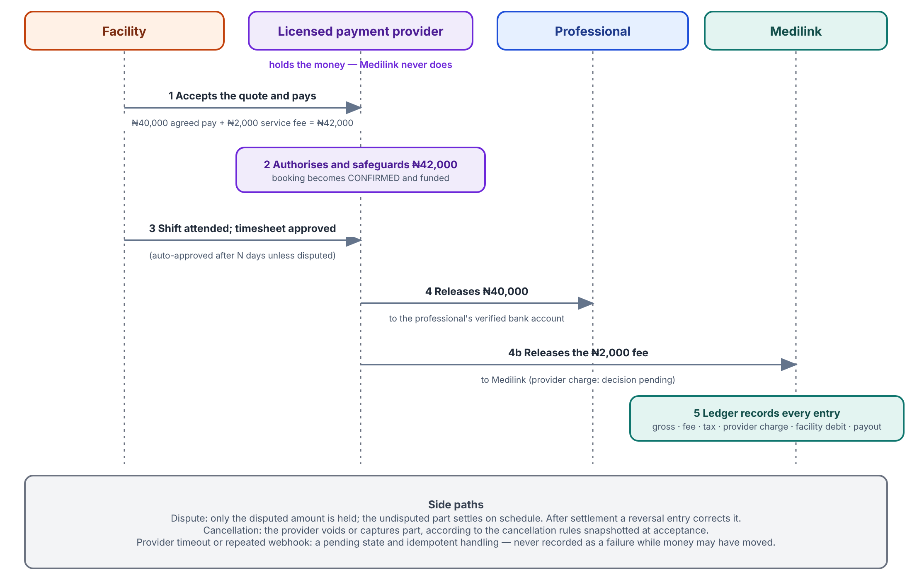
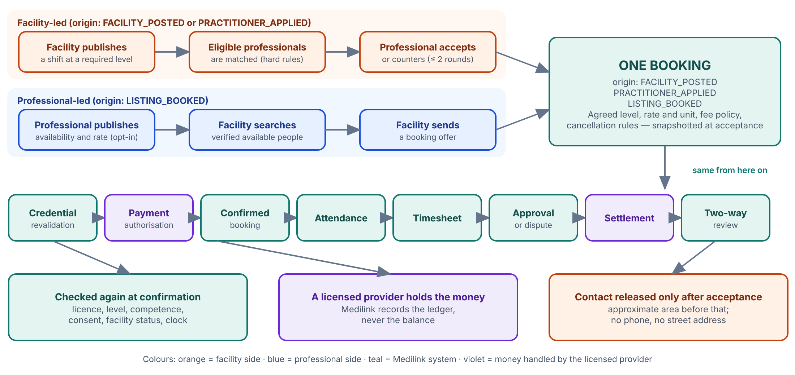
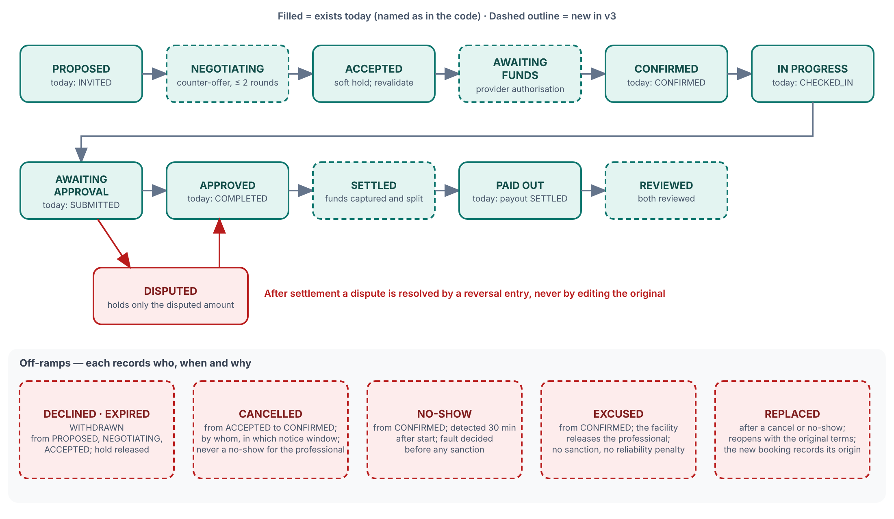
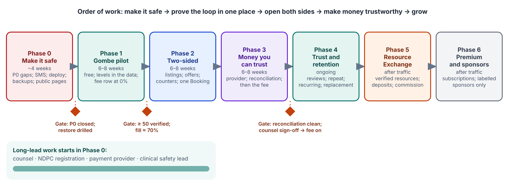

| | |
|---|---|
| **Document** | Medilink System Blueprint, version 3.0 (draft for team review) |
| **Builds on** | System Documentation v2.9 (September 2026) and the redesign review of 13 October 2026 |
| **Companion** | *Module Reference v3.0* — one full chapter per module and console, with the evidence behind every gap |
| **Evidence base** | The repository at commit `5c199c1` (branch `claude/focused-thompson-q3c4g0`), read module by module; every "current" statement was checked against code and carries a file reference |
| **Audience** | Founders, clinical and compliance leads, operations, finance, developers, and counsel |
| **Status** | Recommendation and specification. No application code was changed to produce it |
| **Pilot** | Gombe State, one or two professions, a small number of facilities |

# Contents

**How to read this document**

**The one-page brief**

**Part 1 — Why Medilink exists, who it serves, and how each group says "yes"**

- 1.1 The problem
- 1.2 The promise
- 1.3 What Medilink is not
- 1.4 Who it serves
- 1.5 What each group must see before it says yes
- 1.6 How adoption will be earned — the pilot path

**Part 2 — Where we stand: v2.9, the code, and v3 side by side**

- 2.1 Three sources of truth, and how we reconcile them
- 2.2 The module map: v2.9 against the repository
- 2.3 What is strong — do not rebuild
- 2.4 Where the code diverges from what v2.9 promised
- 2.5 What v3 adds beyond v2.9

**Part 3 — The system as it is today, module by module**

- 3.1 The six areas in brief
- 3.2 Module cards
- 3.3 Walk-through: a Gombe PHC needs a verified nurse tonight

**Part 4 — How the system hangs together today**

- 4.1 One shift, end to end, as built
- 4.2 The architecture at a glance
- 4.3 Who can do what: five roles
- 4.4 Five problems that belong to the joins, not the modules

**Part 5 — The gap register**

- 5.1 Counts
- 5.2 The P0 gaps as fourteen pilot blockers
- 5.3 P0 — every gap in full
- 5.4 P1 — before growth or a second state
- 5.5 P2 — later

**Part 6 — The target: Medilink v3**

- 6.0 Design principles
- 6.1 Move 1 — Model the professional hierarchy correctly
- 6.2 Moves 2 and 3 — One Booking, and a true two-sided marketplace
- 6.3 Move 4 — Transparent rate negotiation
- 6.4 Move 5 — A transparent success-fee revenue model
- 6.5 Keep the free tier meaningful, and decide what is never for sale
- 6.6 Advertising — only with rules
- 6.7 Move 6 — Payments through a licensed provider that holds the money
- 6.8 Move 7 — Make trust the product
- 6.9 Notifications are the nervous system
- 6.10 Improve the interface — and conduct the Gombe appraisal
- 6.11 Move 8 — Protect privacy by design
- 6.12 Move 9 — A separate second marketplace: the Clinical Resource Exchange
- 6.13 Architecture — extend the modular monolith; do not rebuild it
- 6.14 The metrics that control decisions

**Part 7 — The recommended flows**

- 7.1 Facility-led journey
- 7.2 Professional-led journey
- 7.3 The converged engagement workflow and the Booking's states
- 7.4 Exception flows
- 7.5 Onboarding flows
- 7.6 A day in each person's life
- 7.7 What is recorded for every engagement

**Part 8 — How the system must change: data, permissions, events and interfaces**

- 8.1 Reference data (owned by compliance, versioned, with a named owner and review date)
- 8.2 People and facilities
- 8.3 The marketplace core
- 8.4 Money
- 8.5 Trust, communication and privacy
- 8.6 Roles and permissions
- 8.7 Domain events
- 8.8 New interfaces (all under /api/v1, versioned)
- 8.9 Feature flags for gradual rollout

**Part 9 — The roadmap, the decisions, the risks and the Gombe appraisal**

- 9.1 Roll-out order
- 9.2 Decisions the team must make
- 9.3 The Gombe appraisal
- 9.4 Risks
- 9.5 Regulatory and legal register (to confirm before reliance)

**Appendix A — Glossary and state discipline**

**Appendix B — Draft professional ladders (to validate, not facts)**

**Appendix C — Gombe usability study: script and scoring sheet**

**Appendix D — Go or no-go checklist**

**Appendix E — Sources, verification and limits**

**Appendix F — Money: one shift, three ways, the money states, and the fix order**

- Annex M1 — One shift, three ways
- Annex M2 — Money state glossary and target states
- Annex M3 — Fix order for money correctness

**Appendix G — Roles and permissions**

**Appendix H — Event catalogue**

**Appendix I — Scheduled jobs and boot guardrails**

**Appendix J — The shift-day state glossary**


# How to read this document

This document has one job: to let every member of the team see **the same picture** of Medilink — what we have built, where it falls short of what we promised in v2.9, what we are now adding, and the order in which to do it.

It keeps four things strictly apart, because mixing them is how teams argue about different systems without knowing it.

| Label | Meaning | Where you will see it |
|---|---|---|
| **CURRENT** | Built and working in the repository today | Part 3 |
| **CURRENT + IMPROVE** | Built, but wrong, unsafe or incomplete; the fix is specified | Parts 3 and 5 |
| **NEW EXPANSION** | Not built; part of the v3 target and planned for the pilot or the first growth phases | Parts 6 to 9 |
| **LATER (GATED)** | Valuable but deliberately held back until named conditions are met (legal advice, traffic, trust) | Parts 6 and 9 |

**Evidence marks.** `[Verified]` means read in the code at the commit above; it does not mean observed running, because no application was run to produce this document. `[v2.9]` means the specification promises it. `[Strategy]` means it is a v3 proposal. `[Counsel]` means law, tax or regulation — a qualified adviser must confirm it; this document gives the shape of the issue, not an opinion. `[Unverified]` means a fact we could not confirm (a price, a vendor behaviour, a regulator's rule).

**Priorities.** **P0** — fix before the Gombe pilot (safety, privacy, money correctness, or the pilot cannot run). **P1** — before growth or a second state. **P2** — later. **Effort** — S: days; M: one to three weeks; L: a month or more (rough, one developer).

**Gap identifiers** such as `MAT-02` or `BIL-07` are stable. They appear in the chapters of the companion *Module Reference* and are collected into one register in Part 5, so a ticket, a test and a decision can all point to the same number.

# The one-page brief

**What Medilink is.** A verified healthcare workforce marketplace and settlement platform for Nigeria, beginning in Gombe. Facilities obtain the right verified professional at the right level, place, time and price. Professionals find suitable work, control their availability and are paid reliably. Medilink earns only when it creates measurable value — a shift that was filled, attended, approved and paid.

**Where we stand.** Seventeen of the eighteen v2.9 Priority-0 modules are built (scheduling is a deliberate stub), behind three consoles — practitioner, facility and operations — with about 1,050 automated test cases. The foundations are better than most pilots: a permission-and-scope guard on every route, an audit trail with a coverage test, a transactional outbox, integer-kobo money with a balanced double-entry ledger, and a pure, explainable matching engine.

**The study found 410 specific gaps** — 119 of them P0 — which fall into three groups:

1. **Safety and privacy gaps that must close before real people use it.** For example: a facility owner can revoke another hospital's access grants with one identifier; the candidate list returns every practitioner's name and phone number to any facility user; dispute evidence can be fetched without being a party; a confirmed shift can be overbooked; a lapsed licence can still be confirmed; and nothing tells a practitioner they have been offered a shift.
2. **Money does not yet work the way v2.9 says it must.** The code charges the platform fee to the *practitioner* and books it when an invoice is *drafted*, where v2.9 says the *facility* bears it and it is earned at *settlement*. Practitioners are credited before the facility has paid, which is the credit risk v2.9 explicitly rejected. There is no payment gateway, no bank-account model, no tax fields, and a billing bug that under-charges night shifts that overlap a public holiday.
3. **The product is one-way and silent.** There is no concept of professional level or cadre anywhere in the data. Practitioners cannot browse shifts, publish a priced availability, or be booked directly. Seventeen of the twenty domain events have no consumer, so the system raises events that nobody hears.

**What we are building (v3).** Nine moves, each specified in Part 6: (1) a correct professional hierarchy; (2) one Booking that every route to work ends in; (3) two-way discovery, so facilities and professionals can each start an engagement; (4) transparent rate negotiation; (5) a facility-paid success fee, free until proven; (6) payments through a licensed provider that holds the money, not Medilink; (7) trust as the product — verification, reliability, two-way reviews; (8) privacy by design; (9) later, a Clinical Resource Exchange and premium services, kept off the shift path.

**The order that protects the business.** Make it safe → run a free Gombe pilot → build the two-sided marketplace → make money trustworthy → switch the fee on → trust and retention → resources and premium. A fee charged on a system that leaks phone numbers or pays people before it is paid teaches users to leave.

**The one measure that decides.** The number of **verified, completed, paid and dispute-free engagements per month.** Registrations alone are not success.

**Decisions we need from the team** (full list in Part 9): who pays the fee and at what pilot rate; who holds the money during the pilot; the level ladder for the first one or two professions; what Gombe facilities without a CAC number can show instead; WhatsApp or SMS as the primary channel; whether Hausa-assisted onboarding is in the pilot; and when to engage counsel for the agreement text, tax treatment and data-protection registration.


# Part 1 — Why Medilink exists, who it serves, and how each group says "yes"

## 1.1 The problem

Health facilities across Nigeria — particularly outside the major cities — face short-notice staffing gaps: night and weekend cover, maternity leave, a sudden resignation, a surge in an outbreak. Today those gaps are filled through personal networks and WhatsApp groups. There is no standard way to check a practitioner's licence, no reliable record of who worked where and for how long, and no guarantee of timely pay `[v2.9 §2]`.

The consequences fall on three groups:

- **Facilities** risk engaging someone who is unlicensed, wrongly qualified for the duty, or who simply does not turn up — and have no record if something goes wrong.
- **Practitioners** have no transparent route to legitimate paid work beyond who they know, are paid late or not at all, and carry no portable record of their work.
- **Patients** meet an unstaffed ward, a cancelled clinic, or an unverified clinician.

Medilink's own v2.9 puts the core position plainly: *a staffing platform for healthcare is a clinical-safety system before it is a marketplace.* That position does not change in v3. What changes is the ambition around it.

## 1.2 The promise

> **Facilities obtain the right verified professional at the right level, place, time and price. Professionals find suitable work, control their availability and receive reliable payment. Medilink earns only when it creates measurable value.**

Stated as three promises, each of which can be tested:

| To | Promise | How we will know it is kept |
|---|---|---|
| **Facilities** | Only verified, currently licensed professionals at the level the duty needs; a filled shift or an early warning; a plain, visible price | Shift fill rate; time to first qualified candidate; no-show rate; zero unverified people on a ward |
| **Professionals** | Real work at an agreed rate they can see before they accept; control over when and where; payment on a known day; a record that is theirs | Offer acceptance rate; time from approval to payout; dispute rate; repeat bookings |
| **The business** | Revenue only from completed, approved, paid engagements; no hidden fee; no held client money | Effective take rate; engagements per month; payment success; reconciliation clean |

## 1.3 What Medilink is not

- **Not an electronic medical record.** It does not hold patient identifiers, clinical results or treatment notes, and the incident module is built so it cannot become an informal one `[v2.9 Module 14]`.
- **Not a wallet.** It records a ledger and settles through a licensed payment provider; it does not hold client funds `[v2.9 §8.4, §9.4.2]`.
- **Not the practitioner's employer or the clinical provider.** v2.9 adopts the position that Medilink is an *introducer and platform operator*; the engagement is between facility and practitioner `[v2.9 §9.4.3]` `[Counsel]`.
- **Not a job board.** A job board lists vacancies. Medilink verifies the person, matches by level and licence, records attendance, approves hours, and settles payment.
- **Not "Uber for doctors".** Qualifications, terms and payment are built into every engagement rather than bolted on afterwards.

## 1.4 Who it serves

| Persona | Examples | What they are trying to get done | What they fear |
|---|---|---|---|
| **Practitioner** | Staff nurse or midwife; medical officer; pharmacist; medical laboratory scientist; radiographer | Find legitimate extra or part-time work, know the rate before they say yes, be paid on time, build a record that follows them | Not being paid; being blamed for something that was not their fault; their phone number or documents leaking; a platform that takes a cut they cannot see |
| **Facility owner or representative** | Proprietor of a private hospital; medical director; officer-in-charge of a PHC | Keep wards covered safely and cheaply; be able to show a regulator who worked | Unlicensed or under-qualified staff; hidden charges; being responsible for something they cannot audit |
| **Ward or unit manager / scheduler** | Matron; head of department; roster officer | Fill tonight's gap in minutes, on a phone, without a long form | Software that is slow or confusing; offers that never get answered |
| **Facility finance or HR** | Accounts officer; HR officer | Timesheets and invoices that agree with each other and with the bank; records for tax | Being billed a figure they did not approve |
| **Medilink compliance officer** | Verifies identity, licences, facilities | Decide quickly and defensibly, with the evidence in front of them | Pressure to approve without evidence; no record of why they decided |
| **Medilink operations and finance** | Runs queues, disputes, invoices, payouts | A queue they can work; money that reconciles | Silent failures; one person able to do everything |
| **Regulators and ministries** *(indirect)* | MDCN, NMCN, PCN, MLSCN, RRBN; state ministry | A lawful route to ask who worked where; no bulk access | A platform that undermines their registers |

## 1.5 What each group must see before it says yes

"The way the target group approves the system" is not a meeting; it is a short list of conditions that must be true, which they judge for themselves. The table below states those conditions, how the system answers each one **today**, and where this document deals with the gap. It is also the checklist for the Gombe appraisal in Part 9.

**Practitioners**

| They must be able to say | Today `[Verified]` | Status |
|---|---|---|
| "Getting verified is free and I know what is expected of me." | Wizard, submit-for-approval and officer confirmation exist and cost the practitioner nothing; but credential requirements are seeded for doctors only, and a rejection is shown in the app but not sent | Partly |
| "I see the rate — and any night or holiday premium — before I accept." | The hourly rate is on the offer; premiums sit on a facility rate card practitioners cannot read; cancellation terms and shift notes are not shown | Partly |
| "I am told on my phone when I am offered a shift." | No message is sent for an offer; SMS gateways are not implemented; the practitioner must open the app | Missing |
| "I will be paid, on a day I can see, and I can see any fee." | An earnings screen exists; the fee is taken from the practitioner but never shown to them; there is no payment rail | Diverges from v2.9 |
| "My number and documents are not handed out." | The match list returns names and full phone numbers to any facility user; erasure is an assessment, not a deletion | Missing (P0) |
| "I can use it on an ordinary phone with weak data." | Responsive and installable, but 14-pixel content text, no offline queue, no icons in the install manifest | Partly |
| "If something goes wrong I am treated fairly." | Disputes and excusals exist; neither party is notified; the sanction ladder and appeals in v2.9 do not | Partly |

**Facilities**

| They must be able to say | Today `[Verified]` | Status |
|---|---|---|
| "Only verified people at the right level work on my wards." | Identity, registration, screening and credentials gate matching; no concept of level; only doctors have full credential requirements | Partly |
| "I can fill tonight's gap quickly." | Ranked, explained matching exists; "urgent" changes nothing; the nurse is not messaged; the offer lasts 24 hours | Partly |
| "The fee is fair, visible and cheaper than the alternative." | No fee is shown to a facility; the fee rate is an environment variable; no pricing page | Missing |
| "No-shows are caught and covered." | A sweep flags a no-show only after the shift ends; no early detection or backfill | Partly |
| "Timesheets, invoices and payments agree." | A timesheet shows base pay only while the invoice includes premiums; no tax fields, statements or payment reference | Partly (P0 money fixes) |
| "My team can share the work safely." | Two facility roles; staff must already hold an account; no department or branch scoping | Partly |

**Medilink staff**

| They must be able to say | Today `[Verified]` | Status |
|---|---|---|
| "The evidence is beside the decision." | Officer confirmation reads the practitioner's photograph beside the number and records the access | Built |
| "Every decision is traceable." | Audit trail with a build-failing coverage test | Built |
| "No one person can do everything." | Operations, compliance and finance are merged into one `administrator` role; the same grant raises, marks paid, prepares and releases money | Missing (P0) |

## 1.6 How adoption will be earned — the pilot path

v2.9 §11.1 and the review set out a disciplined route. This document adopts it, with the gates made explicit.

| Stage | What happens | Gate to move on |
|---|---|---|
| **A. Gombe appraisal** | A structured usability study (not a presentation) with facility owners, ward managers, roster and finance staff, nurses, doctors, laboratory staff and pharmacists, and a compliance adviser. Each performs nine tasks; we record success, time, hesitation, misunderstanding, trust and whether the fee felt fair. It also *validates decisions*: the level ladder, what facilities pay agencies today, rate bands, the fee | The level ladder for the first one or two professions is agreed; the fee test results are recorded; the larger-text mode and plain-English fixes are scheduled |
| **B. Closed alpha** | Operations team, two or three Gombe facilities, about thirty practitioners; live SMS; manual identity and registration review; no payment gateway; fee at 0% | All P0 gaps closed; a worker killed mid-event loses nothing; a timed restore meets the target |
| **C. Pilot** | At least fifty verified practitioners across two or three specialties **before** approaching five to ten facilities; the first fifty engagements hand-matched by operations even though the engine produces rankings; support by a staffed phone and WhatsApp line | Sustained fill rate of about 70% or better (published requests that become an attended shift); second-shift return rates for both sides |
| **D. Growth** | A second state, the fee switched on, the two-sided marketplace, payments through the licensed provider | The primary measure — verified, completed, paid, dispute-free engagements per month — is rising and the fee has not reduced repeat bookings |

Do not attempt all professions, all states and all resource types together. Prove that Medilink can repeatedly turn an open shift into a verified, attended and paid engagement in one place. When that loop works reliably, expansion and revenue become much easier.


# Part 2 — Where we stand: v2.9, the code, and v3 side by side

## 2.1 Three sources of truth, and how we reconcile them

| Source | What it is | How this document treats it |
|---|---|---|
| **System Documentation v2.9** (Sept 2026) | The specification we committed to: 36 modules in three priority bands, the safety principles, and the baseline decisions on revenue, payment timing and legal role | The **standard**. Where the code falls short of it, that is a gap; where the code does something different, that is a divergence to resolve |
| **The repository** at commit `5c199c1` | What actually exists and runs. Every module under `src/modules/`, the three consoles under `src/app/`, the shared machinery under `src/lib/` | The **truth about the present**. Where a stage document and the code disagree, the code was treated as correct and the document flagged as stale |
| **The v3 strategy** (this document, Part 6) | The expansion: professional hierarchy, a two-sided marketplace, negotiation, a success fee, licensed-provider payments, trust, privacy, later a resource exchange | The **direction**. Anything in it that is not already built is labelled NEW EXPANSION or LATER (GATED) |

The through-line of v2.9 survives intact and is the test every v3 change must pass: *every irreversible step is preceded by a check that can be evidenced afterwards.* A practitioner cannot be matched without verification; a shift cannot be paid without an approved timesheet; a sanction cannot be applied without a fault decision; a correction never overwrites what it corrected.

## 2.2 The module map: v2.9 against the repository

The repository numbers its modules slightly differently from v2.9 — it splits v2.9's Module 9 into attendance and timesheets, and it folds v2.9's Module 16 (Administration and operations) into the operations console. This document uses **the repository's numbers** in chapter headings, because that is how code, tests and stage documents refer to them, and shows the v2.9 number beside each.

| Repo # | Module (`src/modules/…`) | v2.9 # | Built? | Maturity for a Gombe pilot |
|---|---|---|---|---|
| 1 | Authentication and access (`auth`) | 1 | Built | Ready after P0 fixes |
| 2 | Practitioner profiles (`practitioners`) | 2 | Built | Ready after P0 fixes; no level/cadre |
| 3 | Credential verification (`credentials`) | 3 | Built | Doctors only fully gated |
| 4 | Facility management (`facilities`) | 4 | Built | Ready after P0 fixes |
| 5 | Availability (`availability`) | 5 | Built | Private pattern data, not an offer |
| 6 | Service requests (`service-requests`) | 6 | Built | Ready after P0 fixes; no level |
| 7 | Matching and assignment (`matching`) | 7 | Built | Not safe: privacy leak, overbooking |
| 8 | Scheduling (`scheduling`) | 8 | **Stub** | List only; schedule lives in matching |
| 9 | Attendance (`attendance`) | 9 (part) | Built | Ready after P0 fixes |
| 10 | Timesheets (`timesheets`) | 9 (part) | Built | Ready after P0 fixes |
| 11 | Rates and contracts (`rates-contracts`) | 10 | Built | Floors for two professions only |
| 12 | Billing, ledger and settlement (`billing-settlement`) | 11 | Built, gateway stubbed | **Not ready** |
| 13 | Cancellations, no-shows and sanctions (`cancellations-sanctions`) | 12 | Partly | No ladder, no appeals |
| 14 | Disputes (`disputes`) | 13 | Built | Not ready: access gaps, no money link |
| 15 | Clinical incidents (`clinical-incidents`) | 14 | Built | Not ready: subject rule, no suspension |
| 16 | Notifications (`notifications`) | 15 | Partly | SMS adapter, no live gateway |
| 17 | Audit, consent and compliance (`audit-compliance`) | 17 | Built | Erasure and agreement gate missing |
| 18 | Suggestions (`suggestions`) | 18 | Built | Loop not closed |
| — | Operations console (`/admin`) | 16 | Built | Queues work; no second approver |
| — | Reference data (`config`) | (8.6) | Built | Seed-only; no admin screen |

**v2.9 Priority 1 and 2 modules (19 to 36).** Reports and analytics (21) and low-bandwidth/PWA delivery (27) are partly present (dashboards; a responsive, installable app). Credential renewal (22) exists only as an expiry sweep. **Not started:** ratings and performance (19), rostering (20), tax and statements (23), preferred pools (24), fraud and risk (25), customer support (26), the Flutter client (28), and all of the ecosystem modules (29 to 36). Several of these become v3 pilot or Phase 2–4 work; see Part 9.

## 2.3 What is strong — do not rebuild

The review of 13 October and this study agree that these are better than most pilots and should be extended, not replaced.

- **The authorisation guard** enforces permission *and* scope on the server for every route, before any data is read; step-up (a fresh password check) is evaluated before the permission. Navigation hides what a person cannot do as a courtesy; it is never the control.
- **The audit trail** is written in the same transaction as the change, and a **coverage test fails the build** if a write to an audited table has no audit row.
- **The transactional outbox** claims events with `SKIP LOCKED`, counts the attempt before running a handler, backs off, dead-letters after eight attempts, and has a two-worker concurrency test.
- **The matching engine** is a pure function: hard exclusions (every reason collected, not just the first), then a 100-point score — proximity 35, experience 30, fatigue 20, reliability 15 — with the weights and every candidate's factors stored with the run, so "why did they rank there" can be answered later.
- **The eligibility rule** is a pure function with ten explicit hard blockers, each with a human-readable reason shown on the practitioner's own screen.
- **Attendance** has an exhaustively tested state machine (all 81 state pairs against an independent list); check-in codes are bound with a keyed hash, expire in five minutes and allow five attempts.
- **Money primitives** are sound: integer kobo, basis-point multipliers, a signed double-entry ledger that refuses an unbalanced set, compare-and-set status changes, and one invoice line per assignment enforced by a unique key.
- **Timesheet revisions** keep the whole prior state; break, night and holiday minutes are walked minute by minute.
- **Boot-time guardrails** refuse a production start with console SMS, console payments, a published secret, or a non-HTTPS address.
- **Login hygiene**: Argon2id hashing, timing equalised against unknown numbers, one-time codes stored as keyed digests, lockout and an audited attempt record.
- **Reference data**: all 36 states, the FCT and all 774 local government areas are seeded, with the counts asserted in a test.
- **Verification by evidence**: the officer reads the practitioner's photograph beside the number and confirms; the identity number is kept out of the audit trail and masked after use.
- **About 1,050 automated test cases** across unit, integration (real PostgreSQL) and browser journeys through all three consoles.

## 2.4 Where the code diverges from what v2.9 promised

These are not new ideas; they are promises already made. Each is a gap in Part 5 with an identifier.

| # | v2.9 says | The code does | v2.9 reference |
|---|---|---|---|
| 1 | The **facility** bears the commission, deducted at settlement, shown on the facility invoice and the practitioner statement; the practitioner receives the accepted rate | The **practitioner** bears the fee; it is booked when the invoice is **drafted**; neither the facility invoice nor any practitioner statement shows it | §9.4.1 |
| 2 | The facility authorises payment before the shift; a licensed provider captures on timesheet approval; **Medilink never holds funds**; payout follows promptly | No authorise or capture step exists; Medilink's ledger models receiving facility cash and paying out of it; practitioners are credited at invoice draft and a payout does not require the invoice to be paid | §9.4.2, §8.4 |
| 3 | A practitioner facing an emergency asks the **facility** to release them | A **platform officer** decides excusals | Module 12 |
| 4 | A graduated sanction ladder, compliance-officer-only authority, appeals | Fault is recorded; there is no ladder, no appeal and no compliance-officer role | Module 12 |
| 5 | Opening an incident suspends the practitioner from matching at that facility; either party may report; legal hold | Opening an incident suspends nobody; only facilities can report; no legal hold | Module 14 |
| 6 | A dispute holds **only the disputed amount**; later corrections are reversal entries; each type has a resolution target | A dispute does not touch money at all; no reversal facility; no target time | Module 13 |
| 7 | Nine roles, including separate compliance, operations and finance officers and separate facility scheduler and finance roles | Five roles; operations, compliance and finance merged into one `administrator`; one coarse `payout.manage` | §6, §8.8 |
| 8 | Modules communicate through domain events and never read each other's tables | Several modules read each other's tables directly (billing reads attendance; matching reads facilities); 17 of 20 events have no handler | §8.2 |
| 9 | A verification panel and three evidence tiers on each claim; NIN typed and verified through a provider | No facility-facing panel or tiers; NIN is free text; providers switched off by design; manual path instead | Modules 2 and 3 |
| 10 | Matching has transactional conflict detection, race handling, and PostgreSQL time-range exclusion constraints | Confirm locks the practitioner only; no request lock; no database overlap constraint | §9.16 |
| 11 | A staffed telephone and WhatsApp line is a **condition of launch**; SMS-first notifications | No support surface in the product; SMS gateways are not implemented; no message is sent for an offer | §11, Module 15 |
| 12 | Seed data before first registration: categories, floors, holidays for this and next year, one agreement template, notification templates | Floors for doctors and nurses only; six 2026 holidays only; no agreement or notification template seeded | §11.2 |
| 13 | Idempotency keys, webhook signature validation, correlation identifiers on every request, event and ledger entry | None of these exist for money; correlation identifiers are never written | §9.12 |
| 14 | Legal gate: revenue decision, legal opinion on Medilink's role, authorise-then-capture confirmed, NDPC registration, NIMC account, clinical safety lead, engagement agreement | All eight gate items are "Not started" | Stage 3 checklist |

## 2.5 What v3 adds beyond v2.9

| Topic | v2.9 | v3 |
|---|---|---|
| **Positioning** | A staffing and payment tool | A verified workforce marketplace and settlement platform whose defensible advantage is trust |
| **Professional hierarchy** | Scope of practice and supervision are required in §9.8 but have no data model | A first-class structure: profession → registration category → cadre → specialty → competencies → experience band → supervision → licence; hard eligibility rules |
| **Direction of the market** | Facility posts, practitioner applies or is invited; availability is private | Both sides can start: facility-posted shifts *and* professional-published priced availability, converging on one Booking |
| **Pricing** | A rate is accepted | Offer, bounded counter-offers and an agreed rate, each side floor-checked, with a non-binding recommended range and no open auction |
| **Revenue** | A facility-borne commission is the baseline | The same baseline, sharpened: free to join, verify and publish; a dated fee policy; 0% in the pilot; a 4–6% success fee tested; shown plainly; per-line applied rate |
| **Payments** | Authorise-then-capture through a licensed provider | The same, made specific: split settlement, delayed release, refunds, idempotent webhooks, reconciliation; and a stated pilot interim that does not hold funds |
| **Reviews** | P1 ratings with moderation | Phase 4: structured two-way reviews between parties to a completed booking, with appeal and anti-retaliation |
| **Advertising and premium** | Not specified | Gated by explicit rules: ads never alter ranking; verification, safety and ordinary work are never paid features |
| **Resource exchange** | Not in v2.9 | A separate second marketplace for clinical space and equipment, after the workforce loop works |
| **Privacy** | §9.9 and §9.14 | Adds a formal DPIA, a responsible officer, explainable matching, human review of adverse automated decisions, and separate consent for priced listings |
| **Evidence activity** | Launch operating model in §11.1 | Adds the structured Gombe usability study and a single north-star measure |


# Part 3 — The system as it is today, module by module

Part 3 gives a **one-card summary of each module and console**: its status, why it exists, and its P0 gaps. The full chapter for each — who uses it, how it works step by step, the state tables, the rules it enforces, every gap with its evidence, the recommended change and the acceptance criteria — is in the companion document, the **Module Reference**. Evidence in both is by `file:line` at commit `5c199c1`; nothing was run, so *verified* means read in the code.

Status labels: **Built**, **Partly built** or **Stub**; and **CURRENT**, **CURRENT + IMPROVE** or **CURRENT + NEW EXPANSION** (see *How to read this document*). Maturity says whether the module is ready for a Gombe pilot as it stands.

## 3.1 The six areas in brief

### Identity, access, notifications, compliance and platform

- **What is solid.** Signing in is built carefully: one-time codes are stored as keyed hashes, passwords use Argon2id, an unknown phone number takes about as long to refuse as a wrong password, and a suspended person is locked out on their very next request. Every route that touches a record names a permission and a scope, and the audit trail has a test that fails the build if a change forgets to write its row. The outbox that carries events survives a failing consumer and two workers running at once. The server refuses to boot in staging or production with console SMS, a published secret or a non-https address.
- **What is dangerous.**
  - A hospital owner can revoke another hospital's staff by pasting a grant id. The guard proves the scope the caller names; `revokeGrant` never checks that the grant is in that scope.
  - The password step of sign-up is not tied to the code step, so anyone who knows a half-registered number can finish it.
  - A wrong-code counter can be beaten with parallel guesses, and nothing limits requests per IP address.
  - Anyone can register a "hospital" and, while it is unverified, look up any user by phone number.
  - Nobody can reset a forgotten password from the screen, and there is no way to create the first administrator in production.
- **What is silent.** The product's whole promise is replacing phone calls, yet only one of the 20 domain events sends a message (shift confirmed), and no real SMS provider exists. A practitioner learns of an offer only by opening the app. A failed text is recorded as handled and never retried. Times are printed in UTC.
- **What is missing for privacy law.** Erasure is only an assessment. Audit rows keep names and emails. Agreements are not required at sign-up. There is no retention schedule, breach process or lawful-disclosure route, and registration with the data-protection regulator, a privacy officer and counsel's opinion are all "Not started" in `docs/stage-3-gate-checklist.md`.
- **What cannot ship as built.** The production Docker image has no `src/` folder, so the worker and the seed cannot run from it. Nothing deploys, nothing alerts, stranded outbox events are never reclaimed, and backups are a local drill whose runbook does not exist.
- **Order of work.** Close the five access holes and the three platform blockers first (Phase 0), then give the pilot real messages, a real image, alerts and a backup you have restored once. Everything else in these chapters can wait for growth.

---

### Practitioners and credentials

- **What is solid.** Whether a practitioner may be offered work is decided by one pure, well-tested function that returns every reason at once, not the first. Identity is stored as a keyed hash plus the last four digits, never the NIN itself. An officer confirms a NIN or licence from the practitioner's own photograph in one click, and the number is never retyped. A practitioner cannot review their own documents. Every state change writes an audit row.
- **What is dangerous.**
  - Only doctors have document requirements. Nurses, pharmacists, laboratory scientists and radiographers are checked by identity, a regulator registration and screening only.
  - A doctor who renews an expired licence stays blocked (a bug found in this study, in none of the earlier reviews).
  - The sanctions list ships empty, so screening says "clear" for everyone.
  - Nobody is texted about a decision or an expiry.
  - The raw NIN sits in clear text in the database until an officer confirms it.
  - The platform has no idea of level, cadre, registration category, supervision or competence. A house officer and a consultant are the same person to it.
- **What facilities see.** Nothing about verification. The only trust signal a facility gets is that a person was ranked at all.
- **Where eligibility is checked.** At match time only. Invitations and confirmations do not re-check it (fix lives in Module 7).
- **Providers.** NIMC (identity) and the regulator register check are switched off, and every non-off setting throws. Manual officer review is the only live path, which suits a pilot of about fifty practitioners.
- **Order of work.** Fix the renewal bug, seed requirements for the other four professions, load the sanctions lists, mask the NIN, and add outbound notices (Phase 0). Build the level, registration-category and supervision model before any pilot data exists (Phase 1).

---

### Facilities, availability, requests, matching and scheduling

- **What is solid.** The matching engine is a pure, explainable function; every ranking is stored with its weights and factors. A request cannot be published below its rate floor or by an unverified facility. An accepted offer is not a booking — the facility must confirm — and the confirmation checks the practitioner's schedule under a lock. Every assignment change records who and why.
- **What is dangerous.**
  - The candidate list returns every practitioner's **name and full phone number**, ranked *and* excluded, to any facility user.
  - Two different practitioners can be confirmed onto the last place of one request at the same moment; at headcount 2 the request is then never marked filled.
  - Invitations, acceptances and confirmations never re-check licence, category, consent, the clock or the facility's own status.
  - Cancelling a filled shift leaves the people on it confirmed, and no screen can cancel one person.
  - Nobody is messaged when they are offered a shift.
- **What is missing for the v3 direction.** There is no level or cadre, no per-person rate, no counter-offer, no way for a practitioner to browse shifts, apply, or publish a priced availability, and no direct booking. The whole marketplace is one-way.
- **What facilities cannot do.** A rejected facility cannot recover; no screen uploads a licence; government hospitals and PHCs, which have no CAC number, cannot register honestly; there is no suspend action and no licence-expiry sweep.
- **Order of work.** Phase 0: strip contact details from matching, lock the request, re-validate at invite and confirm, make cancellation cascade, add notifications, fix facility recovery and licence upload. Phase 1: add the level model to requests so pilot data is born with it. Phase 2: the Booking, proposals and listings.

---

### Attendance, timesheets, sanctions, disputes, incidents and suggestions

- **What is solid.** Attendance has one transition table for its nine states, entered through a single function, with an exhaustive test over all 81 pairs. The check-in code is a six-digit secret that the facility issues and the practitioner presents. It is stored as a keyed fingerprint tied to one shift and one purpose, lives five minutes and dies after five wrong tries. Every correction to hours keeps the whole earlier version with who changed it and why. Nobody can be marked a no-show until a person has decided whose fault it was. Incident reports cannot be edited or withdrawn, and a suspension is written in the same transaction as the closure that ordered it. Suggestions from a declined offer are stored without the practitioner's name.
- **What is dangerous.**
  - **Check-in is not tied to the person it is for.** Any signed-in practitioner who hears the code on the ward can check in a colleague. The facility-side "issue a code" and "record by hand" functions do not check that the shift belongs to the facility asking.
  - **Dispute evidence is open to any practitioner.** Anyone can attach to, or download from, any live case by id, and the case list for a shift answers any caller. Nobody is told that a dispute was opened, decided or withdrawn. Facilities have no dispute screen and cannot even reach the evidence and withdraw routes.
  - **Money and disputes do not meet.** A dispute never holds a payout and never produces a credit note.
  - **The timesheet shows one figure and the invoice bills another.** The sheet is at base rate; the invoice adds premiums and, on a holiday night, drops minutes.
  - **A facility that never approves stalls the practitioner's pay.** There is no deadline.
  - **An incident can name any user.** Opening one restricts nobody. A death-severity report raises no alert.
  - **Suspension does not touch confirmed shifts.** The facility is not told, and the suspended person cannot sign in to explain an absence the sweep will flag.
- **What is missing against v2.9.** The sanction ladder, appeals, penalty rules, replacement search, optional location, a dispute hold on the disputed amount only, reversal entries, dispute deadlines and escalation, legal hold, and a suggestion status the submitter can see.
- **Where the code departs from v2.9 on purpose or by drift.** Excusals are decided by a platform officer, not by the facility. An incident restricts nobody when it is opened. "Suspended" means three different things. There is no compliance-officer role. Details are in Modules 13 and 15 and in the glossary at the end.
- **Nobody is told anything.** Of the seven events this slice raises, one has a handler (it computes the timesheet). A rejected timesheet, an opened dispute, a flagged no-show, a suspension and a suggestion answer reach no one unless they open the app.
- **Order of work.** Phase 0: bind check-in to the assignee and the facility, close the dispute-evidence and dispute-list holes, constrain the incident subject, add an alert and an interim restriction for serious incidents, give disputes a payout hold and a facility screen, set a timesheet deadline, make the timesheet show what will be billed, and detect no-shows at the start of the shift rather than after the end. Phase 1: notices, the ladder with appeals, practitioner withdrawal, and the author-visible suggestion status.

---

### Rates, billing, ledger and payouts

**What is solid.** Money is stored as whole kobo, never decimals. Every ledger step must add up to zero or it is refused. A shift can only be invoiced once (a database rule), invoices can only be built from hours the facility has already approved, and every status change on an invoice or payout is a guarded one-way step with an audit row. The minimum-rate check is correct for the doctor and nurse rates it has, and the premium maths (night, holiday, overtime, on-call) is clear and well tested.

**What is dangerous.**
- **Wrong amounts today:** a night shift that touches a public holiday is under-billed (a 24-25 December night shift loses 2 of its 12 hours), and a facility can change its premium rates between the shift and the invoice.
- **Money leaves too early:** practitioners are credited when a draft invoice is created, not when the facility pays, and a payout does not check that anyone paid.
- **Payouts are not safe:** two clicks at once can create two payouts for the same money, any gateway error is recorded as "nothing moved", and outside a developer laptop there is no setting under which a payout can complete at all.
- **No correction path:** an invoice cannot be voided, credited or reversed, and a dispute never touches the ledger.
- **The fee is not what the spec says:** it is taken from the practitioner, booked at draft, and set by an environment variable. It is 0% today, so nothing is lost yet, but it must not be switched on in this form.
- **Missing pieces:** no bank-account record, no tax fields, no statements, no reconciliation, no provider integration (authorise/capture), and the money columns overflow at ₦21,474,836.47.

The minimum fix order, with effort, is in Annex M3. The same shift worked three ways (as built, as v2.9 specifies, as v3 targets) is in Annex M1.

---

### The three consoles, the public site, accessibility and quality

- **What is solid.** Three consoles exist and cover the whole shift-to-payment journey for a practitioner, a facility and Medilink staff: 35 pages, one shared shell, one status-colour vocabulary, honest empty and error states, times in West Africa Time, and a permission-driven menu. Screens say what a button will do before it is pressed ("Accepting is not being confirmed", "Uphold — send the figures back"). The practitioner onboarding wizard and the officer's "confirm from the photograph" flow are good.
- **What is dangerous.**
  - Nobody is told anything. No offer, confirmation, decision or reminder reaches a practitioner or a facility unless they open the app, and the only SMS adapter that works prints to a log.
  - The marketplace is one way: a practitioner cannot see a shift, apply, or state a price.
  - A facility cannot upload a licence, edit its details or answer a rejection, and its registration form insists on a CAC number that most Gombe government hospitals and PHCs do not have.
  - A nurse, pharmacist, laboratory scientist or radiographer is asked for no documents at all.
- **What the public sees.** One landing page and two forms. No forgot-password screen, no pricing, terms, privacy or contact page, no phone or WhatsApp number, and developer text on the login page.
- **Readability.** Content is 14px and 12px on a 16px root, buttons are 36px, input borders are 1.31:1, the commonest status badge is 3.01:1, there is no larger-text or projector mode, no skip link, no service worker, and the web manifest has no icons.
- **Delivery.** About 1,050 automated test declarations and a five-job CI pipeline are in place. There are no component or accessibility tests, no deploy job, and the demo data contains nothing in Gombe. Several docs describe an older product, and the v2.9 spec and Implementation Plan are not in the repo.
- **Roles.** The spec has nine roles; the code has five. Separation of duties between compliance, operations and finance, and between a facility scheduler and a finance officer, no longer exists.
- **Order of work.** Phase 0: notifications and a deliverable SMS provider, the offer card's missing facts, document requirements for the other four professions, facility profile and licence upload, a CAC alternative, forgot-password, the public pages, and the readability fixes. Phase 1: levels in the profile and the shift form. Phase 2: shift board, applications, priced listings and proposals.

---

## 3.2 Module cards

### Module 1 · Authentication and access control

**Status:** Partly built · **Label:** CURRENT + IMPROVE · **Maturity for a Gombe pilot:** Ready after P0 fixes — sign-in, sessions and the permission guard are sound and well tested, but one cross-tenant revoke hole, an unbound password step, no rate limits, no reset screen and no first-administrator path must be closed first.

**Why it exists.** A nurse in Gombe needs an account on their phone number, a ward manager needs to sign in on a shared hospital computer, and a hospital owner needs to give each colleague their own login. Medilink needs to know who did what, and to cut off a person's access at once when a clinical incident suspends them. Without this module, either nothing is protected or everyone shares one password.

**Gaps found:** 10 P0 · 10 P1 · 6 P2.

**P0 — before the pilot:**

- `AUT-01` revokeGrant never compares the grant's own scope with the scope the guard approved, and the route takes that scope from the request body.
- `AUT-02` No limit per IP address or overall. register and resend-code create rows and send SMS for any valid-looking number without limit; the address is recorded and never used.
- `AUT-03` The per-phone lockout can be used against a victim: every locked-out attempt is itself recorded as a failure and pushes the lock out another 15 minutes, and completing…
- `AUT-04` The password step is not bound to the code step.
- `AUT-05` The wrong-guess counter is read, judged, then incremented in a separate step.
- `AUT-06` Password reset has no screen and the login page has no "forgot password" link; the lockout message tells people to reset.
- `AUT-07` A signed-in user can register a facility and is made facility_owner at once, while it is still PENDING.
- `AUT-08` No way to create the first super administrator in production: the role is never offered in the UI and the scripts that create one refuse to run outside local.
- `AUT-09` No Content-Security-Policy and no HSTS header; only four basic headers are set.
- `AUT-10` No test calls a route as a user from another tenant.

### Module 2 · Practitioners

**Status:** Partly built · **Label:** CURRENT + NEW EXPANSION · **Maturity for a Gombe pilot:** Ready after P0 fixes — the doctor path works end to end, but the renewal bug, the empty sanctions list and the missing level and supervision model must be fixed before pilot data exists.

**Why it exists.** A nurse in Gombe wants to be trusted without phoning around; a ward manager wants to staff a night shift without checking a stranger's papers. This module holds who the practitioner says they are, what a Medilink officer has checked, and the single rule that says "safe to offer work". Without it, anyone could be matched to a shift, including a struck-off or unlicensed person.

**Gaps found:** 6 P0 · 21 P1 · 5 P2.

**P0 — before the pilot:**

- `PRA-01` No level, cadre or grade anywhere: not on the profile, the shift request, the rate floor or the matching engine.
- `PRA-02` No structured registration category (provisional, full, intern, post-basic register) and no supervision requirement.
- `PRA-08` Renewing an expired credential never clears credential_expired.
- `PRA-10` The raw NIN sits in clear in credential_submissions.reference_number from submission until an officer confirms.
- `PRA-14` The sanctions and "quack" lists ship empty, and no route or screen can add to them.
- `PRA-26` Eligibility is not re-checked when a practitioner is invited, accepts, or is confirmed.

### Module 3 · Credentials

**Status:** Partly built · **Label:** CURRENT + IMPROVE · **Maturity for a Gombe pilot:** Ready after P0 fixes — the review queue and one-click confirmation work, but only doctors have required documents and nobody is told of a decision or an expiry.

**Why it exists.** A licence number proves a licence exists; a photograph and a reviewer prove that someone looked. This module is where a practitioner sends the evidence (a licence, a NIN slip, a degree, an indemnity certificate) and an officer decides. Without it, "verified" would be a claim, and a facility would be trusting a stranger's word about a theatre list.

**Gaps found:** 5 P0 · 7 P1 · 6 P2.

**P0 — before the pilot:**

- `CRE-01` Credential requirements are seeded for doctors only.
- `CRE-02` No NMCN, PCN, MLSCN or RRBN credential types, and no qualification, internship or post-basic types for any profession but doctors.
- `CRE-04` A credential's expiry is the review date plus the type's review days, not the date printed on the document, and that computed date is what the practitioner is shown.…
- `CRE-07` Decisions are not sent to the practitioner.
- `CRE-08` No expiry warnings (30 and 7 days) and no renewal prompt.

### Module 4 · Facilities

**Status:** Partly built · **Label:** CURRENT + IMPROVE · **Maturity for a Gombe pilot:** Ready after P0 fixes — the verification gate works, but a rejected facility is stuck, no screen uploads a licence, and the identity rules do not fit government facilities.

**Why it exists.** A hospital, PHC or clinic must be a real, licensed place before any practitioner is sent to it. A fabricated facility drawing a nurse to an address that does not exist is as serious as a fabricated nurse `[v2.9 Module 4]`. This module gives a facility an identity and one decision — *may it publish work?* — that the rest of the system relies on.

**Gaps found:** 5 P0 · 8 P1 · 2 P2.

**P0 — before the pilot:**

- `FAC-01` A REJECTED facility is stuck.
- `FAC-02` No screen uploads a facility licence, and approval needs none.
- `FAC-03` A self-registered, unverified facility's owner holds facility_owner immediately, including the ability to create drafts and look up users by phone to add staff.
- `FAC-04` CAC number is not normalised at self-registration, so someone can squat another hospital's number in a different spelling, and a duplicate is not caught.
- `FAC-05` CAC is mandatory, but government hospitals and primary health centres — most of the facilities in Gombe — have no CAC number.

### Module 5 · Availability

**Status:** Built (API); UI partly · **Label:** CURRENT + IMPROVE, then NEW EXPANSION (priced listings) · **Maturity for a Gombe pilot:** Ready after P0 fixes — the engine is sound, but the screen cannot say "free tonight" and, as designed, anyone without a weekly pattern is never offered work.

**Why it exists.** A nurse who works nights on Monday and Thursday should not be offered a Tuesday morning. Availability is the practitioner's statement of when they can work, and the matcher uses it as a hard filter.

**Gaps found:** 1 P0 · 5 P1 · 1 P2.

**P0 — before the pilot:**

- `AVL-02` The screen cannot express "free tonight" or "all day".

### Module 6 · Service requests

**Status:** Built · **Label:** CURRENT + IMPROVE, then NEW EXPANSION (levels, rates per person) · **Maturity for a Gombe pilot:** Ready after P0 fixes — but a request still cannot say what *level* it needs.

**Why it exists.** A ward manager says "we need two nurses on Saturday night at this rate." This module captures that need, refuses it if it is below the rate floor or the facility is not verified, and holds it until it is filled, cancelled or has started.

**Gaps found:** 3 P0 · 8 P1 · 1 P2.

**P0 — before the pilot:**

- `REQ-01` A request cannot name a level, cadre, supervision requirement or per-person rate.
- `REQ-02` Cancelling a filled request leaves its assignments live, and no screen can cancel an individual assignment — yet the cancel dialog tells the user to do that separately.
- `REQ-03` The offer hides what a dispute turns on.

### Module 7 · Matching and assignment

**Status:** Built · **Label:** CURRENT + IMPROVE, then NEW EXPANSION (Booking, proposals) · **Maturity for a Gombe pilot:** **Not ready** — privacy leak, an overbooking race and missing re-validation must be fixed first.

**Why it exists.** "Never simply the first to click accept" `[v2.9]`. Matching turns a published request into a ranked, explained shortlist, lets a person choose, lets the practitioner say yes, and lets the facility make it final.

**Gaps found:** 5 P0 · 9 P1 · 2 P2.

**P0 — before the pilot:**

- `MAT-01` The match result carries each candidate's name and full, unmasked phone number — ranked and excluded — to any facility user, nationwide.
- `MAT-02` Confirm locks the practitioner, not the request.
- `MAT-03` Invite, accept and confirm never re-check licence/eligibility, category, consent, user status, the facility's own verified status, or the clock.
- `MAT-04` Match and invite do not require a published request or a verified facility.
- `MAT-05` No screen can cancel an assignment, though the API exists.

### Module 8 · Scheduling

**Status:** Stub · **Label:** CURRENT (placeholder) + NEW EXPANSION · **Maturity for a Gombe pilot:** Acceptable as a list for the pilot; calendars and recurrence are Phase 4.

**Why it exists.** Both sides need a reliable, conflict-free schedule. v2.9 asks for calendars, recurring shifts, rescheduling, replacement requests, reminders and calendar export.

**Gaps found:** 2 P0 · 1 P1 · 0 P2.

**P0 — before the pilot:**

- `SCH-02` No shift reminder and no early no-show detection.
- `SCH-03` Public holidays: six fixed 2026 dates only; none for 2027; no state holidays; not used by scheduling.

### Module 9 · Attendance

**Status:** Built · **Label:** CURRENT + IMPROVE · **Maturity for a Gombe pilot:** Ready after P0 fixes — the state machine and the code check are sound and tested, but check-in is not tied to the practitioner it is for, and the facility-side functions do not check which facility owns the shift.

**Why it exists.** A charge nurse at a Gombe general hospital needs proof that the locum was on the ward from 19:00 to 07:00, and the locum needs proof of the same. Without a record that both sides trust, every disputed night turns into a phone call and a paper register. It is also the gate between "confirmed" and "paid": nothing is invoiced unless the attendance record is Approved.

**Gaps found:** 2 P0 · 8 P1 · 2 P2.

**P0 — before the pilot:**

- `ATT-01` Check-in is not tied to the assignee.
- `ATT-02` The facility-side "issue a code" and "record by hand" functions never check that the shift belongs to the facility named in the request.

### Module 10 · Timesheets

**Status:** Built · **Label:** CURRENT + IMPROVE · **Maturity for a Gombe pilot:** Ready after P0 fixes — hours, revisions and approval work and are tested, but a facility that never approves stalls the practitioner's pay, the sheet shows a different figure from the invoice, and a holiday night loses minutes at billing.

**Why it exists.** A PHC ward manager will not pay for hours they have not seen, and a night nurse wants every night and holiday minute counted. A timesheet turns "who checked in and out when" into hours, bands and an amount that both sides can read, with every correction kept. Without it, pay is argued on the phone and nobody can show what the figures used to be.

**Gaps found:** 3 P0 · 9 P1 · 0 P2.

**P0 — before the pilot:**

- `TIM-01` No deadline, reminder or auto-approval.
- `TIM-02` The sheet is at base rate; the invoice adds night, holiday, overtime and on-call premiums from the facility's rate card.
- `TIM-03` The correct non-overlapping split of minutes is computed and then discarded.

### Module 11 · Rates and contracts

**Status:** Built · **Label:** CURRENT + IMPROVE · **Maturity for a Gombe pilot:** Ready after P0 fixes — the pricing maths works, but a missing floor lets any rate publish, premiums are not frozen at booking, and the holiday list runs out on 26 December 2026.

**Why it exists.** A ward manager at a Gombe general hospital needs to post a night shift at a rate a nurse will take, and a nurse needs to know the pay is not a race to the bottom. Without a minimum rate, facilities undercut each other and the platform is blamed for hosting it. Without a rate card there is nowhere to record that nights, holidays and overtime pay more than the base rate, so every extra becomes an argument after the shift. Where the floors live matters: in the code the minimum-rate check sits in the service-requests module and the data in config; this chapter covers both, plus the facility rate card and the pricing maths.

**Gaps found:** 3 P0 · 13 P1 · 3 P2.

**P0 — before the pilot:**

- `RAT-01` A missing floor lets any rate publish.
- `RAT-02` Premiums are not frozen at booking.
- `RAT-03` The holiday premium silently stops after 26 Dec 2026.

### Module 12 · Billing, ledger and settlement

**Status:** Partly built · **Label:** CURRENT + NEW EXPANSION · **Maturity for a Gombe pilot:** Not ready — invoices, ledger and payout steps exist, but the amounts can be wrong, money is credited and payable before it is collected, a payout can be created twice, and no payout can complete outside a developer machine.

**Why it exists.** A nurse who covers a night shift at a Gombe PHC wants to be paid promptly and know what she is owed; the facility wants one bill it can trust; Medilink needs a record that survives an audit. Without a ledger, nobody can answer "who owes what" six months later. Without a controlled payout step, one wrong click pays the wrong amount to the wrong person. The module turns approved timesheet hours into an invoice, a set of balanced ledger entries and a two-step payout. It is a **ledger and an operator console**, not a payment system: no money is captured by software, and the gateway is a console stub that works only on a developer machine.

**Gaps found:** 13 P0 · 20 P1 · 6 P2.

**P0 — before the pilot:**

- `BIL-01` Billing drops minutes when a holiday and a night overlap.
- `BIL-02` Practitioners are credited at invoice draft, not on payment. "Owed to you" shows money on drafts the facility cannot see.
- `BIL-03` A payout does not check that any invoice was paid; the platform can pay before it is paid and the cash account can go negative.
- `BIL-04` Two simultaneous "prepare" clicks both read the same balance and create two payouts of the full amount; release never re-checks the balance.
- `BIL-05` Outside local there is no setting under which a payout can complete: console stops the boot, none/paystack/remita throw, and every release attempt leaves a FAILED payout.
- `BIL-06` No bank-account model: no payout destination, no verification, no reuse check; payout.account.change is a permission with no route.
- `BIL-07` Inbound payment is a bare button: no reference, amount, date or payer; always the full gross; no partial payment.
- `BIL-08` No void, credit note or reversing entry.
- `BIL-09` Disputes post no ledger adjustment.
- `BIL-10` Payouts ignore disputes: no hold, no disputed-amount account; v2.9 requires a hold on the disputed amount only.
- `BIL-11` The facility approves a base-only timesheet figure but is invoiced a different, premium-inclusive figure.
- `BIL-12` No step-up or stronger protection on any money act, although v2.9 requires it for finance accounts.
- `BIL-13` No signed decisions behind the money model: fee model (3.1), legal role (3.2), authorise-then-capture with the provider (3.3) are all "Not started"; floors and fee are…

### Module 13 · Cancellations, no-shows and sanctions

**Status:** Partly built · **Label:** CURRENT + NEW EXPANSION · **Maturity for a Gombe pilot:** Ready after P0 fixes — the rule that a person decides fault before anyone is marked a no-show works and is tested; but an absence is noticed only after the shift has ended, cancelling a request can leave a live assignment, and there is no ladder, appeal or penalty.

**Why it exists.** A PHC ward manager expects a nurse at 19:00. If nobody comes, the ward needs the shift covered and the platform needs to know whose fault it was: a flooded road and a locked ward are not the same as a nurse who switched their phone off. Without a fault decision, an innocent nurse carries a no-show; without any consequence, a habitual no-show keeps being offered work.

**Gaps found:** 2 P0 · 12 P1 · 2 P2.

**P0 — before the pilot:**

- `SAN-01` An absence is noticed only after the shift ends, on an hourly sweep.
- `SAN-02` Cancelling a request, even a filled one, leaves its assignments confirmed.

### Module 14 · Disputes

**Status:** Partly built · **Label:** CURRENT + IMPROVE · **Maturity for a Gombe pilot:** Not ready — a practitioner can open a case and an officer can decide it, but facilities cannot take part, nobody is told, evidence and the case list are open to the wrong people, and a decision never reaches the money.

**Why it exists.** A nurse in Gombe was approved for eight hours and worked twelve; a ward manager says the locum left early and the record says otherwise. Both need a defined process, with a deadline to raise it, a place to put evidence, and a decision from someone outside the shift. Without one, disagreements go to a phone number and a spreadsheet, and the side with less patience loses.

**Gaps found:** 5 P0 · 6 P1 · 1 P2.

**P0 — before the pilot:**

- `DSP-01` Evidence has no party check.
- `DSP-02` The case list for a shift has no check that the shift is the caller's.
- `DSP-03` Nobody is told when a dispute is opened, put under review, decided or withdrawn.
- `DSP-04` Facilities cannot take part.
- `DSP-05` A dispute is not linked to money.

### Module 15 · Clinical incidents

**Status:** Partly built · **Label:** CURRENT + IMPROVE · **Maturity for a Gombe pilot:** Not ready — reporting, review and closure work and are tested, but opening an incident restricts nobody, a death-severity report raises no alert, the report can name any user, and a suspension ignores the practitioner's confirmed shifts.

**Why it exists.** Medilink does not judge clinical quality and holds no patient records, yet it places practitioners on wards. Sooner or later a patient will be harmed or die on a shift staffed through the platform, and the response must be defined in advance, not improvised by a ward manager at midnight. The module gives a facility a way to say what happened, a compliance officer a queue and a recorded decision, and the platform a way to stop sending a practitioner to work while that decision is made.

**Gaps found:** 4 P0 · 7 P1 · 2 P2.

**P0 — before the pilot:**

- `INC-01` The subject can be any user id.
- `INC-02` Opening an incident restricts nobody.
- `INC-03` A severe or death report raises no alert.
- `INC-04` The summary is free text with no warning on the form and no screening, so it will receive patient names and details. v2.9 says the report must not record patient…

### Module 16 · Notifications

**Status:** Stub · **Label:** CURRENT + NEW EXPANSION · **Maturity for a Gombe pilot:** Not ready — there is no live SMS provider and only one of 20 domain events sends a message, so the promise of replacing phone calls cannot be kept.

**Why it exists.** A Gombe nurse who is offered a night shift needs to know within minutes, not whenever they next open the app. A ward manager needs to know the nurse said yes. A practitioner whose licence has lapsed needs to hear it from Medilink, not from a rejected match. Without messages, every step of the booking becomes a phone call or a refresh, which is exactly what Medilink is meant to replace. Text messages come first because connectivity is patchy and SMS is the channel most likely to arrive.

**Gaps found:** 6 P0 · 6 P1 · 0 P2.

**P0 — before the pilot:**

- `NOT-01` Offers, acceptances, cancellations, reminders, verification decisions and expiry warnings send no message.
- `NOT-02` No SMS gateway is implemented, so no one-time code or confirmation can reach a real phone.
- `NOT-03` A failed text is recorded as handled and never retried.
- `NOT-04` A failed code SMS is hidden: the result is ignored and the API answers "code sent".
- `NOT-05` Confirmation times are printed in UTC, an hour behind Nigerian time.
- `NOT-06` The boot guardrails accept SMS_PROVIDER=termii or africastalking, though neither works.

### Module 17 · Audit, consent and compliance

**Status:** Partly built · **Label:** CURRENT + IMPROVE · **Maturity for a Gombe pilot:** Ready after P0 fixes — the audit trail, consent records and rights queue work, but erasure does not exist, audit rows hold names, agreements are not required, and registration with the data-protection regulator, a privacy officer and a retention schedule are not started.

**Why it exists.** A practitioner hands Medilink a national identity number, licence documents and a photograph. The Nigeria Data Protection Act 2023 says they must be able to see what is held, say who may see their profile, change their mind, and be answered within a month. A compliance officer must be able to answer "who approved this licence, when and why", and a hospital must be able to show what it agreed to. Without this module, a dispute about "I never agreed to that" or "who changed this" cannot be settled, and the platform is not lawfully operable.

**Gaps found:** 5 P0 · 9 P1 · 5 P2.

**P0 — before the pilot:**

- `AUD-01` Erasure is not implemented.
- `AUD-02` Audit rows keep personal data.
- `AUD-03` Agreements are not enforced.
- `AUD-04` No data inventory, no retention schedule and no purge job for any category (identity, documents, notifications, audit, sessions). v2.9 §9.14 requires purpose, basis,…
- `AUD-05` Registration with the data-protection regulator as a controller of major importance, a data-protection officer, a privacy impact assessment, counsel's opinion on…

### Module 18 · Suggestions

**Status:** Partly built · **Label:** CURRENT + IMPROVE · **Maturity for a Gombe pilot:** Ready — filing and triage work and are tested; closing the loop to the person who wrote is a P1, but the screen already promises a reply that nothing delivers.

**Why it exists.** The pilot exists to learn what the specification got wrong. That only works if a nurse who finds a screen confusing, or a ward manager who finds matching unhelpful, has somewhere to say so that is not a WhatsApp message to the founder. v2.9 says the reason in one line: a suggestion box that swallows input teaches people to stop using it.

**Gaps found:** 0 P0 · 2 P1 · 6 P2.

### Reference data and configuration

**Status:** Partly built · **Label:** CURRENT + NEW EXPANSION · **Maturity for a Gombe pilot:** Ready after P0 fixes — the lists work for doctors and nurses, but nothing can be edited without a developer, four professions have no document requirements, three have no pay floor, and the sanctions list is empty.

**Why it exists.** Every form and every safety rule leans on a few controlled lists: which professions exist and who regulates them, which documents a profession must show, which states and LGAs a person works in, what a shift may pay at minimum, which days are public holidays, and which names are barred. When a compliance officer in Gombe learns that pharmacists need a new document, or that Eid has been announced for a Friday, the list has to change the same day without a developer. Without these lists, a nurse could be matched on a doctor's rules or a shift could be posted below a defensible rate.

**Gaps found:** 4 P0 · 8 P1 · 3 P2.

**P0 — before the pilot:**

- `CFG-01` No credential types or requirements for nurses, pharmacists, laboratory scientists or radiographers.
- `CFG-02` Pay floors exist only for doctor and nurse, day and night.
- `CFG-03` The sanctions list is empty and nothing can fill it, so screening reports "clear" for everyone.
- `CFG-04` No level, cadre, registration category, supervision, skill or competency lists exist.

### Platform and operations

**Status:** Partly built · **Label:** CURRENT + IMPROVE · **Maturity for a Gombe pilot:** Not ready — the engine is well made, but the production image cannot run the worker, nothing deploys, nothing alerts, and no backup has been restored.

**Why it exists.** This is everything that is not a feature but decides whether features keep working: the way the code is laid out, the queue that carries events, the sweeps that run at night, where documents live, what stops a misconfigured server from starting, and how a release reaches a server. On a ward at 2 a.m. the practitioner only notices it when it fails. Without it, a lost event means a practitioner is never granted a role, a crashed server means nobody is told, and a bad deploy cannot be undone.

**Gaps found:** 5 P0 · 11 P1 · 5 P2.

**P0 — before the pilot:**

- `PLT-01` The production image has no src/ folder, so pnpm worker and pnpm db:seed (which import from src/) cannot run from it.
- `PLT-02` Nothing deploys.
- `PLT-03` Stranded outbox events are never reclaimed.
- `PLT-04` No alerts of any kind and no way to see trouble: no view, alert or replay for dead letters; no alert on a sweep's failure count; no worker heartbeat; no error tracker…
- `PLT-05` Backups are a local drill only: no schedule, no point-in-time recovery, no recovery targets, no restore ever proven, and the runbook the script cites does not exist.…

### Console A · Practitioner

**Status:** Built · **Label:** CURRENT + NEW EXPANSION · **Maturity for a Gombe pilot:** Ready after P0 fixes — the journey from registration to earnings works on a phone-width screen, but an offer arrives silently, the offer card hides the ward, the notes and the cancellation terms, and a nurse is asked for no document.

**Why it exists.** A nurse in Gombe wants to see what they are being offered, say yes or no, turn up, prove they were there, get their hours approved and be paid, all from a phone in a corridor. A practitioner who cannot tell why they are not being offered work stops trusting the product. This console is the practitioner's whole view of Medilink. Without it every step is a phone call to operations.

**Gaps found:** 4 P0 · 7 P1 · 2 P2.

**P0 — before the pilot:**

- `UXP-01` Nobody is told.
- `UXP-02` The offer card and the My shifts card show facility name, rate, urgency and times only.
- `UXP-03` A nurse, pharmacist, laboratory scientist or radiographer is shown "No documents are required for your profession right now" and can submit for approval with no licence…
- `UXP-04` The engagement agreement is an optional line inside the Privacy tab.

### Console B · Facility

**Status:** Built · **Label:** CURRENT + NEW EXPANSION · **Maturity for a Gombe pilot:** Ready after P0 fixes — a verified hospital can publish, staff, track attendance and approve hours today, but a Gombe government hospital or PHC cannot register without a CAC number, no one can upload a licence or answer a rejection, and the owner learns of an acceptance only by staring at the page.

**Why it exists.** A ward manager in Gombe has a night shift with no nurse and today fills it by phone and WhatsApp. They need to say what they need, see who could do it and why, offer it, know who turned up, and approve the hours that will be billed. Without this console the facility side of the marketplace is a series of phone calls to Medilink operations.

**Gaps found:** 7 P0 · 9 P1 · 0 P2.

**P0 — before the pilot:**

- `UXF-01` No facility profile page.
- `UXF-02` CAC registration is mandatory in the form, the API and the database column.
- `UXF-03` A rejected facility is told "Reply to Medilink with the corrected documents to be reviewed again", but no reply or upload path exists and REJECTED is terminal.
- `UXF-04` Practitioner names and phone numbers are shown permanently on the roster, the timesheets and the shift's confirmed list, and the match response carries a phone number…
- `UXF-05` An acceptance is visible only on the open shift page (polled every 15 seconds).
- `UXF-06` The shift form has no level or match rule, shift type (day or night) is chosen by hand and not derived from the times, and the rate floor is a single figure per…
- `UXF-07` The Approve button states the base-rate amount, but the invoice later adds rate-card premiums, so a facility approves a figure it will not be billed.

### Console C · Operations

**Status:** Built · **Label:** CURRENT + IMPROVE · **Maturity for a Gombe pilot:** Ready after P0 fixes — every queue the pilot needs can be worked from a screen, but an officer cannot create a facility, can verify one with no licence on file, can mark a payment received with no reference, and can close an erasure request without anything being erased.

**Why it exists.** A compliance officer in Gombe has fifty practitioners waiting to be approved and three hospitals to verify; a finance officer has to invoice and pay. The spec says the first fifty engagements are hand-matched and the safety-critical checks are staff-assisted, so this console is where the pilot's human work happens. Without it every decision is a database edit or a `curl` command, which is exactly where the project was before this console existed.

**Gaps found:** 4 P0 · 10 P1 · 0 P2.

**P0 — before the pilot:**

- `UXO-01` No screen creates a facility, although the spec's launch model is operations-assisted onboarding and docs/testing-by-role.md tells testers to "onboard a new one".
- `UXO-02` "Verify" is a live button whether or not a licence is on file, and records only a free-text note.
- `UXO-03` "Record payment" sends no reference, amount, date or payer.
- `UXO-04` A data request can be closed as "Answered" with a typed note while the erasure itself is only an assessment; nothing in the product erases or pseudonymises.

### Public site and sign-in

**Status:** Partly built · **Label:** CURRENT + NEW EXPANSION · **Maturity for a Gombe pilot:** Not ready — a visitor can read one landing page and fill two forms, but a locked-out user has no way back in, the one-time code cannot be delivered outside a developer's machine, and there is no contact number, terms, privacy notice or price anywhere.

**Why it exists.** A nurse in Gombe hears about Medilink from a colleague and opens the link on a phone. They need to know what it is, whether it costs anything, who stands behind it, how to get in, how to get back in after forgetting the password, and whom to phone at eleven at night when registration fails. The v2.9 spec makes a staffed phone line and a WhatsApp line a condition of launch for exactly this person (`v29.md:946`). Without these pages a pilot practitioner has no way to trust the product and no way to ask for help.

**Gaps found:** 6 P0 · 4 P1 · 1 P2.

**P0 — before the pilot:**

- `UXW-01` No forgot-password screen.
- `UXW-02` One-time codes cannot be delivered outside a developer machine: the real SMS adapters throw and the working one is refused in staging and production.
- `UXW-03` No contact surface at all: no phone, WhatsApp, email, help or FAQ on the landing page, login, register, footer or consoles.
- `UXW-04` No public Terms of use or Privacy notice, and the sign-up form links to neither and records no acceptance.
- `UXW-05` The login page tells visitors "Locally, seed-demo.ts creates every demo account… See docs/interfaces.md."
- `UXW-06` No pricing page and no statement anywhere that using Medilink is free during launch.

### Readability, accessibility and low-bandwidth

**Status:** Partly built · **Label:** CURRENT + IMPROVE · **Maturity for a Gombe pilot:** Not ready — the screens are responsive and honest, but the type is small, the controls are short, the commonest status colour is hard to read, there is no larger-text or projector mode, and nothing works when the network does not.

**Why it exists.** The pilot's users include practitioners reading a phone in a dim corridor and facility managers reading a shared desktop, many of them older and not used to software. The readability complaint was raised in Gombe and is recorded in the redesign review (`docs/redesign-recommendations-2026-10-13.md`, section 3 direction 4 and section 8); the study document behind it is not in the repository and was not read for this chapter. The v2.9 spec asks for an interface "designed for varied levels of digital literacy", in-app help, multilingual support later, small payloads, compressed uploads, retry logic, draft-saving forms and network-status feedback (`v29.md:716-722,911-915`). A user who cannot read the screen, tap the button or load the page does not use the product.

**Gaps found:** 6 P0 · 7 P1 · 4 P2.

**P0 — before the pilot:**

- `UXA-01` Type is too small for the pilot's readers: 14px content, 12px secondary text on 272 lines, 11.2px menu headings.
- `UXA-02` Controls are 36px (32px small) and the focus ring on Button and Input is 1px with no offset.
- `UXA-03` Contrast falls short: input border 1.31:1, warning badge 3.01:1 (eight statuses, including the commonest ones), grey text on a grey tint 4.19:1, destructive badge in…
- `UXA-04` No larger-text switch and no projector mode, the direct answer to the Gombe complaint.
- `UXA-06` No skip-to-content link; the phone drawer neither traps nor returns focus nor stops the page behind it from scrolling.
- `UXA-08` The web manifest has no icons, so the app cannot be installed to a phone's home screen.

### Quality and delivery

**Status:** Partly built · **Label:** CURRENT + IMPROVE · **Maturity for a Gombe pilot:** Ready after P0 fixes — the engine is well tested and the pipeline gates every change, but nothing is deployed from it, the browser tests do not cover most of the facility and operations consoles, the demo data is not in Gombe, and several documents describe a product that no longer exists.

**Why it exists.** The pilot will be run by a small team that has to trust a green build, rehearse in front of Gombe stakeholders with believable data, and hand the system to the next developer or a lawyer who will read the documents. A suite that proves the rules, a pipeline nobody can bypass, a demo world that looks like the pilot, and documents that match the code are what stop the first real shift from being the first test.

**Gaps found:** 3 P0 · 8 P1 · 1 P2.

**P0 — before the pilot:**

- `QAL-01` No suite proves that every route taking an id refuses a caller from another tenant, the pattern behind the review's most serious findings.
- `QAL-02` The pipeline builds and tests but has no image build, no release and no deploy job, and no staging environment.
- `QAL-06` The v2.9 Section 11.2 seed list is not met: requirements for doctors only; specialties for doctors (12) and nurses (3) only; six credential types, all doctor-flavoured;…

## 3.3 Walk-through: a Gombe PHC needs a verified nurse tonight

This is the story the pilot has to win. Where today's flow stalls is in the right-hand column.

| # | What should happen | What happens today |
|---|---|---|
| 1 | The PHC officer-in-charge registers the facility | It must have a CAC number; government PHCs usually do not (FAC-05) |
| 2 | Medilink verifies the PHC | Approval can happen with no licence on file; nobody is told when it is done (FAC-02, FAC-09) |
| 3 | The officer posts "one nurse, tonight, 8 pm–8 am" | Possible only because "tonight" passes the not-in-the-past check; the form pre-fills ₦5,000 and a hand-picked shift type; no level can be stated (REQ-01, 04, 10) |
| 4 | Qualified, available nurses are found | The engine ranks only practitioners who entered a **weekly** pattern covering the whole shift; "free tonight" cannot be entered on screen (AVL-02). The result shows names **and phone numbers** (MAT-01) |
| 5 | The best-ranked nurses are offered the shift at once | "Urgent" changes nothing; the offer lasts 24 hours, longer than "tonight" (REQ-05, MAT-08) |
| 6 | The nurse is told by SMS and answers in minutes | **No message is sent.** She must open the app (NOT-01); the offer hides cancellation terms and ward notes (REQ-03) |
| 7 | The PHC confirms; both are told | Confirm does not re-check licence or the clock (MAT-03); the SMS prints UTC (SCH-03) |
| 8 | If she does not come, the PHC knows at 8:30 pm and a backup is invited | The no-show is flagged an hour after the shift ends (SCH-02) |


# Part 4 — How the system hangs together today

Part 3 takes the modules one at a time. This part steps back: how a piece of work travels through them, what the machinery under them is, and the five problems that are not any one module's fault but come from how they are joined.

## 4.1 One shift, end to end, as built

```
Register ─► Practitioner profile ─► Credentials / Identity / Registration / Screening ─► Eligibility ─┐
                                    Availability ───────────────────────────────────────────────────┤
Facility (verified) ─► Service request (published) ─────────────────────────────────────────────────┤
                                                                                                    ▼
          Matching (rank) ─► Invitation ─► Assignment ─► Attendance ─► Timesheet ─► Invoice ─► Ledger ─► Payout
Side channels:  Notifications (events) · Disputes · Incidents · Sanctions / unhonoured · Audit · Consent
```

The *only* direction work flows today is left to right and facility-first: a facility publishes, the engine ranks, a person is invited, accepts, is confirmed, attends, is approved, is invoiced and — manually — is paid. The side channels do not talk back to the main line: a dispute does not touch money; an incident does not stop matching; most events reach no one.

## 4.2 The architecture at a glance

| Layer | What it is | Notes |
|---|---|---|
| Application | Next.js 15 (App Router), React 19, TypeScript | One deployable; the API lives under `src/app/api/v1` |
| Data | PostgreSQL, the single primary datastore, through Prisma; 19 namespaced schemas | Migrations squashed into a baseline plus incremental files; money in integer kobo |
| Files | Tigris (S3-compatible); MinIO locally | Only object keys and metadata in the database |
| Background work | A PostgreSQL transactional outbox and a worker process | Six scheduled sweeps; events retried with back-off and dead-lettered after eight attempts |
| Interface | Tailwind, shadcn/ui conventions, Radix, lucide icons, Framer Motion; React Query | Three consoles: `/practitioner`, `/facility`, `/admin` |
| Validation | Zod at every input boundary | |
| Quality | Vitest unit and real-PostgreSQL integration tests; Playwright journeys; about 1,050 test cases | CI runs lint, types, unit, migration up-down-up, integration, dependency audit, secret scan and end-to-end; **no deploy job** |
| Mobile | Progressive web app first; Flutter later | The Flutter decision is recorded (ADR 0003); nothing is built |

Every module has the same internal shape — `domain/`, `application/`, `infrastructure/`, `presentation/`, plus `permissions.ts`, `routes.ts` and tests — and is meant to talk to the others through domain events, never by reading their tables.

**The six rules that are not negotiable** (README): authorisation is enforced on the server by permission *and* scope, never by role alone; every state change writes an audit row in the same transaction; money is integer kobo, never a float; no binary file lives in PostgreSQL; no practitioner is matched before identity and licence verification pass; migrations are backward-compatible for one release and must roll back.

## 4.3 Who can do what: five roles

The code has five roles where v2.9 describes nine. Operations, compliance and finance staff are merged into one `administrator`; facility scheduler and finance roles are merged into `facility_administrator`. The permission-by-permission matrix is Appendix G.

| Role | Scope | What it is for |
|---|---|---|
| `practitioner` | Self | Granted automatically to every registrant |
| `facility_administrator` | One facility | Runs shifts, rosters, timesheets, rates, invoices |
| `facility_owner` | One facility | Everything above plus granting staff access and handling disputes |
| `administrator` | Platform | Verification, credential review, incidents, disputes, money, audit |
| `super_administrator` | Platform | Everything, including configuration |

## 4.4 Five problems that belong to the joins, not the modules

| # | Systemic problem | What it looks like | Where it shows up (Part 5) |
|---|---|---|---|
| 1 | **Events with no listener.** The outbox is excellent, but almost nothing subscribes. Seventeen of the twenty domain events have no handler; the review counted eight. Offers, acceptances, verification outcomes, disputes, incidents, invoices and payouts are all silent | A practitioner learns of an offer only by opening the app; a facility never hears it was verified | `NOT-01`, `FAC-09`, `MAT-05`, `SCH-02` |
| 2 | **Claimed scope is checked; the record's own scope is not.** The guard proves the scope the caller *says* they act in; several actions never check the *record* belongs to that scope. The same shape recurs in grant revocation, dispute evidence and listing, the incident subject, check-in, and invitations | One identifier from another tenant is enough to act on their record | `AUT-01`, `DSP-01`, `DSP-02`, `INC-01`, `ATT-01`, `ATT-02`, `MAT-03` |
| 3 | **The rate lives in the wrong place.** It is on the request, not on the booking, so levels, two-way pricing, snapshots and per-person rates all need it moved | A facility can change its premiums between acceptance and invoice; billing re-derives what the timesheet already knew | `REQ-01`, `RAT-02`, `BIL-01`, `BIL-11` |
| 4 | **Modules read each other's tables.** Billing reads attendance and assignment tables; matching reads the facility table; notifications read facility and assignment tables; some modules import each other in a cycle | Acceptable at pilot size; it becomes a coupling cost as the money and listing modules grow. Prefer small read functions published by each owning module | `BIL-38`, `FAC-15` |
| 5 | **Stage documents are stale.** At least six of the stage documents say a thing does not exist that now does (self-signup, practitioner and facility consoles, earnings pages, a Stage 7 that is built) | New developers are misled | `QAL-07` |

The fix for problem 2 is a *pattern*, not a patch: for every route that takes an identifier, one test that proves a caller from another tenant is refused. That is a Phase 0 exit criterion (Part 9).


# Part 5 — The gap register

This register collects **every gap found by the study — 410 in all** — from the module chapters in the companion *Module Reference*, each with a stable identifier. **P0** gaps are shown in full, with their evidence, because they gate the pilot. P1 and P2 gaps are shown in one line each; the full text and evidence for every gap are in the Module Reference chapter named in the first column.

**Source** says where the gap came from: `V2.9` — the specification promises it and the code does not deliver; `REVIEW` — flagged in the 13 October review and re-verified in the code for this study; `NEW` — found by this study and not in the review; `V3` — needed by the new strategy.

## 5.1 Counts

| Area | P0 | P1 | P2 | Total |
|---|---|---|---|---|
| 1 Authentication (`AUT`) | 10 | 10 | 6 | 26 |
| 2 Practitioners (`PRA`) | 6 | 21 | 5 | 32 |
| 3 Credentials (`CRE`) | 5 | 7 | 6 | 18 |
| 4 Facilities (`FAC`) | 5 | 8 | 2 | 15 |
| 5 Availability (`AVL`) | 1 | 5 | 1 | 7 |
| 6 Service requests (`REQ`) | 3 | 8 | 1 | 12 |
| 7 Matching (`MAT`) | 5 | 9 | 2 | 16 |
| 8 Scheduling (`SCH`) | 2 | 1 | 0 | 3 |
| 9 Attendance (`ATT`) | 2 | 8 | 2 | 12 |
| 10 Timesheets (`TIM`) | 3 | 9 | 0 | 12 |
| 11 Rates (`RAT`) | 3 | 13 | 3 | 19 |
| 12 Billing (`BIL`) | 13 | 20 | 6 | 39 |
| 13 Sanctions (`SAN`) | 2 | 12 | 2 | 16 |
| 14 Disputes (`DSP`) | 5 | 6 | 1 | 12 |
| 15 Incidents (`INC`) | 4 | 7 | 2 | 13 |
| 16 Notifications (`NOT`) | 6 | 6 | 0 | 12 |
| 17 Audit and compliance (`AUD`) | 5 | 9 | 5 | 19 |
| 18 Suggestions (`SUG`) | 0 | 2 | 6 | 8 |
| Reference data (`CFG`) | 4 | 8 | 3 | 15 |
| Platform and operations (`PLT`) | 5 | 11 | 5 | 21 |
| Practitioner console (`UXP`) | 4 | 7 | 2 | 13 |
| Facility console (`UXF`) | 7 | 9 | 0 | 16 |
| Operations console (`UXO`) | 4 | 10 | 0 | 14 |
| Public site (`UXW`) | 6 | 4 | 1 | 11 |
| Accessibility and low bandwidth (`UXA`) | 6 | 7 | 4 | 17 |
| Quality and delivery (`QAL`) | 3 | 8 | 1 | 12 |
| **All areas** | **119** | **225** | **66** | **410** |

## 5.2 The P0 gaps as fourteen pilot blockers

The 119 P0 entries below overlap — the same missing notification or credential list shows up under several modules — so they collapse into **fourteen pilot blockers**. Each blocker names its gaps; closing them is the scope of Phase 0 and the early part of Phase 1 (Part 9).

| # | Pilot blocker | Why it stops the pilot | Gaps | What closes it |
|---|---|---|---|---|
| 1 | **Cross-tenant access and scope** | A caller from one hospital can act on another's records with one identifier; no test proves otherwise. | `AUT-01`, `AUT-07`, `AUT-10`, `QAL-01`, `DSP-01`, `DSP-02`, `INC-01`, `ATT-01`, `ATT-02`, `FAC-03`, `MAT-04` | Scope check on every id-taking route; a cross-tenant refusal test per route (Phase 0 exit criterion). |
| 2 | **People's contact details and personal data** | Phone numbers and names leave the platform to anyone who asks; erasure and agreements are not real. | `MAT-01`, `UXF-04`, `PRA-10`, `AUD-01`, `AUD-02`, `AUD-03`, `AUD-04`, `AUD-05`, `UXP-04`, `UXW-04`, `UXO-04` | Initials and area only until a booking exists; erasure that pseudonymises audit rows; an agreement and privacy-notice gate; counsel, DPO and NDPC registration started. |
| 3 | **Overbooking, stale checks and cancellation** | A shift can be over-filled, a lapsed licence confirmed, and a cancelled shift leaves people confirmed. | `MAT-02`, `MAT-03`, `PRA-26`, `REQ-02`, `REQ-03`, `MAT-05`, `SAN-02`, `UXP-02`, `SAN-01`, `SCH-02` | One booking function: lock the request then the practitioner, re-validate at invite and confirm, cancel with cascade, early no-show detection. |
| 4 | **Nobody is told anything** | Offers, decisions, disputes and reminders reach no one; one-time codes cannot reach a real phone. | `NOT-01`, `NOT-02`, `NOT-03`, `NOT-04`, `NOT-05`, `NOT-06`, `UXP-01`, `UXF-05`, `CRE-07`, `CRE-08`, `DSP-03`, `INC-03`, `UXW-02` | Two SMS providers with failover and receipts; messages for every priority-one event; times in West Africa Time; retry through the outbox. |
| 5 | **Verification only works for doctors** | Four of five professions have no document requirements, no licence types, and an empty sanctions list; renewing a licence does not clear the block. | `CRE-01`, `CRE-02`, `CFG-01`, `UXP-03`, `QAL-06`, `PRA-14`, `CFG-03`, `CRE-04`, `PRA-08`, `CFG-02`, `RAT-01` | Seed credential types and requirements and rate floors for the pilot professions with compliance sign-off; load the sanctions lists; capture the printed expiry; fix the renewal bug. |
| 6 | **The level model must exist before pilot data** | A house officer and a consultant are the same to the platform; retrofitting a level later is the most expensive change. | `PRA-01`, `PRA-02`, `REQ-01`, `CFG-04`, `UXF-06` | Registration categories, cadre levels, competencies and supervision as reference data; level on the request and in rate floors; derived shift type. |
| 7 | **Facility onboarding and verification** | A rejected facility is stuck; no screen uploads a licence; government facilities cannot register without a CAC number. | `FAC-01`, `FAC-02`, `FAC-04`, `FAC-05`, `UXF-01`, `UXF-02`, `UXF-03`, `UXO-01`, `UXO-02` | A facility profile page with licence upload; a rejected-to-review path; accepted references where there is no CAC; approval requires evidence. |
| 8 | **Disputes, incidents and fairness** | Disputes are one-sided and touch no money; an incident suspends no one and raises no alert. | `DSP-04`, `DSP-05`, `INC-02`, `INC-04`, `BIL-09`, `BIL-10` | Facility participation and party checks; a hold on the disputed amount only; incident alerting, suspension at the facility, and patient-data guidance. |
| 9 | **Billing is wrong in specific cases** | Night shifts that overlap a holiday are under-billed; the timesheet figure differs from the invoice; premiums are not frozen; holidays stop after 26 December 2026. | `BIL-01`, `TIM-01`, `TIM-02`, `TIM-03`, `BIL-11`, `UXF-07`, `RAT-02`, `RAT-03`, `SCH-03` | Store the exact minute split; price at approval so one figure exists; snapshot premiums at booking; auto-approve after N days; a rolling holiday list. |
| 10 | **Money is not safe to move** | Practitioners are credited before payment; payouts can double; no bank accounts, payment references, reversals or step-up; the money decisions are unsigned. | `BIL-02`, `BIL-03`, `BIL-04`, `BIL-05`, `BIL-06`, `BIL-07`, `BIL-08`, `BIL-12`, `BIL-13`, `UXO-03` | Credit on collection; payout lock and maker-checker; bank-account model; payment reference; void and credit note; sign the Stage-3 money decisions; choose the pilot option in Part 6.7. |
| 11 | **Abuse and account security** | No IP-level limits; a victim can be locked out; the password step is not tied to the code step; no password-reset screen; no first administrator in production. | `AUT-02`, `AUT-03`, `AUT-04`, `AUT-05`, `AUT-06`, `AUT-08`, `AUT-09`, `UXW-01` | Edge and per-phone-plus-IP rate limits without permanent lock; bind password to code; reset screen; production bootstrap for the first administrator; CSP and HSTS. |
| 12 | **Running it in production** | The production image cannot run the worker; nothing deploys; stranded events are never reclaimed; there are no alerts; no restore has been proven. | `PLT-01`, `PLT-02`, `PLT-03`, `PLT-04`, `PLT-05`, `QAL-02` | A production image with the worker; a deploy pipeline; reclaim and dead-letter handling; alerts to a person; a timed restore on staging. |
| 13 | **Readable and usable by the pilot's users** | Small text, 36px controls, weak contrast, no larger-text mode, no install icons; a practitioner cannot say "free tonight". | `UXA-01`, `UXA-02`, `UXA-03`, `UXA-04`, `UXA-06`, `UXA-08`, `AVL-02` | 16–18px body text, 44px controls, contrast fixes, A/A+/A++ and projector mode, skip link, install icons, free-tonight shortcuts. |
| 14 | **The public face** | No contact, no pricing statement, no terms or privacy page; developer text on the login page. | `UXW-03`, `UXW-05`, `UXW-06` | A staffed phone and WhatsApp line shown everywhere; pricing, terms, privacy and contact pages; remove developer text. |

## 5.3 P0 — every gap in full

| ID | Gap | Source | Evidence |
|---|---|---|---|
| AUT-01 | `revokeGrant` never compares the grant's own scope with the scope the guard approved, and the route takes that scope from the request body. A facility owner can revoke any hospital's staff, or any user's own practitioner role, by id. | REVIEW | `src/modules/auth/application/grants.ts:306-355`; `src/app/api/v1/grants/[id]/revoke/route.ts:25` |
| AUT-02 | No limit per IP address or overall. `register` and `resend-code` create rows and send SMS for any valid-looking number without limit; the address is recorded and never used. | REVIEW | `src/modules/auth/application/login.ts:34-46`; `src/modules/auth/application/registration.ts:67-95`; `docs/stage-4-2-auth.md:100-101` |
| AUT-03 | The per-phone lockout can be used against a victim: every locked-out attempt is itself recorded as a failure and pushes the lock out another 15 minutes, and completing a password reset does not clear it. | REVIEW | `src/modules/auth/application/login.ts:43-45`; `src/modules/auth/domain/lockout.ts:44-52`; `src/modules/auth/application/recovery.ts:96-113` |
| AUT-04 | The password step is not bound to the code step. Anyone who knows a phone that has verified but not set a password (an abandoned sign-up stays claimable for ever) can set its password and account type. | NEW | `src/modules/auth/application/registration.ts:173-175`; `src/modules/auth/presentation/schemas.ts:36-41` |
| AUT-05 | The wrong-guess counter is read, judged, then incremented in a separate step. Parallel guesses all see the old count, so the five-try limit can be exceeded. Together with AUT-02 this removes the protection that makes a six-digit code safe; how many guesses fit in ten minutes was not measured. | REVIEW | `src/modules/auth/application/otp-service.ts:125-149`; `src/modules/auth/domain/otp.ts:97` |
| AUT-06 | Password reset has no screen and the login page has no "forgot password" link; the lockout message tells people to reset. A forgotten password locks the person out. | REVIEW | `src/app/(auth)/register/page.tsx:394-396`; `src/app/(auth)/login/page.tsx:99-123`; `src/modules/auth/domain/errors.ts:26-28` |
| AUT-07 | A signed-in user can register a facility and is made `facility_owner` at once, while it is still PENDING. That role carries `role.grant`, which opens a lookup of any registered user's name, phone and status by phone number. The guard never looks at facility status. | REVIEW | `src/modules/facilities/application/facility.ts:194,224-245`; `src/app/api/v1/grants/find/route.ts:15-24`; `src/modules/auth/application/grants.ts:386-393` |
| AUT-08 | No way to create the first super administrator in production: the role is never offered in the UI and the scripts that create one refuse to run outside local. | NEW | `src/modules/auth/application/grants.ts:73-79`; `scripts/support/demo.ts:27-34`; `docs/end-to-end.md:53` |
| AUT-09 | No Content-Security-Policy and no HSTS header; only four basic headers are set. | REVIEW | `next.config.mjs:24-36` |
| AUT-10 | No test calls a route as a user from another tenant. The only route-level isolation test covers the audit endpoint. The grants test calls the function directly and says the route's scope check protects it. | REVIEW | `tests/integration/authorization.test.ts:347-380`; `tests/integration/grants.test.ts:189-212` |
| PRA-01 | No level, cadre or grade anywhere: not on the profile, the shift request, the rate floor or the matching engine. A house officer and a consultant are the same to the platform. | REVIEW | `prisma/schema.prisma:466-497`; `matching/domain/engine.ts:135-146` |
| PRA-02 | No structured registration category (provisional, full, intern, post-basic register) and no supervision requirement. The only candidate field is a free-text `practice_type`, settable only through the API and read by nothing. | V3 | `schema.prisma:711`; `application/verification.ts:248` |
| PRA-08 | **Renewing an expired credential never clears `credential_expired`.** The old EXPIRED row stays, and the rule flags any expired required type even when a newer VERIFIED row exists. Every doctor whose first licence credential lapses stays blocked after renewing. Found by reading; no test covers it. | NEW | `domain/eligibility.ts:90-91`; `application/eligibility.ts:85-88,164-170` |
| PRA-10 | The raw NIN sits in clear in `credential_submissions.reference_number` from submission until an officer confirms. It is masked only on the confirmed path, so a rejected, queried or mismatched submission keeps it whole. | NEW | `application/confirm-from-submission.ts:96-118`; `credentials/application/submission.ts:548-576` |
| PRA-14 | The sanctions and "quack" lists ship empty, and no route or screen can add to them. Screening therefore reports "clear" for everyone until compliance inserts rows by SQL. No feed from any list exists. | REVIEW | `prisma/seed.ts:165-178`; `docs/stage-5-6-screening.md` |
| PRA-26 | Eligibility is not re-checked when a practitioner is invited, accepts, or is confirmed. The only consumers are the match run, the practitioner's own screens and the eligibility route. Fix lives in Module 7. | REVIEW | `application/candidates.ts:65-83` |
| CRE-01 | Credential requirements are seeded for doctors only. A nurse, pharmacist, laboratory scientist or radiographer needs no document to submit for review and is verified by identity, registration and screening alone. | REVIEW | `prisma/seed.ts:127-149` |
| CRE-02 | No NMCN, PCN, MLSCN or RRBN credential types, and no qualification, internship or post-basic types for any profession but doctors. The one-click registration confirm exists only for the doctor-labelled MDCN licence type, so a nurse's NMCN registration is recorded through that label or by hand. | REVIEW | `prisma/seed.ts:99-107`; `application/confirm-from-submission.ts:130,146` |
| CRE-04 | A credential's expiry is the review date plus the type's review days, not the date printed on the document, and that computed date is what the practitioner is shown. (The review said the printed date is never captured; at HEAD it can be entered on the registration but not on the credential.) | REVIEW | `submission.ts:363`; `domain/submission.ts:50-58`; `credentials-section.tsx:229` |
| CRE-07 | Decisions are not sent to the practitioner. Reject and request-more publish no event, and the three credential events that do exist have no handler. They find out when they open the app. | REVIEW | `submission.ts:409-410`; `worker/handlers.ts:15-52` |
| CRE-08 | No expiry warnings (30 and 7 days) and no renewal prompt. The only expiry actions are the daily sweeps. Both CRE-07 and CRE-08 need a working SMS provider from Module 16. | REVIEW | `worker/jobs.ts:31-56` |
| FAC-01 | **A REJECTED facility is stuck.** Verify requires PENDING; the CAC number cannot be edited; re-registering hits the unique CAC rule. The dashboard banner tells the owner to "reply with the corrected documents" — there is no way to. | REVIEW | `src/modules/facilities/application/facility.ts:352,410,246-252`; `src/app/facility/page.tsx:131-166` |
| FAC-02 | **No screen uploads a facility licence, and approval needs none.** The upload API exists but nothing calls it; the administrator may approve with no evidence on file. | REVIEW | `facility.ts:399-464,480-525`; `src/app/admin/facilities/facility-detail.tsx:208-211` |
| FAC-03 | **A self-registered, unverified facility's owner holds `facility_owner` immediately**, including the ability to create drafts and look up users by phone to add staff. Facility permissions are not gated on verified status. | REVIEW | `facility.ts:194,224-232`; `src/app/api/v1/grants/find/route.ts` |
| FAC-04 | CAC number is not normalised at self-registration, so someone can squat another hospital's number in a different spelling, and a duplicate is not caught. | REVIEW | `src/modules/facilities/presentation/schemas.ts:91` vs `24-32`; `facility.ts:202` |
| FAC-05 | **CAC is mandatory**, but government hospitals and primary health centres — most of the facilities in Gombe — have no CAC number. They cannot register truthfully. Needs a ministry or registration reference alternative. | REVIEW | `prisma/schema.prisma:567`; `schemas.ts:91`; `src/app/facility/register/page.tsx:82` |
| AVL-02 | **The screen cannot express "free tonight" or "all day".** It builds weekly patterns only; one-off slots and effective dates are API-only; the time input cannot yield 24:00, and 00:00–23:59 leaves a one-minute hole that refuses overnight shifts. Default-deny means a practitioner without a pattern is never offered anything. | REVIEW | `src/app/practitioner/profile/availability-section.tsx:93-98,153-168`; `src/modules/availability/application/availability.ts:103-105` |
| REQ-01 | **A request cannot name a level, cadre, supervision requirement or per-person rate.** One hourly rate is the contract for everyone on it. Retrofitting a level into live shifts, rates and invoices is the most expensive change in this document, so the field must exist before pilot data does. | V3 | `prisma/schema.prisma:922-967`; `src/modules/matching/domain/engine.ts:135-146` |
| REQ-02 | **Cancelling a filled request leaves its assignments live**, and no screen can cancel an individual assignment — yet the cancel dialog tells the user to do that separately. | REVIEW | `src/modules/service-requests/application/request.ts:305-317`; `src/app/facility/shifts/page.tsx:408,473-475` |
| REQ-03 | **The offer hides what a dispute turns on.** The practitioner sees the rate and times, but not the cancellation terms, the notes (ward, what to bring), the address or the headcount; they accept blind, and no acceptance of terms is recorded. | NEW | `src/modules/matching/application/assignment.ts:762-771,790-803` |
| MAT-01 | **The match result carries each candidate's name and full, unmasked phone number — ranked and excluded — to any facility user, nationwide.** Exclusion reasons and factor text also expose a named person's calendar (`blocked`, `unavailable`), other commitments, verification state, years of experience, home-area tier and hours worked this week. Nothing tests that phones are absent. This is a privacy breach and it destroys the fee: people simply phone each other. | REVIEW | `src/modules/matching/application/match.ts:37-55,157-179`; `engine.ts:94-102,194-217` |
| MAT-02 | **Confirm locks the practitioner, not the request.** Two different practitioners can be confirmed onto the last place at once. At headcount 2, two concurrent confirms each see a count of zero, so the request is **never marked FILLED**, stays published at full strength and is later marked EXPIRED. A test runs this case and asserts only that both succeed. | REVIEW | `src/modules/matching/application/assignment.ts:393-395,411,420,479`; `tests/integration/assignments.test.ts:341-367` |
| MAT-03 | **Invite, accept and confirm never re-check** licence/eligibility, category, consent, user status, the facility's own verified status, or the clock. A lapsed licence still gets confirmed; a started shift can still be invited and confirmed until the hourly sweep; an accepted offer never goes stale. | REVIEW | `assignment.ts:91-202,211-276,404-518` |
| MAT-04 | **Match and invite do not require a published request or a verified facility.** A draft by an unverified owner can be matched; the "Find candidates" button shows on any status. | REVIEW | `match.ts:64-72`; `src/app/facility/shifts/[id]/page.tsx:312-321` |
| MAT-05 | **No screen can cancel an assignment**, though the API exists. Cancelling emits no event, notifies nobody, has no time guard and writes unconditionally. | NEW | `assignment.ts:527-576`; grep of `src/app` |
| SCH-02 | **No shift reminder and no early no-show detection.** A no-show is flagged only by the hourly sweep after the shift ends, so an urgent shift cannot be saved. | REVIEW | `src/worker/jobs.ts:31-68`; `assignment.ts:1000-1006` |
| SCH-03 | Public holidays: six fixed 2026 dates only; none for 2027; no state holidays; not used by scheduling. Display is Africa/Lagos, but the confirmation SMS prints UTC and the shift form's date inputs follow the browser's time zone. | REVIEW | `prisma/seed.ts:253-271`; `src/modules/notifications/application/handlers.ts:21-27`; `new-shift-dialog.tsx:79-80` |
| ATT-01 | Check-in is not tied to the assignee. Any signed-in practitioner who hears or guesses the code can check someone else in, and can burn another shift's five tries. The event keeps the presenter's id, so it is visible only afterwards. | REVIEW | `application/attendance.ts:224-228,241-242,263-268`; `app/api/v1/assignments/[id]/attendance/present/route.ts:20-28` |
| ATT-02 | The facility-side "issue a code" and "record by hand" functions never check that the shift belongs to the facility named in the request. Staff of hospital A can issue codes or write hours for hospital B's shift by sending their own facility id with B's shift id. The audit row names the real facility, so it is detectable, not prevented. | NEW | `application/attendance.ts:147-148,351-358`; `app/api/v1/assignments/[id]/attendance/token/route.ts:21-27`; `.../manual/route.ts:22-33` |
| TIM-01 | No deadline, reminder or auto-approval. A facility that never approves stalls the practitioner's pay; nothing reminds either side. The facility screen acts only on "submitted" rows. | REVIEW | `src/worker/jobs.ts:31-68`; `app/facility/timesheets/page.tsx:396,458` |
| TIM-02 | The sheet is at base rate; the invoice adds night, holiday, overtime and on-call premiums from the facility's rate card. The facility approves a figure it will not be billed, and the button says "Approve ₦" followed by the base amount. | REVIEW | `domain/hours.ts:193`; `app/facility/timesheets/page.tsx:424-427,492`; `src/modules/rates-contracts/domain/pricing.ts:98-139` |
| TIM-03 | The correct non-overlapping split of minutes is computed and then discarded. Billing re-derives it by subtracting all holiday minutes from night, so a night that runs into a holiday loses minutes (case B: 120). The fix is in Module 12; the root cause is here. | REVIEW | `domain/hours.ts:183-189`; `application/timesheet.ts:134-144`; `src/modules/billing-settlement/application/invoice.ts:113-122` |
| RAT-01 | A missing floor lets any rate publish. The seed has floors for doctors and nurses only, so pharmacist, laboratory scientist and radiographer shifts have no minimum at all. | REVIEW | `src/modules/service-requests/domain/rate-floor.ts:82`; `prisma/seed.ts:278-281` |
| RAT-02 | Premiums are not frozen at booking. One card, chosen when the invoice is raised, prices every shift on it; the card's own effective dates and the shift dates are ignored; a facility can supersede its card (down to 1.0×) any time before the officer raises the invoice. Only the base rate is effectively frozen (immutable request, copied to the timesheet). | REVIEW | `src/modules/rates-contracts/application/rate-card.ts:134-140`; `src/modules/billing-settlement/application/invoice.ts:166-167` |
| RAT-03 | The holiday premium silently stops after 26 Dec 2026. Only six fixed 2026 dates are seeded, no 2027, no moveable holidays (Eid, Good Friday, Easter Monday), and no screen or route writes holidays. | NEW | `prisma/seed.ts:253-271`; `src/modules/timesheets/application/timesheet.ts:64` |
| BIL-01 | Billing drops minutes when a holiday and a night overlap. It subtracts all holiday minutes from night and subtracts the overlap twice from ordinary, using overlapping figures the timesheet stored; the correct split is computed and thrown away. Example: a 19:00 24 Dec to 07:00 25 Dec shift is billed for 600 of 720 minutes, ₦12,500 (1,250,000 kobo) short. It only ever under-bills. | REVIEW | `src/modules/billing-settlement/application/invoice.ts:119-121`; `src/modules/timesheets/application/timesheet.ts:134-144` |
| BIL-02 | Practitioners are credited at invoice draft, not on payment. "Owed to you" shows money on drafts the facility cannot see. | REVIEW | `src/modules/billing-settlement/application/invoice.ts:222-234`; `src/app/practitioner/earnings/page.tsx:87-93` |
| BIL-03 | A payout does not check that any invoice was paid; the platform can pay before it is paid and the cash account can go negative. The test builds a payout from a draft. | REVIEW | `src/modules/billing-settlement/application/payout.ts:78-88`; `tests/integration/billing.test.ts:431-439` |
| BIL-04 | Two simultaneous "prepare" clicks both read the same balance and create two payouts of the full amount; release never re-checks the balance. A FAILED payout is also excluded from "in flight", so a new one can be prepared at once. | REVIEW | `src/modules/billing-settlement/application/payout.ts:78-93,83-86` |
| BIL-05 | Outside local there is no setting under which a payout can complete: `console` stops the boot, `none`/`paystack`/`remita` throw, and every release attempt leaves a FAILED payout. The pilot has no way to record a manual payout. | NEW | `src/modules/billing-settlement/infrastructure/gateway.ts:57-67`; `src/lib/env-rules.ts:63-67`; `src/modules/billing-settlement/application/payout.ts:142-164` |
| BIL-06 | No bank-account model: no payout destination, no verification, no reuse check; `payout.account.change` is a permission with no route. | REVIEW | `src/modules/billing-settlement/infrastructure/gateway.ts:18-22`; `docs/stage-4-8-step-up.md:22` |
| BIL-07 | Inbound payment is a bare button: no reference, amount, date or payer; always the full gross; no partial payment. | REVIEW | `src/modules/billing-settlement/application/invoice.ts:301-318` |
| BIL-08 | No void, credit note or reversing entry. VOID exists in the database but no code sets it; a wrong draft cannot be cancelled because its lines pin the shifts and the ledger has already credited the practitioner. | REVIEW | `prisma/schema.prisma:1870`; `src/lib/audit-coverage.ts:108` |
| BIL-09 | Disputes post no ledger adjustment. An upheld dispute can never change an invoiced shift because it cannot be re-billed. | REVIEW | `src/modules/billing-settlement/application/invoice.ts:152-164`; `src/modules/attendance/domain/state-machine.ts:52,59` |
| BIL-10 | Payouts ignore disputes: no hold, no disputed-amount account; v2.9 requires a hold on the disputed amount only. | REVIEW | `src/modules/billing-settlement/application/payout.ts:74-107` |
| BIL-11 | The facility approves a base-only timesheet figure but is invoiced a different, premium-inclusive figure. | REVIEW | `src/modules/timesheets/application/timesheet.ts:134-144`; `src/modules/billing-settlement/application/invoice.ts:169-194` |
| BIL-12 | No step-up or stronger protection on any money act, although v2.9 requires it for finance accounts. | REVIEW | `src/lib/authz/permissions.ts:77-83` |
| BIL-13 | No signed decisions behind the money model: fee model (3.1), legal role (3.2), authorise-then-capture with the provider (3.3) are all "Not started"; floors and fee are placeholders. | V2.9 | `docs/stage-3-gate-checklist.md:9-11` |
| SAN-01 | An absence is noticed only after the shift ends, on an hourly sweep. Nothing alerts the ward at the start, and nothing reopens the shift or invites a replacement. | REVIEW | `src/modules/matching/application/assignment.ts:1000-1006`; `src/worker/jobs.ts:62-67` |
| SAN-02 | Cancelling a request, even a filled one, leaves its assignments confirmed. The sweep then flags the shift as an absence and an officer is asked whose fault it was. The fix belongs to Modules 6 and 7; it is listed here because the damage lands here. | REVIEW | `src/modules/service-requests/application/request.ts:305-333` |
| DSP-01 | Evidence has no party check. The upload link needs only a live case; attach needs only that the caller owns the uploaded object; the download link takes an evidence id and ignores the dispute id. Any signed-in practitioner who has a case or evidence id can add to it or read it. `notAParty` is defined and never used. No test covers evidence. | REVIEW | `application/evidence.ts:29-30,67-114,122-163,226-246`; `app/api/v1/disputes/[id]/evidence/[evidenceId]/url/route.ts:29-34` |
| DSP-02 | The case list for a shift has no check that the shift is the caller's. Any SELF or FACILITY caller who names a shift id is returned the reasons and findings of its cases. | NEW | `app/api/v1/assignments/[id]/disputes/route.ts:50-54`; `application/dispute.ts:409-418` |
| DSP-03 | Nobody is told when a dispute is opened, put under review, decided or withdrawn. The admin screen says "Marking it under review tells the other side somebody is looking" and "both sides read it"; neither is true. | REVIEW | `src/worker/handlers.ts:15-52`; `application/dispute.ts:208-220`; `app/admin/disputes/dispute-detail.tsx:261-263,279-281` |
| DSP-04 | Facilities cannot take part. No facility screen exists; the evidence and withdraw routes are SELF-scoped and unreachable by facility grants; only the facility owner may even open a case. | REVIEW | `routes.ts:19-36`; `src/lib/authz/permissions.ts:140-147,199` |
| DSP-05 | A dispute is not linked to money. Payouts ignore it; there is no hold, no credit note and no reversal entry; the invoice status "void" has no writer. | REVIEW | `src/modules/billing-settlement/application/payout.ts:55-120`; `.../invoice.ts:140-162` |
| INC-01 | The subject can be any user id. With no shift, the id is stored unchecked; with a shift, a supplied subject overrides the shift's practitioner; the column has no foreign key. A throwaway facility can file a death-severity report against anyone, who then appears with their name and phone in compliance's queue, and a closure can suspend whoever was named. | REVIEW | `application/incident.ts:143-150`; `presentation/schemas.ts:13-16`; `prisma/schema.prisma:1573`; `app/api/v1/incidents/[id]/route.ts:33-48` |
| INC-02 | Opening an incident restricts nobody. There is no interim hold at the facility pending review and no review period; the only suspension is at closure and covers the whole account. | V2.9 | `application/incident.ts:133-191`; `application/suspension.ts:87-128` |
| INC-03 | A severe or death report raises no alert. The event has no handler, so it waits in a queue until somebody looks. The review rated this P1; it is P0 here because a death waits silently. | REVIEW | `application/incident.ts:176-187`; `src/worker/handlers.ts:15-52` |
| INC-04 | The summary is free text with no warning on the form and no screening, so it will receive patient names and details. v2.9 says the report must not record patient identifiers. | REVIEW | `presentation/schemas.ts:9`; `app/facility/incidents/report-incident-dialog.tsx:217` |
| NOT-01 | **Offers, acceptances, cancellations, reminders, verification decisions and expiry warnings send no message.** Only `assignment.confirmed` has a handler. `shift.invited`, `shift.accepted`, `credential.verified`, `credential.expired`, `facility.verified`, `timesheet.submitted`, `timesheet.approved`, `dispute.opened` and nine more are published and ignored; cancellation, rejection and reminder events do not exist at all. See Annex P2. | REVIEW | `src/worker/handlers.ts:20-51`; `src/worker/processor.ts:79-86`; `src/lib/events.ts:5-26` |
| NOT-02 | No SMS gateway is implemented, so no one-time code or confirmation can reach a real phone. There is no second provider, no failover and no delivery receipt, and the `transactional` flag meant for do-not-disturb numbers is never read. | REVIEW | `src/lib/sms/index.ts:23-25,69-84,105-108` |
| NOT-03 | A failed text is recorded as handled and never retried. The handler returns normally, the event becomes PROCESSED, and the duplicate check counts failed rows, so even a manual re-run sends nothing. | REVIEW | `src/modules/notifications/application/notify.ts:42-55`; `src/modules/notifications/application/handlers.ts:13-19`; `src/worker/processor.ts:88-96` |
| NOT-04 | A failed code SMS is hidden: the result is ignored and the API answers "code sent". A person waits for a text that was never sent. | REVIEW | `src/modules/auth/application/otp-service.ts:87-96` |
| NOT-05 | Confirmation times are printed in UTC, an hour behind Nigerian time. The rest of the product uses Lagos time. | REVIEW | `src/modules/notifications/application/handlers.ts:21-27`; `src/modules/audit-compliance/application/platform-summary.ts:88-91` |
| NOT-06 | The boot guardrails accept `SMS_PROVIDER=termii` or `africastalking`, though neither works. The server starts, every code then fails silently, and the only trace is an error log line. | NEW | `src/lib/env-rules.ts:42-80`; `src/lib/sms/index.ts:105-108` |
| AUD-01 | Erasure is not implemented. The page and API only assess blockers and explain; closing an erasure request records words and deletes nothing. No code replaces personal data, deletes stored files, or sets an account to closed. | REVIEW | `src/modules/audit-compliance/application/data-subject.ts:411-431,177-219`; `src/app/api/v1/me/erasure/route.ts:12-20` |
| AUD-02 | Audit rows keep personal data. Registration stores full name and email; facility rows store contact phone and email; free text from rights requests and consent notes goes into the reason. Redaction works on key names only. Names would survive an erasure. | REVIEW | `src/modules/auth/application/registration.ts:80`; `src/lib/audit.ts:31-48`; `src/modules/facilities/application/facility.ts:74-98,221`; `data-subject.ts:109` |
| AUD-03 | Agreements are not enforced. Sign-up has no privacy-notice or terms step; nothing blocks work until accepted; a new version is not re-accepted; a hospital's acceptance records the person, not the facility. The fee cannot be made binding on someone who never accepted terms. | REVIEW | `src/modules/audit-compliance/application/consent.ts:218-253`; `prisma/schema.prisma:2020-2037`; `src/app/api/v1/agreements/facility/route.ts:36-45` |
| AUD-04 | No data inventory, no retention schedule and no purge job for any category (identity, documents, notifications, audit, sessions). v2.9 §9.14 requires purpose, basis, owner, retention and deletion method per category. | V2.9 | `prisma/schema.prisma:2096-2146` (no retention model); `src/worker/jobs.ts:31-68` |
| AUD-05 | Registration with the data-protection regulator as a controller of major importance, a data-protection officer, a privacy impact assessment, counsel's opinion on Medilink's role and a cross-border storage note are all "Not started". [Counsel] | REVIEW | `docs/stage-3-gate-checklist.md:9-16` |
| CFG-01 | No credential types or requirements for nurses, pharmacists, laboratory scientists or radiographers. Four of five professions need no document to submit for review. Same fact as CRE-01 and CRE-02. | REVIEW | `prisma/seed.ts:99-149` |
| CFG-02 | Pay floors exist only for doctor and nurse, day and night. A shift for any other profession has no floor and **silently passes**, at any rate. The floors that exist are placeholders. | REVIEW | `prisma/seed.ts:273-299`; `src/modules/service-requests/domain/rate-floor.ts:78-83` |
| CFG-03 | The sanctions list is empty and nothing can fill it, so screening reports "clear" for everyone. Same as PRA-14. | REVIEW | `prisma/seed.ts:157-178`; no writer in `src/` |
| CFG-04 | No level, cadre, registration category, supervision, skill or competency lists exist. They must be in place before pilot data exists. | V3 | `prisma/schema.prisma:307-336` |
| PLT-01 | The production image has no `src/` folder, so `pnpm worker` and `pnpm db:seed` (which import from `src/`) cannot run from it. Nothing runs migrations when the image starts. There is no separate web, worker or migrate entrypoint. | REVIEW | `Dockerfile:32-44`; `package.json:24`; `prisma/seed.ts:14-15` |
| PLT-02 | Nothing deploys. There is no deploy workflow and no staging or production definition, and CI never builds the image, which is how PLT-01 went unnoticed. | REVIEW | `.github/workflows/ci.yml:22-187`; `docs/stage-3-gate-checklist.md:29-30` |
| PLT-03 | Stranded outbox events are never reclaimed. A worker killed after claiming leaves up to 20 events in PROCESSING for ever; the claim query only looks at PENDING and FAILED. | REVIEW | `src/worker/processor.ts:43-52` |
| PLT-04 | No alerts of any kind and no way to see trouble: no view, alert or replay for dead letters; no alert on a sweep's failure count; no worker heartbeat; no error tracker or uptime check; no alert on a severe incident. | REVIEW | `docs/scheduled-jobs.md:71-73`; `docs/stage-4-6-outbox-recovery.md:71-76`; `src/worker/index.ts:24-58` |
| PLT-05 | Backups are a local drill only: no schedule, no point-in-time recovery, no recovery targets, no restore ever proven, and the runbook the script cites does not exist. v2.9 §9.15 requires targets, encryption and a restore-test frequency. | REVIEW | `scripts/backup-drill.sh:16` |
| UXP-01 | Nobody is told. No message is sent for an offer, a withdrawal, a decision on a document, a timesheet decision, an invoice or a payout, and there is no in-app inbox or bell. A practitioner learns of an offer only by opening the app. | REVIEW | `src/worker/handlers.ts:20-44`; `src/components/app/console-shell.tsx:264-295` |
| UXP-02 | The offer card and the My shifts card show facility name, rate, urgency and times only. The facility is told its "Notes for the practitioner" (ward, who to report to) and "Cancellation terms" are for the practitioner, but neither the notes, the terms, the address, the premiums nor the total pay are returned or shown. A practitioner accepts a shift without knowing where to go. | NEW | `facility/shifts/new-shift-dialog.tsx:236-260`; `src/modules/matching/application/assignment.ts:793-802`; `offers/page.tsx:147-153` |
| UXP-03 | A nurse, pharmacist, laboratory scientist or radiographer is shown "No documents are required for your profession right now" and can submit for approval with no licence evidence beyond what an officer records by hand. Only doctors have seeded requirements. | REVIEW | `profile/setup-wizard.tsx:399-401`; `prisma/seed.ts:127-150` |
| UXP-04 | The engagement agreement is an optional line inside the Privacy tab. Nothing asks a practitioner to accept it before they accept a shift, and the dashboard never mentions an outstanding agreement. | REVIEW | `profile/privacy-section.tsx:97-125`; `offers/page.tsx:184-193` |
| UXF-01 | No facility profile page. No one can upload a licence or CAC certificate, edit the address, contact or licence number, or see what compliance holds. The edit and upload routes exist and no screen calls them. | REVIEW | `src/app/api/v1/facilities/[id]/route.ts:30`; `src/app/api/v1/facilities/[id]/licence-upload-url/route.ts`; `register/page.tsx:210-224` |
| UXF-02 | CAC registration is mandatory in the form, the API and the database column. Government hospitals and primary health centres, most of Gombe, have none, and there is no other reference a facility can give. | REVIEW | `register/page.tsx:79-85`; `src/modules/facilities/presentation/schemas.ts:91`; `prisma/schema.prisma:567` |
| UXF-03 | A rejected facility is told "Reply to Medilink with the corrected documents to be reviewed again", but no reply or upload path exists and REJECTED is terminal. | REVIEW | `page.tsx:168-176`; `docs/stage-5-10-facility-verification.md:117` |
| UXF-04 | Practitioner names and phone numbers are shown permanently on the roster, the timesheets and the shift's confirmed list, and the match response carries a phone number for every ranked and excluded candidate. This invites bypass and exposes personal data. | REVIEW | `shifts/[id]/page.tsx:52,59,262-264`; `roster/page.tsx:245`; `timesheets/page.tsx:404` |
| UXF-05 | An acceptance is visible only on the open shift page (polled every 15 seconds). No message or inbox entry tells the facility someone accepted, declined, submitted hours, or failed to arrive. | REVIEW | `shifts/[id]/page.tsx:151`; `src/worker/handlers.ts:20-44` |
| UXF-06 | The shift form has no level or match rule, shift type (day or night) is chosen by hand and not derived from the times, and the rate floor is a single figure per profession. | V3 | `shifts/new-shift-dialog.tsx:186-197` |
| UXF-07 | The Approve button states the base-rate amount, but the invoice later adds rate-card premiums, so a facility approves a figure it will not be billed. There is no approval deadline, reminder or auto-approval, so one inattentive facility stalls a practitioner's pay. | REVIEW | `timesheets/page.tsx:492` and the comment above the premium line |
| UXO-01 | No screen creates a facility, although the spec's launch model is operations-assisted onboarding and `docs/testing-by-role.md` tells testers to "onboard a new one". Combined with the mandatory CAC number, a government hospital or PHC cannot be put on the platform from any screen. | NEW | `docs/testing-by-role.md:281`; `src/app/admin/facilities/page.tsx` (no create control); `prisma/schema.prisma:567` |
| UXO-02 | "Verify" is a live button whether or not a licence is on file, and records only a free-text note. Nothing records what was checked. | REVIEW | `facilities/facility-detail.tsx:266-272` |
| UXO-03 | "Record payment" sends no reference, amount, date or payer. The same holder of `payout.manage` can generate, issue, mark paid, prepare and release, with no second approver, and release writes a stub reference. | REVIEW | `invoices/page.tsx:299-309`; `payouts/page.tsx:78,87,105-111`; `src/lib/authz/permissions.ts:179` |
| UXO-04 | A data request can be closed as "Answered" with a typed note while the erasure itself is only an assessment; nothing in the product erases or pseudonymises. | REVIEW | `data-requests/request-detail.tsx:98-100`; review section 5 (audit-compliance) |
| UXW-01 | No forgot-password screen. A locked-out user is told to reset and cannot. | REVIEW | `register/page.tsx:395`; `src/modules/auth/domain/errors.ts:27`; reset routes with no UI caller |
| UXW-02 | One-time codes cannot be delivered outside a developer machine: the real SMS adapters throw and the working one is refused in staging and production. Registration and password reset therefore cannot work in a Gombe pilot until a provider is written. | REVIEW | `src/lib/sms/index.ts:98-108`; `src/lib/env-rules.ts:53-55` |
| UXW-03 | No contact surface at all: no phone, WhatsApp, email, help or FAQ on the landing page, login, register, footer or consoles. The spec makes a staffed phone and WhatsApp line a condition of launch. | V2.9 | `v29.md:946`; `page.tsx:443-475`; `src/modules/auth/domain/errors.ts:52` |
| UXW-04 | No public Terms of use or Privacy notice, and the sign-up form links to neither and records no acceptance. Terms are shown only inside consoles after sign-in. For counsel to confirm what must be shown at the point of collection under the data-protection law. | REVIEW | `(auth)/register/page.tsx` (no terms or privacy text); `practitioner/profile/privacy-section.tsx:97-125` |
| UXW-05 | The login page tells visitors "Locally, `seed-demo.ts` creates every demo account… See `docs/interfaces.md`." | REVIEW | `(auth)/login/page.tsx:119-122` |
| UXW-06 | No pricing page and no statement anywhere that using Medilink is free during launch. | REVIEW | `page.tsx` (no price text); no `/pricing` route |
| UXA-01 | Type is too small for the pilot's readers: 14px content, 12px secondary text on 272 lines, 11.2px menu headings. | REVIEW | `src/components/ui/button.tsx:20,36`; `src/components/app/console-shell.tsx:174,215`; `src/components/app/page-shell.tsx:99-100` |
| UXA-02 | Controls are 36px (32px small) and the focus ring on Button and Input is 1px with no offset. | REVIEW | `button.tsx:20,35-36`; `src/components/ui/input.tsx:11` |
| UXA-03 | Contrast falls short: input border 1.31:1, warning badge 3.01:1 (eight statuses, including the commonest ones), grey text on a grey tint 4.19:1, destructive badge in dark mode 3.42:1. | REVIEW | `src/app/globals.css:32,37,44,50,97`; `src/components/app/status-badge.tsx:38-59` |
| UXA-04 | No larger-text switch and no projector mode, the direct answer to the Gombe complaint. | REVIEW | no matching code |
| UXA-06 | No skip-to-content link; the phone drawer neither traps nor returns focus nor stops the page behind it from scrolling. | REVIEW | `src/components/app/console-shell.tsx:225-246,311` |
| UXA-08 | The web manifest has no icons, so the app cannot be installed to a phone's home screen. | REVIEW | `public/manifest.webmanifest:9` |
| QAL-01 | No suite proves that every route taking an id refuses a caller from another tenant, the pattern behind the review's most serious findings. Per-module 401 and 403 cases exist, but I did not check them route by route. | REVIEW | `docs/CONTRIBUTING.md:73-81`; `tests/integration/authorization.test.ts` |
| QAL-02 | The pipeline builds and tests but has no image build, no release and no deploy job, and no staging environment. Whether the production image contains the worker's source was not verified here (platform slice). | REVIEW | `.github/workflows/ci.yml:24-185` |
| QAL-06 | The v2.9 Section 11.2 seed list is not met: requirements for doctors only; specialties for doctors (12) and nurses (3) only; six credential types, all doctor-flavoured; four rate-floor rows (doctor and nurse, day and night); six fixed 2026 holidays and none for 2027; seven facility types and no ownership types; regulators as text, not a list; no engagement agreement template and no notification templates in the seed; owners are named but no review date; loaded by `db:seed`, not by migrations. Owned by the Config chapter. | V2.9 | `prisma/seed.ts:36-42,73-77,100-107,127-150,194-201,253-262,273-282,301-312`; `v29.md:960-964` |

## 5.4 P1 — before growth or a second state

| ID | Gap | Source |
|---|---|---|
| AUT-11 | Registered numbers can be told apart from unknown ones: resend-code answers 429 only for registered numbers; reset-confirm answers a weak-password… | REVIEW |
| AUT-12 | Sessions last 14 days with no idle timeout, and no job removes old sessions, codes or login attempts. | REVIEW |
| AUT-13 | Suspension does not revoke sessions (it works by re-reading status), so a reinstated person's old sessions come back to life. | NEW |
| AUT-14 | A password reset by SMS alone covers administrator and compliance accounts, and there is no second factor anywhere (v2.9 asks for authenticator or… | V2.9 |
| AUT-15 | The "cannot grant what you do not hold" check merges permissions from all scopes, so permissions held at one hospital count when granting at another. | REVIEW |
| AUT-16 | Anyone can burn a victim's five code attempts (verify and reset-confirm need no sign-in), stopping their sign-up or reset until a new code is sent. | NEW |
| AUT-17 | The client address is the first x-forwarded-for value, trusted without a proxy check; agreement acceptances store the whole header. | NEW |
| AUT-18 | The facility scheduler and finance roles were merged into one administrator. v2.9 §9.10 asks for separation of duties on payment release; today one… | V2.9 |
| AUT-19 | Recovery relies on the registered phone alone. | V2.9 |
| AUT-20 | DEACTIVATED is checked in six places and set by none; users.deleted_at is never written. | NEW |
| PRA-03 | One optional specialty; no skill or competency set, no subspecialty. | REVIEW |
| PRA-04 | Experience is a self-declared whole number (0–60) with no evidence and no "practising since" date. | REVIEW |
| PRA-05 | A folio number is unique across all regulators, so a doctor and a nurse with the same digits collide. | REVIEW |
| PRA-06 | The regulator on a manually recorded registration is free text (2–20 characters) and must equal the profession's regulator string exactly. | REVIEW |
| PRA-07 | Changing category, specialty, years or home area after approval does not return the application for review. | REVIEW |
| PRA-09 | A credential's lapse is enforced only after the daily sweep marks it EXPIRED, up to a day late. | NEW |
| PRA-11 | The NIN hash is keyed with SESSION_SECRET, with no key version. | NEW |
| PRA-12 | A "name does not match" record still reserves the NIN hash (it is unique). | NEW |
| PRA-13 | Identity assurance is name-only and officer-asserted: no date of birth, no photo comparison, no regulator-record name captured. | V2.9 |
| PRA-15 | Recording a registration does not trigger screening, so a listed folio is first checked at the next nightly sweep. | NEW |
| PRA-16 | Facilities see no verification information: no MDCN status and date, licence expiry, NIN yes/no, evidence tier or regulator. | V2.9 |
| PRA-17 | No structured qualifications (degree, institution, year, housemanship, fellowships) and no employment history. | V2.9 |
| PRA-18 | No languages spoken. | V2.9 |
| PRA-19 | Indemnity cover is an optional document with no provider, policy number or real expiry, no renewal reminder, and the rule does not read it. | V2.9 |
| PRA-20 | A duplicate NIN or folio is refused only when an officer records it, not when the second person submits it. | V2.9 |
| PRA-21 | No bank-account reuse check, because the schema has no bank-account model. | V2.9 |
| PRA-22 | No account recovery through a compliance officer; recovery is by phone code only. | V2.9 |
| PRA-23 | "Held, not refused" when there is no NIN is half built: the person waits at identity_unverified, but no officer path decides on other evidence,… | V2.9 |
| PRA-25 | Five of the eight spec categories are seeded (no dentist, physiotherapist or community health practitioner). | V2.9 |
| PRA-27 | No second approver and no step-up on identity or registration confirmation, clearing a sanctions flag, or reinstatement. | NEW |
| PRA-28 | The annual licence number the practitioner types is stored, made unique and sanction-matched as the "folio number". | NEW |
| CRE-03 | The submit form lists every credential type to every profession, so a nurse is offered "MDCN Annual Practising Licence". | NEW |
| CRE-05 | The printed expiry on the registration is optional for the officer. | NEW |
| CRE-06 | A verified credential blocks a new submission of its type, so a renewal cannot be sent early. | REVIEW |
| CRE-09 | Both verification providers are unimplemented switches. | V2.9 |
| CRE-10 | The confirm path reads a photographed licence, not the regulator's register. | V2.9 |
| CRE-11 | A verified credential cannot be revoked, withdrawn or superseded, so a forged certificate cannot be un-verified except by editing the registration… | NEW |
| CRE-14 | No retention rule for rejected documents, no image compression for weak connections and no malware check on uploads. | REVIEW |
| FAC-06 | No suspend action and no licence-expiry sweep. | REVIEW |
| FAC-07 | No facility profile page: no edit screen, no licence upload, no representative change. | NEW |
| FAC-08 | Only one representative exists and it is immutable; it is the sole recipient of confirmation messages. | NEW |
| FAC-09 | Nobody is told a facility was verified or rejected (facility.verified has no handler; rejection emits no event). | NEW |
| FAC-10 | Facility types: no pharmacy, maternity home or other; no ownership type (public, private, mission, NGO). | REVIEW |
| FAC-11 | v2.9 evidence missing: CAC register result with retrieval date; a representative verified by NIN and phone; first-engagement address confirmation;… | V2.9 |
| FAC-12 | The last owner can revoke themselves, leaving the facility with no one who can appoint. | REVIEW |
| FAC-14 | Self-registration is throttled only by "one pending per person"; there is no limit on verified or rejected registrations, and no test covers the… | NEW |
| AVL-01 | The pattern is not an offer. | V3 |
| AVL-03 | No way to remove a blocked period from the screen, and block reasons are free text kept in the audit trail indefinitely (may contain health… | NEW |
| AVL-04 | Location is one home state and LGA, not preferred areas; travel is three tiers (own LGA / own state / anywhere), not a distance. | V2.9 |
| AVL-05 | No day, night, weekend, holiday or on-call preference; no practitioner-set maximum working hours. | V2.9 |
| AVL-06 | A practitioner who left home state empty is silently excluded by the default SAME_STATE travel preference; one with preference SAME_LGA can never… | NEW |
| REQ-04 | Shift type (day or night) is chosen by hand, not derived from the times, so a night shift labelled "day" gets the lower floor. | REVIEW |
| REQ-05 | Urgency is display-only: no shorter offer lifetime, no broadcast, no automatic invitation. | REVIEW |
| REQ-06 | The expiry sweep marks a half-filled request EXPIRED (distorting fill rate) and returns the count it selected, not the count it updated. | REVIEW |
| REQ-07 | No clone, repeat or recurring request; no edit of non-contractual fields. | REVIEW |
| REQ-08 | v2.9 fields missing: branch, department, structured responsibilities, minimum experience, per-request required credentials, allowances, application… | V2.9 |
| REQ-09 | An unverified facility's owner can create drafts; a lapsed facility's already-published request remains matchable, invitable and confirmable. | NEW |
| REQ-10 | The new-shift dialog pre-fills ₦5,000 per hour for every profession, anchoring facilities low. | REVIEW |
| REQ-11 | cancelServiceRequest writes without a status condition (a race with a concurrent confirm); two different "filled" counts exist (list counts… | NEW |
| MAT-06 | Rebooking someone who cancelled crashes with a 500: the (request, practitioner) unique key raises an error nothing catches. | REVIEW |
| MAT-07 | Decline reasons are returned to the facility next to the practitioner's name, though the practitioner screen promises the reason "reaches the… | NEW |
| MAT-08 | Offer lifetime is a flat 24 hours regardless of the shift or urgency; EXPIRED is never written; accepted offers never expire; the screen promises… | REVIEW |
| MAT-09 | No two-way marketplace: no application to a shift, no counter-offer, no per-person rate, no priced listing, no direct or instant booking, no shift… | V3 |
| MAT-10 | Ranking quality: experience is self-declared and capped at 10 years; fatigue counts only confirmed shifts and looks only backwards (completed shifts… | REVIEW |
| MAT-11 | The whole profession is loaded into memory on every run and a row is written for every practitioner each time; nothing is paginated or pre-filtered… | REVIEW |
| MAT-12 | No database-level overlap or headcount constraint (the time-range exclusion v2.9 asks for was explicitly declined); no soft hold, so two facilities… | V2.9 |
| MAT-13 | The facility roster shows each practitioner's phone permanently, before and after the shift. | REVIEW |
| MAT-15 | The first fifty engagements are not forced through operations hand-matching, and none of the launch signals (fill rate, time to confirm,… | V2.9 |
| SCH-01 | No calendar, recurrence, rota template, shift swap, rescheduling or replacement request; no calendar export. | V2.9 |
| ATT-03 | There is no server-side check-in window. | REVIEW |
| ATT-04 | Hand-recorded and corrected times can be any date, including the future or days from the shift. | REVIEW |
| ATT-05 | No idempotency. | REVIEW |
| ATT-06 | The wrong-try limit reads a count and then increments it, so a burst of parallel guesses can exceed five. | NEW |
| ATT-07 | Stuck states have no sweep or alert. "Check-in pending" never lapses (the move back to "not started" is in the table and no code uses it), "checked… | NEW |
| ATT-08 | The QR exists only as an API string. | V2.9 |
| ATT-09 | A practitioner cannot record or declare a break; it exists only if the facility enters it by hand or in a correction. v2.9 lists breaks, overtime… | V2.9 |
| ATT-10 | No offline or queued check-in for weak connections, although v2.9 expects the practitioner client to queue check-in events and sync later. | V2.9 |
| TIM-04 | Approval and "assignment completed" are two steps. | REVIEW |
| TIM-05 | The holiday list is six fixed 2026 dates (no Easter, no Eid al-Fitr or al-Adha, no Maulud, nothing after 2026) and has no state or region. | REVIEW |
| TIM-06 | A facility correction puts a submitted sheet back to "manually corrected" and the facility has no Approve button until the practitioner submits again. | NEW |
| TIM-07 | A correction is not atomic. | NEW |
| TIM-08 | A check-in or check-out that makes a shift longer than 24 hours raises an error inside the shift.completed handler. | NEW |
| TIM-09 | History is thinner than v2.9 asks. | V2.9 |
| TIM-10 | No weekend band exists in the classifier or the rate card, although v2.9 lists weekend allowances. | V2.9 |
| TIM-11 | Nobody is told when a sheet is submitted, approved, rejected or corrected. | REVIEW |
| TIM-12 | The rate is read from the service request at every recomputation, not from the booking, and no premium multipliers are fixed at agreement. | V3 |
| RAT-04 | The on-call multiplier cannot be below 1.0×, although the code describes on-call as paid at a fraction of the rate. | REVIEW |
| RAT-05 | On-call defaults to full rate, and its whole amount is counted as "premium" because on-call minutes sit outside the base. | NEW |
| RAT-06 | Each band rounds on its own while the base rounds once, so at par the "premium" can be +1 or -1 kobo; the facility approves one figure and is… | REVIEW |
| RAT-07 | No ceiling on an hourly rate (any positive whole number), no check against the floor, and the new-shift form pre-fills ₦5,000 for every profession. | REVIEW |
| RAT-08 | No weekend allowance band, although v2.9 lists weekend allowances and a schema comment mentions weekend. | V2.9 |
| RAT-09 | Only hourly rates. | V2.9 |
| RAT-11 | No cancellation penalty: cancellation terms are free text with no money consequence. | V2.9 |
| RAT-12 | No tax or withholding configuration. | V2.9 |
| RAT-13 | Floors can be changed only through the seed script, which overwrites same-key floors on every run; the permission described as owning floors… | NEW |
| RAT-14 | Shift type (day/night) is chosen by hand, not derived from the start and end times, so a night shift labelled day is checked against the lower floor. | REVIEW |
| RAT-15 | Practitioners cannot read the rate card, so premiums are invisible when an offer is accepted; the code comment says they may. | REVIEW |
| RAT-16 | No per-engagement contract: agreements are user-to-platform, versioned, with recorded acceptance, but nothing requires acceptance before a shift is… | V2.9 |
| RAT-19 | Floors have no level or unit and are checked only at create and publish; v3 needs level-keyed floors and a re-check on every proposal and… | V3 |
| BIL-14 | Any gateway error, including a timeout after the provider accepted, is recorded as FAILED with "nothing moved"; no pending state, no status query. | REVIEW |
| BIL-15 | Payout dead ends: a RELEASED payout with settled:false never completes (no webhook or poller); a PREPARED payout cannot be cancelled; the RELEASED… | NEW |
| BIL-16 | No separation of duties: the same person can raise, issue, mark paid, prepare and release; the payout row records no preparer, so a maker-checker… | REVIEW |
| BIL-17 | payout.manage is in the facility roles (a leftover of the retired facility finance role); only the PLATFORM scope on the routes stops it working. | REVIEW |
| BIL-18 | Money columns are 4-byte integers: the cap is ₦21,474,836.47 per invoice, ledger row, payout or hourly rate (about 275 night shifts like the worked… | REVIEW |
| BIL-19 | Invoice numbers are a timestamp code, not sequential or gapless; two raised in the same millisecond collide. | REVIEW |
| BIL-20 | No VAT, withholding tax or TIN anywhere (invoice, facility, practitioner, ledger). | REVIEW |
| BIL-21 | The fee is borne by the practitioner (credit = gross less fee) where v2.9 says the facility bears it and the practitioner receives the accepted rate. | V2.9 |
| BIL-22 | Fee and earnings are recognised at draft creation, not on approved and collected work; no reversal if the invoice is never paid. | REVIEW |
| BIL-23 | The fee is one environment variable: no date, payer, scope, waiver, or applied rate stored per line. | REVIEW |
| BIL-24 | PLATFORM_FEE_BP is not in the environment schema or .env.example; a typo silently means 0%; no upper bound (above 10000 makes every invoice raise… | NEW |
| BIL-25 | The invoice's fee figure can exceed the ledger's revenue rows because the fee is floored per line after being floored on the total (lines… | NEW |
| BIL-26 | The fee is not shown on the facility invoice or on any practitioner statement, and there are no downloadable statements or receipts. | V2.9 |
| BIL-27 | Money passes through Medilink's own cash account: the facility pays Medilink and Medilink pays out. | V2.9 |
| BIL-28 | No provider integration: no authorise, capture, void, refund, webhook, idempotent transfer reference or reconciliation; paystack/remita are named in… | V2.9 |
| BIL-29 | Ledger accounts missing for provider fees, taxes, refunds, holds, disputed amounts, failed payments, reversals and chargebacks; no reversal function. | V2.9 |
| BIL-30 | Ledger integrity is convention only: account is free text, no foreign keys to invoice or payout, no CHECK, no trigger, no actor or correlation id on… | REVIEW |
| BIL-31 | Money events have no subscribers and carry no idempotency key or correlation id; invoice-issued, payout-prepared, released and failed publish no… | REVIEW |
| BIL-32 | Dashboards mix statuses: the "Platform fees" tile sums fee on every invoice including drafts and void; monthly "invoiced" includes drafts; the… | NEW |
| BIL-33 | No reconciliation (end-of-day, month-end, provider reports) and no statement correction. | V2.9 |
| SAN-03 | No cancellation window, penalty or notice rule. | REVIEW |
| SAN-04 | No sanction ladder and no penalty rules. | V2.9 |
| SAN-05 | No appeal against a fault finding or against reliability data; a closed determination is final and the practitioner cannot see why beyond the reply… | V2.9 |
| SAN-06 | Facility fault is recorded and used by nothing: no facility reliability score and no view for operations. | REVIEW |
| SAN-07 | Recording a fault is not atomic with updating the assignment. | REVIEW |
| SAN-08 | A no-show is final. | REVIEW |
| SAN-09 | Excusals are decided by a platform officer, not the facility. | V2.9 |
| SAN-10 | A facility cannot report a no-show, attach evidence, see a fault decision or contest one. | V2.9 |
| SAN-11 | The assignment-cancel route has no screen, publishes no event and tells the practitioner nothing. | NEW |
| SAN-12 | No emergency replacement search. | V2.9 |
| SAN-13 | A flag, a fault decision and an excusal decision notify nobody. | NEW |
| SAN-14 | No compliance-officer role; sanction.apply sits in the merged administrator role. | V2.9 |
| DSP-06 | A practitioner has no screen to attach evidence and none to read the status, finding or outcome of their own case. | REVIEW |
| DSP-07 | Opening and resolving write attendance in a second step. | REVIEW |
| DSP-08 | A practitioner's submit can pull a disputed shift out of "disputed" by API (the machine allows disputed to submitted, and submit has no dispute… | NEW |
| DSP-09 | No resolution target per type, no named officer, no auto-escalation, no appeal step. "Start reviewing" records no officer. | REVIEW |
| DSP-10 | No amount on a case, so no hold on the disputed amount only and no reversal entry after settlement. | V2.9 |
| DSP-11 | Categories are narrower than v2.9 (no rate, overtime, facility cancellation, unsafe conditions, payment reversal); no-show and cancelled outcomes… | V2.9 |
| INC-05 | A suspension does not touch the practitioner's confirmed shifts and does not tell the facility. | REVIEW |
| INC-06 | No notice, hearing, right of reply or appeal. | REVIEW |
| INC-07 | Practitioners and officers cannot report; v2.9 says either party and an officer acting on information may. | REVIEW |
| INC-08 | A suspension has no kind (pending investigation versus decided), no scope (facility versus platform) and no end date; there is no deadline for… | V2.9 |
| INC-09 | "Referred to the regulator" records only the decision. | V2.9 |
| INC-10 | No legal hold, no exemption from retention, and no log of records produced to a court, coroner or the Council. | V2.9 |
| INC-11 | The reporting facility sees the closure notes word for word. | NEW |
| NOT-07 | No in-app inbox. | REVIEW |
| NOT-08 | v2.9 tables for templates, preferences and per-delivery records do not exist; each text is one row with no opt-out, digest, cost control or provider… | V2.9 |
| NOT-09 | Email, push and WhatsApp channels are not built. | V2.9 |
| NOT-10 | Only the facility's single representative is texted; owners, administrators and schedulers who actually run the shift hear nothing, and removing the… | NEW |
| NOT-11 | All message text is English, written inline; no template store, no Hausa. | V3 |
| NOT-12 | No scheduled reminders (24 hours and 2 hours before a shift) and no "not checked in" alert. | REVIEW |
| AUD-06 | The audit table is append-only by habit only. | REVIEW |
| AUD-07 | The export omits disputes, incidents, notifications, attendance, timesheets, screening, sessions and invoices. | REVIEW |
| AUD-08 | Hospital staff cannot exercise any right: export, erasure assessment, consent and request routes need practitioner permissions that no facility role… | REVIEW |
| AUD-09 | Consent is "yes by silence" in matching: a practitioner with no consent record is shown to hospitals, and the sign-up tick-box is enforced by the… | NEW |
| AUD-10 | Picking up and closing a rights request needs only audit.read, a read permission. | NEW |
| AUD-11 | No lawful-disclosure route for a regulator, court or police request (the request, legal basis, authorising officer and what was released recorded). | V2.9 |
| AUD-12 | No data-breach workflow or incident table. | V2.9 |
| AUD-13 | The correlation id is made for every request and logged, but never saved in an audit row or an event, so one business action cannot be followed… | V2.9 |
| AUD-14 | Consent has four purposes. | V3 |
| SUG-01 | The writer cannot read the status or the response of their own suggestion, though the dialog promises a reply. | REVIEW |
| SUG-02 | Nobody is told when a suggestion is answered. | NEW |
| CFG-05 | Nothing writes the lists except the seed. | REVIEW |
| CFG-06 | Seed edits leave no audit row, so a changed floor or requirement has no who, when or why. | NEW |
| CFG-07 | Specialties are seeded for doctors (12) and nurses (3) only; none for the other three professions; nursing has no intensive-care entry; a… | REVIEW |
| CFG-08 | Professions the review names as missing: dentists, physiotherapists, community health workers, optometrists, medical-records staff (v2.9 §8.6 lists… | REVIEW |
| CFG-09 | Facility types lack pharmacy and maternity home. | REVIEW |
| CFG-10 | Holidays: six fixed 2026 dates, none for 2027, no moveable Islamic or Christian dates, no state holidays. | REVIEW |
| CFG-11 | The reference endpoint returns inactive professions and specialties, sends all 774 LGAs on every call and sets no cache header. (The browser caches… | REVIEW |
| CFG-12 | The platform fee is the environment variable PLATFORM_FEE_BP, read at call time, outside the validated settings, with no dates, no scope and no… | REVIEW |
| PLT-06 | The outbox and the sweeps run one after the other in the same loop. | REVIEW |
| PLT-07 | No job removes processed events, expired sessions, used codes, login attempts or old messages; all grow for ever. | REVIEW |
| PLT-08 | /health checks only the database and is also the container health check, so a database blip restarts the web tier. | REVIEW |
| PLT-09 | Migrations run on start only in the development compose file. | REVIEW |
| PLT-10 | No evidence for the v2.9 target of 10,000 concurrent users or sub-2-second writes. | V2.9 |
| PLT-12 | Uploads are trusted by declared type and size only: no content check, no malware scan, no stored checksum (the column is never written), no function… | REVIEW |
| PLT-13 | No idempotency key on any API route, no inbound webhook route or signature check, and events carry no version. | V2.9 |
| PLT-14 | Observability for the pilot is thin: route statistics live in one process's memory and reset on restart; nothing measures message delivery, queue… | V2.9 |
| PLT-19 | No hosting decision or data-residency note: the repository names the object store but not where the database or the app runs, and cross-border… | REVIEW |
| PLT-20 | One secret, SESSION_SECRET, keys the one-time-code digests and the stored NIN hash. | NEW |
| PLT-21 | A sweep has no per-row protection: one failing row throws, ends the whole sweep, and leaves later rows until the next interval. | REVIEW |
| UXP-05 | One-way marketplace. | V2.9 |
| UXP-06 | A time-away block can be added but not removed, and a wrong one silently stops offers. | NEW |
| UXP-07 | The profile has no level, cadre or skills; years of experience is a self-declared number and there is one optional specialty. | V3 |
| UXP-08 | A confirmed shift cannot be withdrawn from. | V2.9 |
| UXP-09 | After a dispute is opened the practitioner has no screen showing its status, outcome notes or evidence, and cannot attach evidence or withdraw it. | NEW |
| UXP-10 | Earnings shows three totals and a payout list only. | REVIEW |
| UXP-11 | "Consent to be shown to hospitals" is a condition of creating the account (button disabled until ticked) while the page says it can be withdrawn. | V3 |
| UXF-08 | "Publish a shift" is offered to a facility that is not verified. | NEW |
| UXF-09 | The rate field is pre-filled with ₦5,000 (500,000 kobo) for every profession, which anchors facilities low. | REVIEW |
| UXF-10 | No edit, clone or repeat of a shift, no calendar, no rota templates, no recurring shifts; every Saturday night is a new request. | REVIEW |
| UXF-11 | No screen to release or cancel a confirmed practitioner; the cancel route is called by no screen. | REVIEW |
| UXF-12 | The owner holds dispute.manage but there is no facility dispute screen, so a facility cannot answer or open a dispute. | REVIEW |
| UXF-13 | Invoices are read-only. | V2.9 |
| UXF-14 | Staff are added by looking up any account by phone number rather than by an invitation the invitee accepts, and only two roles can be granted (no… | REVIEW |
| UXF-15 | The reason text beside each ranking factor is clipped to seven rem, so the hand review the spec requires for the first fifty engagements cannot read… | NEW |
| UXF-16 | No onboarding checklist. | REVIEW |
| UXO-05 | No screen edits the reference lists (categories, specialties, credential types, requirements, facility types, holidays) or the rate floors. | REVIEW |
| UXO-06 | Case views have no URLs. | NEW |
| UXO-07 | "Waiting for approval" practitioners are the pilot's main work item, yet the dashboard has no tile for them and no age. | NEW |
| UXO-08 | None of the spec's first-month signals are shown: fill rate against the 70% gate for a second state, time from publish to confirmed, time from… | V2.9 |
| UXO-09 | Disputes: the evidence tab is view-only, there is no facility response, no target resolution time or escalation, and no "amount at stake". | REVIEW |
| UXO-10 | Closing an incident with a suspension notifies nobody, there is no direct suspend, and "refer to the regulator" records no regulator or reference. | REVIEW |
| UXO-11 | Suggestions: the response is saved but the author has no screen to read it, so the spec's "status visible to the person who submitted it" is not met. | V2.9 |
| UXO-12 | Access to /admin is checked only in the browser, and the menu filter ignores scope. | NEW |
| UXO-13 | Excusals are decided by a platform officer, not by the facility the practitioner asked, and a facility that habitually refuses is not visible to… | V2.9 |
| UXO-14 | No sanction ladder (warning, pause, removal), no appeal, and no facility reliability view. | V2.9 |
| UXW-07 | No menu on a phone. | REVIEW |
| UXW-08 | Landing copy overstates in one place: practitioners are promised "offers with their terms in full", but the offer card omits cancellation terms and… | NEW |
| UXW-09 | The landing page names no regulator (MDCN, NMCN, PCN, MLSCN, RRBN), shows no real counts of verified practitioners or facilities, and says nothing… | REVIEW |
| UXW-10 | The public page loads the signed-in app's providers (React Query, motion, toaster) because they sit in the root layout; on a slow phone that is… | REVIEW |
| UXA-05 | Record values and ranking reasons are clipped with an ellipsis, so names, amounts and reasons can be unreadable. | REVIEW |
| UXA-07 | Static notices are announced as alerts on every mount, so a screen reader hears the same banner each time a page opens. | REVIEW |
| UXA-09 | No service worker, offline page or queued writes: a check-in or timesheet submitted with no signal fails. | V2.9 |
| UXA-10 | Photographs and scans upload at full size up to 10 MB, with no compression, over weak 4G. | REVIEW |
| UXA-11 | No in-app help; drafts are kept only by the profile wizard. | V2.9 |
| UXA-12 | No Hausa and no i18n: every string is written inline in the screens, so translation starts with extracting them (the review counts about 108 files;… | REVIEW |
| UXA-16 | No keyboard or screen-reader test exists anywhere, so none of the above is guarded against regression (see QAL-03). | NEW |
| QAL-03 | No component tests and no accessibility checks anywhere; the phone-width tests cover the practitioner console and the public pages only, never the… | NEW |
| QAL-04 | The Slow-4G page budget, the load test, the backup drill and the HTTP walk are manual scripts, not run by CI. | NEW |
| QAL-05 | The demo and rehearsal data has no Gombe facility or practitioner, so a Gombe meeting would be shown Abuja, Lagos and Kano. | NEW |
| QAL-07 | Documents describe a product that no longer exists, which misleads a new developer: the statements listed in the document table, plus the activation… | REVIEW |
| QAL-08 | The spec (v2.9) and the Implementation Plan (v1.2) named in the README are not in the repository, while code comments and tests cite their sections… | NEW |
| QAL-09 | The role set diverges from the spec (table above). | V2.9 |
| QAL-10 | The browser tests leave the facility registration form, staff, rates, unhonoured and excusals, suggestions, data requests, audit, agreements,… | NEW |
| QAL-11 | No feature flags. | V2.9 |

## 5.5 P2 — later

| ID | Gap | Source |
|---|---|---|
| AUT-21 | Revoking an already-revoked grant overwrites the timestamp and writes a second audit row. | NEW |
| AUT-22 | register creates a pending account with whatever name and email the caller typed for any number, so the real owner inherits them when they confirm. | NEW |
| AUT-23 | Dead code paths: a LOGIN-purpose code is texted to registered numbers and nothing verifies it; EMAIL_VERIFICATION and STEP_UP purposes are unused;… | NEW |
| AUT-24 | Not built, per v2.9: device management (the table is unused), suspicious-login detection, administrator impersonation, break-glass access. | V2.9 |
| AUT-25 | No CSRF token or Origin check; protection rests on SameSite=Lax and routes parse JSON whatever the content type. | NEW |
| AUT-26 | The route tables are not complete: auth/routes.ts omits step-up, grants and users/find, and three permissions (user.suspend, facility.user.manage,… | NEW |
| PRA-24 | The "platform record" (shifts completed, facilities worked, reliability and the number it is based on) exists only inside a match run, not on the… | V2.9 |
| PRA-29 | The "Record by hand" form pre-selects "name matches" and "ACTIVE", against the stated rule that there is no default. | NEW |
| PRA-30 | A practitioner whose own credential expired, or who changed category, still reads "Waiting for approval" and sits in the officer's waiting queue. | NEW |
| PRA-31 | The ACTIVE label is cosmetic and a day late; DEACTIVATED is set by no code; the PENDING screening value is never written. | NEW |
| PRA-32 | A registration is overwritten in place when re-recorded; only the audit trail keeps what it used to say. v2.9 asks for evidence to be preserved when… | V2.9 |
| CRE-12 | Confirm-from-submission commits three times (record, decide, mask). | NEW |
| CRE-13 | The status model and tables differ from v2.9. | V2.9 |
| CRE-15 | One live submission per type is checked in code only; there is no unique index, so a concurrent double submit can create two waiting rows. | NEW |
| CRE-16 | The spec says expiry suspends the account automatically. | V2.9 |
| CRE-17 | The sweeps run in one pass with no isolation per row and no paging. | REVIEW |
| CRE-18 | Verification turnaround is not measured, though the spec asks for it from week one. | V2.9 |
| FAC-13 | Branches and departments are not built; BRANCH/DEPARTMENT exist only as unused scope values. | V2.9 |
| FAC-15 | Matching reads the facilities table directly, breaking the module rule; staff management is by phone lookup of an existing account, not an invitation. | REVIEW |
| AVL-07 | Old slots and blocks are never pruned; the batch loader reads all of them for every candidate on every run. | REVIEW |
| REQ-12 | The domain transition table and the code disagree (FILLED → PUBLISHED). | NEW |
| MAT-14 | Eligibility collapses to a single not_eligible reason in the stored run, so the specific blocker is lost; no appeal route for inaccurate reliability… | V2.9 |
| MAT-16 | Facility invitations, confirmations and assignment cancellations are audited at the practitioner's scope, so a facility reading its own trail does… | NEW |
| ATT-11 | A device identifier is accepted but no screen sends one, so spec §9.16's "device identifier" is not captured. | V2.9 |
| ATT-12 | Optional coarse location is absent by design (nothing in the schema holds coordinates). | V2.9 |
| RAT-10 | No transport or accommodation allowances on a request or a rate card. | V2.9 |
| RAT-17 | Rate-card integrity: DRAFT is never used, nothing enforces one active card per facility, a backdated card gives an end date earlier than the old… | NEW |
| RAT-18 | Docs list "rate floors" under this module although they live in service-requests/config, and number the module 11 where v2.9 numbers it 10. | NEW |
| BIL-34 | No partial timesheet approval and no multi-tranche settlement: approval is approve or reject, payment is the whole gross, a payout is the whole… | V2.9 |
| BIL-35 | GET /payouts?scopeType=PLATFORM without a person returns every payout and the platform-wide owed total, unpaginated (officer-only). | NEW |
| BIL-36 | Admin screens: the payout page does not show the owed amount the API returns and shows the practitioner's phone; invoice tables omit overtime and… | NEW |
| BIL-37 | Invoice-raise mechanics: period filter uses scheduled start, period end before start is not rejected, the number is made outside the transaction, a… | NEW |
| BIL-38 | Billing reads attendance, assignment, timesheet, user and facility tables directly, against the module rule. | REVIEW |
| BIL-39 | Documentation drift: interfaces.md says the earnings and facility-invoice pages are missing; they exist. | NEW |
| SAN-15 | An excusal can be requested for any assignment of the practitioner, at any status and time, and repeatedly. | NEW |
| SAN-16 | Reliability counts completions in the denominator; cold start tests only completions, so a practitioner with several no-shows and under five… | V2.9 |
| DSP-12 | No case messages, no reply from the other party, no case-assignment and no status-history table (audit only). | V2.9 |
| INC-12 | Attachments are not built. | NEW |
| INC-13 | Reinstating sets the account to active whatever its earlier status was, so a practitioner suspended while under review skips the activation step. | NEW |
| AUD-15 | Coverage is by table, so a write can pass because an unrelated write to the same table was audited in the same window. | NEW |
| AUD-16 | Publishing an agreement with a future start date retires the old one at once and refuses to accept it, leaving nothing in force until the date. | NEW |
| AUD-17 | No exportable report of any kind (CSV) for the audit trail or queues, which v2.9 Module 16 lists. | V2.9 |
| AUD-18 | Only platform staff can read a trail. | NEW |
| AUD-19 | Dashboards read other modules' tables directly (a documented exception). | REVIEW |
| SUG-03 | Only text, area and person are captured; no role, screen or facility (the facility id is used for scope only). | V2.9 |
| SUG-04 | One area of nine values, not tags by module; no status-history table. | V2.9 |
| SUG-05 | No weekly review that sets suggestions beside the dispute log and refused excusals; the summary covers suggestions only. | V2.9 |
| SUG-06 | The route table says submit is SELF only; the handler also accepts FACILITY scope. | NEW |
| SUG-07 | No retention rule, no warning against personal data in the text, and the log is not a complaints channel. | REVIEW |
| SUG-08 | No report-a-user and no after-shift ratings. | REVIEW |
| CFG-13 | The old global "mandatory" flag on credential types is still written, while the real rule is the per-profession requirements table. | REVIEW |
| CFG-14 | Owner labels name retired roles (compliance-officer, operations-officer, finance-officer), so "named owner" no longer points at a person or role… | NEW |
| CFG-15 | v2.9 asks for configurable workflow transitions (§8.7) and feature flags (§8.9). | V2.9 |
| PLT-11 | The audit-coverage test and the request timer use Prisma's $use hook, which Prisma 6 removes (resolved version today: 5.22.0). | REVIEW |
| PLT-15 | CI never exercises the production guardrails or the image: the browser journeys run with APP_ENV: local, and there is no image smoke test. | NEW |
| PLT-16 | Modules read each other's tables, against the written rule: dashboards, the confirmation handler (facility and assignment), matching (facility), the… | REVIEW |
| PLT-17 | Several stage documents are stale (for example step-up "not enforced", four exempt audit tables, README migration command). | REVIEW |
| PLT-18 | The production image carries every development dependency (full install is copied across). | NEW |
| UXP-12 | The three-hour check-in window is enforced by the screen. | REVIEW |
| UXP-13 | The lapsed-offer warning says "The sweep will withdraw it shortly", but the sweep withdraws offers only when the shift starts. | NEW |
| UXW-11 | No sitemap, robots file, social-share image or "Share on WhatsApp" link. | REVIEW |
| UXA-13 | Dark mode is manual only, applied after first paint (a flash), and the system setting is ignored. | REVIEW |
| UXA-14 | The menu marks only an exact path as active, so deep pages such as a shift highlight nothing; a breadcrumb component exists but is unused. | NEW |
| UXA-15 | Whole-naira amounts print with ".00" and rate inputs have no thousands separators. | REVIEW |
| UXA-17 | No Flutter client, no push notifications, no offline-tolerant check-in. | V2.9 |
| QAL-12 | Each module's tests/ folder is an empty placeholder (tests sit beside the domain code or under tests/integration), and the migrations job's comment… | NEW |

# Part 6 — The target: Medilink v3

This part specifies what we are adding. Every section follows one shape so it can be argued, estimated and tested: **what it is → why → what exists today → what to build → rules → acceptance.** Labels: NEW EXPANSION unless marked otherwise.

## 6.0 Design principles

1. **Verified before visible.** No professional is matched, listed or booked before identity, licence and (where the profession needs it) competence are verified. No facility can post work before it is verified.
2. **One engagement record.** Every route to work ends in the same Booking. There are not two booking systems.
3. **Hard rules decide eligibility; preferences decide ranking.** Licence, cadre and mandatory competence can never be traded against price or distance.
4. **Nothing silently changes after agreement.** What the two sides agreed is snapshotted; later changes to a rate card, floor, fee policy or cancellation rule never alter an accepted booking.
5. **Show the price.** Every fee, premium and cancellation charge is visible before a person commits, and is consistent between the quote, the checkout and the invoice.
6. **Money is held by a licensed provider, never by Medilink.** The ledger records; it does not hold.
7. **Free to join; paid for success.** Medilink earns when a shift is attended, approved and paid — not for registration, verification, posting, matching, or the safety of the platform.
8. **Privacy is architecture.** Collect less, reveal later, keep for shorter, explain every automated decision.
9. **Evidence over opinion.** Decisions about the ladder, the fee and the interface are validated with Gombe users, not assumed.

## 6.1 Move 1 — Model the professional hierarchy correctly

**Label:** NEW EXPANSION (data model in Phase 1; ranking and negotiation in Phase 2).

**What it is.** A structure that says what a person is legally and practically able to do, and what a shift legally and practically requires. Not one universal "junior–senior" list: each profession is regulated differently, and these are **legal capability distinctions, not job titles** `[Counsel]`. For example, nursing has a basic register and numerous post-basic specialty registers (the NMCN's own site lists basic General Nursing and Basic Midwifery registration and seventeen post-basic programmes held on nineteen registers); medical laboratory practice distinguishes scientists, technicians and assistants (MLSCN, per secondary sources `[Unverified]`); pharmacy distinguishes pharmacists from pharmacy technicians (PCN `[Unverified]`); and a doctor's provisional registration for housemanship differs from full registration (MDCN `[Unverified]`).

```
Profession
  → Regulatory registration category
  → Cadre or practice level
  → Specialty (one or more)
  → Verified competencies
  → Experience band
  → Supervision requirement
  → Active licence and credentials
```

**Why.** Today a house officer and a consultant are the same thing to the platform, and a shift cannot ask for one or pay for one. Retrofitting a level into live shifts, rates and invoices is the most expensive change in this document, so it must exist **before pilot data does**.

**What exists today.** `[Verified]` Profession (five), one optional specialty, a self-declared integer "years of experience", and a licence check. No registration category, level, supervision, competency set or practising-since date anywhere in the schema, the matching engine, the rate floors or the request (`PRA-01`, `PRA-02`, `REQ-01`).

**What to build.**

*A professional's profile shows:*

| Field | Detail |
|---|---|
| Profession and regulator | e.g. nursing → NMCN |
| Registration category | basic, post-basic register, provisional, full, intern — owned as reference data per regulator |
| Cadre or practice level | an ordered rung from the profession's ladder (Appendix B), claimed by the practitioner and **verified** by compliance with evidence |
| Specialties and verified competencies | a *set* (a nurse can be ICU and theatre), each marked verified, evidenced or stated |
| Experience | "practising since" date drawn from registration evidence, plus years in specialty; replaces the self-declared integer |
| Licence | active practising licence and its **printed** expiry date |
| Supervision restriction | independent, supervised, or provisional |
| Recent relevant experience | structured, not free text |
| Preferences | shift types, locations, expected rate, availability |
| Reliability | objective record: completed, no-shows at fault, with the number of shifts it rests on |

*A facility requirement distinguishes:* mandatory profession and cadre; mandatory specialty and competencies; minimum experience; whether supervision will be available; preferred qualifications; shift type, location and clinical department; headcount; the rate offered and applicable premiums.

*The matching rules.*

| Hard eligibility (a failure removes the person, with a visible reason) | Ranking factors (only order the eligible) |
|---|---|
| Identity and licence verified and unexpired; screening clear; account usable | Distance or travel tier |
| Profession and registration category acceptable for the duty | Experience (as a tie-break, not a substitute for level) |
| Cadre meets the required level — exact, or "this level or above" as the facility chose | Rate fit |
| All mandatory competencies verified | Preferences (shift type, department, facility) |
| Supervision compatible: a supervised or provisional practitioner is never offered an unrestricted independent duty | Fatigue, reliability, past pairing |
| Available for the whole window; no conflict; consent given | |

**Rules.**

- **No downward substitution.** A facility may not select a cheaper lower cadre for duties that require a higher regulated capability. Compliance maintains a *minimum-cadre table per duty class* (for example, which duties need a registered pharmacist rather than a technician); a request whose duty class demands a higher cadre than the one chosen is refused at publish.
- **Supervised or provisional practitioners** can be offered only requests that state supervision is available and name the supervising cadre.
- **Changing level, category or specialty after approval returns the application for review**, otherwise people can promote themselves.
- Ladders are **reference data owned by compliance**, versioned, each rung stating the evidence that proves it and what it maps to on the regulator's register. They are *platform rungs*, not every employer's civil-service title.
- A level mismatch is its own exclusion reason, shown to the facility without naming the person.
- The ladders in Appendix B are drafts to validate with the relevant regulator's guidance and a panel of practising colleagues in Gombe before use.

**Acceptance.**

- Given a request for a pharmacist, when only a pharmacy technician is otherwise eligible, then the technician is excluded with reason `level_mismatch`.
- Given a practitioner with provisional registration, then no independent-duty request is offered to them.
- Given a practitioner who edits their claimed level, then their application returns to review and they are not matched until it is re-approved.
- Given a rate floor keyed to profession and level, when a facility offers below it, then the request is refused.

## 6.2 Moves 2 and 3 — One Booking, and a true two-sided marketplace

**Label:** NEW EXPANSION (Phase 2). Today's flow is one-way: facilities post and pull candidates (`MAT-09`).

**What it is.** Both sides can start an engagement, and both journeys converge on **one** Booking (today's Assignment, extended) that records where it came from.

```
Facility-led:      Facility publishes shift → eligible professionals matched → professionals accept or counter
                   → facility confirms → booking funded → shift attended → timesheet approved → payment settled

Professional-led:  Professional publishes availability and expected rate → facility searches verified available
                   professionals → facility sends a booking offer → professional accepts or counters
                   → the same confirmation and payment process
```

*Both converge on one workflow:*

> **Discovery → Offer → Counter-offer → Acceptance → Credential revalidation → Payment authorisation → Confirmed booking → Attendance → Timesheet → Approval or dispute → Settlement → Two-way review**

The Booking carries an `origin` — `FACILITY_POSTED`, `PRACTITIONER_APPLIED` or `LISTING_BOOKED` — and everything downstream (attendance, timesheet, invoice, payout, dispute, review) reads the Booking, not the request or the listing. The extended schema is in Part 8; the detailed flows are in Part 7.

**Three doors into one Booking.**

| Door | Who starts | What exists today |
|---|---|---|
| A. Facility posts a shift and invites matches | Facility | Exists (Module 6–7) |
| B. Practitioner applies to a posted shift | Practitioner | Missing: practitioners cannot see open shifts |
| C. Practitioner publishes a priced availability listing; facility books it | Practitioner | Missing: availability is private pattern data |

**The professional availability listing** (see `AVL-01`): available dates and times; recurring availability; location and travel radius; profession, cadre and specialty offered; preferred facilities or departments; minimum hourly or shift rate; day, night, weekend and emergency preferences; whether they accept immediate or advance bookings; expiry; status. A listing that is partly booked must say how it splits (whole window only, or any sub-window of at least a stated minimum). **Instant booking** (listing flagged "book now") collapses accept and confirm into one step.

**Discovery and privacy rules.**

- A **shift board** for practitioners: filter by profession, level, state or LGA, rate, date. Anonymous visitors see a teaser; applying needs sign-in and eligibility.
- A **practitioner directory** for facilities: only practitioners who **opted in** under a new consent purpose ("publish a listing with a rate", separate from profile-visibility consent, with re-consent). Cards show a verified badge, level, approximate area, rate-from and "available this week". **No phone and no surname-level detail** until a booking is accepted.
- Exact home address and detailed schedules are never public. Facilities initially see an approximate location and availability window; **full contact details become available only after a booking is accepted** and only inside a window around the shift (or through a relay).
- Log who viewed which practitioner; rate-limit and paginate the directory to discourage scraping.

**One booking function.** Every path goes through a single function so the safety checks exist once:

1. re-validate eligibility, level, category, consent and facility status;
2. check the clock;
3. take a lock on the **request or listing row, then on the practitioner, in a fixed order**;
4. check headcount and schedule conflict;
5. rely on a **database overlap constraint** as a backstop;
6. require an **idempotency key**, so a retry on a weak connection does not book twice;
7. snapshot the commercial agreement (6.3);
8. write the booking, history, audit and event in one transaction.

A **soft hold** protects an accepted-but-unconfirmed offer for a short time so two facilities do not chase one person.

**Acceptance.**

- Given a practitioner listing and a facility offer, when the practitioner accepts, then the resulting booking has origin `LISTING_BOOKED` and flows through the same attendance, timesheet and payment as a facility-posted shift.
- Given two facilities offering the same practitioner the same window, then exactly one booking is confirmed and the other is refused with a clear reason.
- Given a booking not yet accepted, then no response from the directory or the booking contains a phone number or street address.

## 6.3 Move 4 — Transparent rate negotiation

**Label:** NEW EXPANSION (Phase 2; snapshot at booking is Phase 0/1 because it fixes today's billing bug).

**What it is.** Every engagement has three monetary figures: **the facility's offered rate**, **the professional's requested rate**, and **the final agreed rate**. The system may show a **non-binding recommended range** built from profession and cadre, specialty, location, shift duration, night/weekend/public-holiday work, urgency, travel requirement and historical accepted rates (from Medilink's own data once it has some; Gombe supplies the first corrections).

**Rules.**

- **No open bidding auction.** Professionals do not compete to offer the lowest amount: it damages trust and encourages unsafe workforce substitution.
- **Bounded counter-offers:** an offer may be countered at most **two rounds**, each side re-checked against the rate floor for that profession and level. A rate below the floor is refused on both sides.
- **Premiums are visible on the offer** (night, holiday, overtime, on-call) before anyone accepts, and are frozen on the booking. On-call is allowed to be below 1.0×, as the code comments intend.
- **A practitioner's ask may exceed a facility's posted band** only if the facility accepts it; the platform may flag but not block.
- **Snapshot on acceptance.** When an offer is accepted, the complete commercial agreement is stored on the Booking, and later changes cannot silently modify it:

| Snapshotted | |
|---|---|
| Base rate and unit (hourly or per shift) | Premium multipliers in force |
| Platform fee policy and rate | PSP/payment fee estimate and who bears it |
| Cancellation rules (version and windows) | Expected professional take-home |
| Facility's total payment | Level and competencies agreed |

This also fixes today's defect that a facility can change its rate card between acceptance and invoice and thereby change what was agreed (`RAT-02`).

**Acceptance.**

- Given an accepted booking, when the facility later supersedes its rate card, then the booking's invoice is unchanged.
- Given a counter at a rate below the floor, then it is refused with the floor shown.
- Given a third counter-offer, then it is refused.

## 6.4 Move 5 — A transparent success-fee revenue model

**Label:** CURRENT + IMPROVE (the fee already exists but is wrong) and NEW EXPANSION (policy, display).

**What it is.** Medilink earns a small, visible fee **only after an attended and approved engagement**. The model is designed now and charged later, during a clearly defined pilot.

| | Pilot | After the pilot is trusted |
|---|---|---|
| Professional registration | Free | Free |
| Facility registration | Free | Free |
| Profile verification | Free | Free |
| Shift and availability publishing | Free | Free |
| Basic matching | Free | Free |
| Fee | **0%** (a fee-policy row, not a missing feature) | **Facility-paid success fee, test 4–6%** after an attended, approved shift; the professional receives the full agreed rate during the growth stage |

**Worked example** (illustrative; the percentage must be validated with real facilities — test 3%, 5% and a fixed-fee alternative in the pilot interviews):

| | |
|---|---|
| Professional's agreed shift payment | ₦40,000 |
| Medilink facility service fee at 5% | ₦2,000 |
| Facility total before PSP charges | ₦42,000 |
| Professional receives | ₦40,000 |
| Medilink gross revenue | ₦2,000 |

**Why the facility pays first.** Facilities get the most immediate benefit — faster access to verified staff; removing practitioner fees helps build the supply side; a reliable worker can save a facility more than the fee by preventing an unfilled shift; and it reduces pressure on professionals to exchange numbers and complete transactions outside Medilink. Later, an optional professional fee can attach to genuinely optional services such as instant payout — never to access to ordinary work. This is the same baseline v2.9 §9.4.1 already adopted; v3 implements it.

**What exists today.** `[Verified]` The practitioner bears the fee; it is booked at invoice draft; it comes from an environment variable (`PLATFORM_FEE_BP`) that is not in the environment schema, silently becomes 0% if malformed, and breaks every invoice raise above 10,000; and neither the facility invoice nor any practitioner statement shows it (`BIL-21`, `BIL-22`, `BIL-24`, `BIL-26`).

**What to build.**

- A **dated fee policy**: rate (percentage or fixed), who pays (facility, professional, split), optional waiver, scope (everyone, a state, a profession, a plan), start and end dates, who approved it. "Free at launch" is a policy row of 0%. The **applied rate and amount are stored per invoice line** and on the booking snapshot.
- **Earned on approved and collected work**, not at draft; reversed if the booking is reversed.
- The fee is **never hidden**: shown on the quote before acceptance, on the checkout, on the facility invoice and on the professional's statement, consistently between the displayed price and the checkout price `[Counsel: FCCPC pricing and cancellation guidance]`. A small visible fee creates more trust than a hidden fee discovered later.
- **Repeat-pair discount:** a fee that falls on repeat pairs makes the third booking cheaper on the platform than off it.
- A public **/pricing** page: "free during launch; core features stay free". Do not promise "free forever" for things that will be charged.
- **How small is small:** the fee must exceed the cost of collecting and paying out (gateway charges, SMS, verification, support) and sit below what a facility pays an agency or spends in phone time today. **Measure the latter in Gombe.** Gateway rates are `[Unverified]` — obtain current quotes before choosing a number.

**Acceptance.**

- Given a fee policy of 5% payer = facility, when a ₦40,000 booking is approved and captured, then the facility is charged ₦42,000, the professional is paid ₦40,000, and a ₦2,000 revenue entry exists, each shown on both parties' statements.
- Given the policy is set to 0%, then no revenue entry is created and the screens say so.
- Given a malformed or out-of-range policy, then it is refused at save, not silently treated as 0%.

## 6.5 Keep the free tier meaningful, and decide what is never for sale

**Label:** NEW EXPANSION (definition now; premium products LATER, GATED).

A **permanent free tier**: registration; basic verification; a standard profile; availability publishing; shift publishing; basic matching; ordinary notifications; work and payment history; dispute submission.

**Never for sale:** verified status, safety checks, the ranking algorithm, getting paid, and access to ordinary work. Build the fee line and the entitlement idea now so "free" is a setting, not a missing feature.

| Later premium for facilities | Later premium for professionals |
|---|---|
| Multi-branch workforce management | Career and earnings analytics |
| Rota planning and recurring shift templates | Optional instant payouts |
| Bulk bookings | Professional indemnity or insurance packages |
| Staffing analytics | CPD and training bundles |
| Budget controls and approval hierarchy | Document renewal reminders |
| Payroll or HR integration; API access | CV and verified work-history exports |
| Priority support; custom reporting | Featured listing — clearly tagged, never altering rank |
| Faster replacement guarantees | |

**Gate:** do not launch premium until the system has demonstrated repeat bookings and reliable payments.

## 6.6 Advertising — only with rules

**Label:** LATER (GATED) — Phase 6; broad advertising begins only after registered users return and complete transactions. Advertising cannot repair weak retention.

Suitable advertisers: accredited CPD providers; professional associations; medical equipment and uniform suppliers; banks and insurers offering relevant professional products; training institutions; healthcare conferences; telecom and data partners.

**Rules (binding on any ad product):**

1. Every advertisement is clearly marked **Sponsored**.
2. **Advertising never changes matching rank.**
3. No sale of practitioner or facility data.
4. No targeting based on health or incident information; no use of credential, incident, location or availability data for advertising without a separate valid purpose and consent.
5. No advertisements on incident, dispute, identity-verification or payment screens.
6. No unverified medical claims; no pharmaceutical promotion in the first stage without specialist regulatory review.
7. Profiling for ads needs opt-in consent `[Counsel: NDPA]`; no third-party scripts on pages showing personal data.


## 6.7 Move 6 — Payments through a licensed provider that holds the money

**Label:** CURRENT + IMPROVE (ledger, invoice, payout) and NEW EXPANSION (provider integration). The money module is the least ready for a pilot (`BIL-01` to `BIL-39`).

**What it is.** Medilink does not independently hold customer funds and does not operate an informal wallet. It uses a **CBN-licensed payment provider** capable of: subaccounts or split settlement; payment authorisation before a shift; delayed release after timesheet approval; refunds; reversals; webhook verification; settlement reconciliation; payout status; and dispute evidence. The CBN regulates Nigeria's payment system and publishes the authorised provider categories and licence holders `[Counsel]`; secondary sources describe its 2020–21 framework (switching and processing; mobile money operators; payment solution services) and that only certain licensees may hold customer funds `[Unverified — confirm the current framework with counsel and the provider]`.

**The target flow.**

```
Facility accepts quote (agreed pay + visible fee)
  → pays through the licensed provider → provider authorises / safeguards the funds
  → booking is confirmed (funded)
  → shift attended → timesheet approved (or auto-approved after N days unless disputed)
  → provider releases: practitioner payout + Medilink fee
  → Medilink ledger records both sides
```



The ledger records gross engagement value, platform commission, tax treatment, provider charges, facility debit and practitioner payout as **separate entries** `[v2.9 §9.4.1]`. Appendix F (Annex M1) gives the arithmetic for the same shift as built today, as v2.9 specifies, and as the v3 target.

**Rules.**

- **Medilink never holds the balance.** Funds sit with the provider throughout.
- **Every webhook is idempotent**: signature validated, replay-protected, de-duplicated by provider reference, so a repeated message cannot create a duplicate payment. Every provider call has a timeout and a pending state; a timeout is never recorded as a failure while money may have moved; there is a status query and a manual recovery procedure.
- **Credit risk is not Medilink's.** A practitioner is credited only on collection (or a small, explicit credit limit); a payout is released only against captured funds, and respects disputes.
- A dispute **holds only the disputed amount**; the undisputed portion settles on its normal schedule `[v2.9 Module 13]`. A dispute after settlement is resolved by a **reversal entry**, never by editing the original record.
- **Maker-checker:** the person who prepares a payout is not the person who releases it; high-value or changed-bank-account payouts need step-up authentication.
- A **bank account model** with name enquiry, a cooling-off on change, and a reuse check across accounts (the duplicate-identity pattern v2.9 wants caught).
- Money columns become `BIGINT`; invoice numbers become gapless; VAT, withholding tax and TIN fields exist before the fee is switched on.

**The pilot interim — a decision the team must make** (Part 9). The gate checklist item 3.3 ("authorise-then-capture confirmed with the payment provider") is *Not started*, so a provider may not be ready for the first paid shifts. The options:

| | A. Provider from the first paid shift | B. Direct facility-to-practitioner payment, recorded | C. Medilink collects into a segregated account and pays out |
|---|---|---|---|
| How money moves | Through the licensed provider; funds held or authorised by the provider | The facility pays the practitioner directly by bank transfer; Medilink records the agreed amount, the facility's proof of payment and the practitioner's confirmation of receipt | The facility pays Medilink; Medilink pays out manually |
| Consistent with v2.9 §8.4 and §9.4.2 ("never holds funds") | **Yes** | **Yes** (Medilink touches no money) | **No** — it is the model v2.9 rejected; may touch payment-services rules and put VAT and withholding tax on the gross `[Counsel]` |
| Practitioner trust | High: payment is guaranteed once authorised | Lower: no guarantee; depends on the facility | High only if payment is guaranteed |
| Fee enforcement | Strong | None needed at 0%; leaks later | Strong |
| Needs before use | Provider contract, counsel opinion | Nothing new; a "payment received?" confirmation step and a dispute path | Counsel's written approval; segregated account; reconciliation |
| Recommendation | **Target. Start onboarding in Phase 0.** | **Acceptable interim for a 0% closed alpha only** | **Not recommended** unless counsel approves in writing |

*Today's code approximates option C* (a `CASH` ledger account, the facility pays Medilink, Medilink pays out, practitioners are credited at draft) — which is why `BIL-27` and `BIL-03` are rated as they are. An honest caveat on the target: "authorise then capture" is a card concept; in a market with heavy bank-transfer use the equivalent may be a provider-held collection account released by split settlement. Which product gives the held-funds semantics is a question for the provider `[Unverified]`.

**Acceptance.** See Appendix F (Annex M3, the fix order) and the "ready for real money" checklist in Appendix D.

## 6.8 Move 7 — Make trust the product

**Label:** CURRENT + IMPROVE (verification, audit, disputes, incidents) and NEW EXPANSION (reviews, reliability, facility trust). Medilink's defensible advantage should be trust, not only compliance.

**Professional trust controls.** Identity verification; regulator and licence verification; automatic expiry checks; specialty verification; competency evidence; sanctions screening; completed-shift history; objective attendance reliability; dispute and appeal rights.

**Facility trust controls.** Registration verification (CAC, or a ministry or registration reference where there is none) and a verified representative; facility licence verification and expiry monitoring; the correct clinical department and location; payment reliability; cancellation history; safety and incident record; resource accreditation where applicable.

**Two-way reviews** — Phase 4.

- **Only parties to a completed engagement** may review each other; one review per party per booking.
- **Structured measures**, not free-form accusations.

| Facilities are rated on | Professionals are rated on |
|---|---|
| Accurate shift description | Punctuality |
| Safe working environment | Attendance |
| Staff cooperation | Communication |
| Timely timesheet approval | Professional conduct |
| Payment reliability | Fulfilment of the agreed role |

- **Do not ask patients to rate clinical outcomes** through this marketplace. Clinical competence is never inferred from a star rating `[v2.9 Module 19]`.
- **Do not publish unmoderated accusations.** Reviews are held until both parties submit or the window closes (to prevent retaliation), pass moderation, can be answered, and have an **appeal process**.
- **Objective reliability** (completed, at-fault no-shows, with the number of shifts it rests on) is kept separate from reviews, and is the only thing the matching engine uses. Reliability reflects only assignments where the practitioner was found at fault `[v2.9 Module 12]`.

**Attendance accountability** (v2.9 Module 12, still to be built): fault is determined before any sanction; the facility decides an excusal; a graduated sanction ladder — recorded warning, temporary suspension from matching, extended suspension, removal — each step needing a stated reason and **only a compliance officer** able to apply, vary or lift it; a facility can report and a practitioner can appeal, but neither can impose or remove a sanction; **a facility reliability measure** too (today facility fault is recorded and consumed by nothing). Financial consequence is kept separate from disciplinary consequence.

**Clinical incidents.** Opening an incident suspends the practitioner from new matching **at that facility** pending review; either party may report; it records no patient identifiers; suspension is not a finding of fault; records go under legal hold; production of records is logged.

**Acceptance.**

- Given a completed booking, when both parties have reviewed or the window has closed, then both reviews appear; given only one party reviewed, then neither is visible before the window closes.
- Given a person who never took part in a booking, then they cannot review either party.
- Given an adverse review, then the reviewed party can appeal and a moderator's decision is recorded.

## 6.9 Notifications are the nervous system

**Label:** CURRENT + IMPROVE. Seventeen of the twenty domain events have no consumer; the promise of "replacing phone calls" depends on telling people things.

Recommended order of what to send:

| Priority | Message | To |
|---|---|---|
| 1 | Offer received; offer accepted; booking confirmed or cancelled; shift reminders (24 hours and 2 hours); **not checked in 30 minutes after start** | Practitioner and facility |
| 2 | Verification decisions; licence-expiry warnings (30 and 7 days); facility licence expiry | Practitioner; facility owner |
| 3 | Timesheet submitted and approaching auto-approval; invoice issued and paid; payout sent | Facility finance; practitioner |
| 4 | Dispute opened and answered; incident reported (a severe incident alerts compliance immediately) | Parties; compliance |

**Channels.** SMS (two providers behind the existing adapter, with failover and delivery receipts); WhatsApp business messaging (widely used in Nigeria — to be validated at the Gombe appraisal); an in-app inbox with a bell; email. Per-user preferences and digests early, because SMS cost is real and in a free product the platform bears it.

**Rules.** Critical events (an offer, a confirmation or cancellation, a reminder, a payment, a security event) go by SMS regardless of preference. Times are always in **West Africa Time**. A failed message is retried through the outbox, never silently recorded as handled; a failure to send a one-time code is shown to the user; one-time codes are flagged transactional so numbers on do-not-disturb lists still receive them. Templates exist in **English and Hausa** for the pilot (see 6.10).

**Acceptance.** Given a practitioner offered a shift, then they receive an SMS within one minute stating facility, time (WAT), rate and reply instruction; given a message provider fails, then the system fails over and records the delivery receipt.

## 6.10 Improve the interface — and conduct the Gombe appraisal

**Label:** CURRENT + IMPROVE. A physical review meeting in Gombe is strongly recommended — but as a **structured usability study**, not only a presentation. The measured readability findings are in Part 3 (UXA).

**Immediate accessibility changes.**

| Change | Target |
|---|---|
| Minimum normal body text | 16–18 px (nothing under 14 px) |
| Table text and form labels | Larger, wrapped not truncated |
| Touch targets | At least 44 px |
| Contrast | Text 4.5:1; input borders and controls 3:1; solid status fills |
| Focus indicator | 2 px with offset, everywhere |
| Feedback | Visible loading and success states |
| Display modes | An app-wide **Larger text** switch (A / A+ / A++) and a **projector/presentation mode** |
| Zoom | Browser zoom without broken layouts |
| Language | Plain English; **Hausa-assisted onboarding** for the Gombe pilot |
| Platform | Mobile-first screens; low-bandwidth operation; SMS for critical events |

**The appraisal itself** — participants, tasks and what to record are in Part 9 and Appendix C. Use it to *validate decisions* (the level ladder, what facilities pay agencies today, rate bands, the fee) rather than only to preview screens.

## 6.11 Move 8 — Protect privacy by design

**Label:** CURRENT + IMPROVE. Medilink handles identity, licences, work history, location, attendance, payment and possibly incident information.

The NDPC's published principles emphasise lawful and transparent processing, purpose limitation, data minimisation, accuracy, retention limits and security, and recognise access, correction, objection, portability, erasure and human intervention in automated decisions `[Counsel]`.

**Before expanding into payments, detailed location tracking, automated ranking or the clinical resource exchange:**

1. Complete a formal **data-protection impact assessment**.
2. Determine whether Medilink must register as a **data controller or processor of major importance** (the NDPC's guidance notice describes a threshold and a category for commercial technology services; confirm the current criteria `[Counsel]`).
3. Appoint a responsible **privacy officer**.
4. Establish **retention periods** for every category (identity records, NIN results, regulator evidence, documents, bank details, attendance and location, timesheets, contracts, ledger, disputes, incidents, audit, support, notifications) with purpose, legal basis, owner, storage, encryption, deletion method, legal-hold behaviour and cross-border status `[v2.9 §9.14]`.
5. **Encrypt** sensitive information; record **third-party processors**.
6. Provide account **export, correction and erasure** workflows. Erasure today is an *assessment*, not a deletion, and audit rows keep names and email (`AUD-01`, `AUD-02`); erasure must pseudonymise personal data **including audit rows**, with a test.
7. Keep **matching explainable** (already true) and allow **human review of adverse automated decisions**.
8. Never use credential, incident, location or availability data for advertising without a separate, valid purpose and consent.
9. Make agreement acceptance a **gate** (with re-acceptance on new versions and per-entity facility acceptance) and add a privacy-notice step at sign-up; the fee cannot be made binding on someone who never accepted terms.

## 6.12 Move 9 — A separate second marketplace: the Clinical Resource Exchange

**Label:** LATER (GATED) — Phase 5. It should follow, not delay, the workforce marketplace. Do not mix it into shift booking.

**What it is.** A marketplace where verified facilities list laboratory capacity, consulting rooms, theatre sessions, diagnostic and imaging equipment, training rooms, ambulances or transport, and other controlled clinical resources.

**Every resource records:** owner and facility; regulatory or accreditation status; equipment category and model; maintenance and calibration records; available dates; price per hour, session or procedure; required operator qualification; included consumables; safety and infection-control requirements; deposit and cancellation rules; insurance responsibility; inspection and incident history.

```
Resource listed → facility and resource verified → professional or organisation requests time
  → owner approves → payment authorised → resource used → completion confirmed
  → settlement split → review and incident window
```

**Rules.**

- **Start with lower-risk resources** (rooms, training spaces). High-risk diagnostic equipment and laboratories only after regulatory, insurance and operating-procedure reviews; the MLSCN, for example, regulates laboratory practitioners and laboratories `[Counsel]`.
- **Do not store patient results or clinical records** in the first release. Medilink arranges the verified resource, booking and payment — not the clinical record.
- **Reuse** the facility identity and verification gate (generalised from "may publish" to "may list"), roles, stored files, audit, outbox, invoice and ledger rails. **New:** an Asset (owner, type, condition, regulator certificate with expiry), a resource booking, and a fee basis separate from shift pay.
- **The money rails must be generalised:** today the model assumes the practitioner is always the payee and the facility always the payer (ledger accounts, payout, a unique non-null link from invoice line to assignment). Add party type and id, a line kind (shift, resource use, subscription, advert, fee), a facility payee with a bank account, and set-off where the same facility is on both sides.
- **Disputes** generalise from "a shift" to "a booking of any kind", with a damage claim and a deposit hold.
- A higher transaction percentage (possibly 6–10%) may be justified because resource booking involves inventory, deposits, availability and dispute support; the rate needs market testing.
- **Settle first** `[Counsel]`: who is clinically accountable when a practitioner uses a facility's equipment for their own patients; patient consent and records; indemnity and insurance; damage deposits; VAT and withholding tax on hire.

## 6.13 Architecture — extend the modular monolith; do not rebuild it

**Label:** CURRENT (keep) + NEW EXPANSION (new modules). The present modular monolith, PostgreSQL database, audit trail and transactional outbox are appropriate for the next stage. **Do not rebuild as microservices.**

**New business modules**, each following the existing internal shape (`domain/`, `application/`, `infrastructure/`, `presentation/`, `permissions.ts`, `routes.ts`, tests), and each reading other modules only through published functions and events:

| Module | Responsibility |
|---|---|
| Professional Catalogue | Profession-specific registers, cadres and grades, specialties and competencies; duty-to-cadre rules |
| Marketplace Listings | Facility shifts and professional availability listings |
| Offers and Negotiation | Offers, counters, expiry, acceptance, soft holds |
| Booking Contracts | The final snapshot of role, time, rate and obligations (the extended Assignment) |
| Payment Orchestration | Provider authorisation, settlement, refunds, reconciliation; webhook handling |
| Reputation | Structured two-way reviews and appeals; facility reliability |
| Resource Exchange | Facility equipment and clinical-space listings (later) |
| Growth | Referrals, campaigns, sponsorship and attribution (later) |
| Marketplace Analytics | Fill rate, liquidity, revenue and service quality |

**Domain events** continue to carry transitions: `OfferSent`, `OfferCountered`, `OfferAccepted`, `BookingFunded`, `BookingConfirmed`, `ShiftStarted`, `TimesheetApproved`, `PaymentSettled`, `ResourceBookingCompleted`, `LicenceExpired`, and so on (the full catalogue is Appendix H). Events become **versioned** and carry correlation identifiers.

**Infrastructure required before public launch** `[v2.9 §9.15]`: separate development, staging and production environments; managed PostgreSQL with point-in-time recovery; encrypted backups and a **tested restoration**; managed object storage; a secrets manager; central logs, metrics and alerts; error and performance monitoring; payment webhook monitoring; rate limiting and abuse detection; dependency and container vulnerability scanning; feature flags for gradual rollout; zero-downtime migrations; incident-response and disaster-recovery procedures. Today the production image does not contain the worker's source, nothing deploys, stranded outbox events are never reclaimed and there are no alerts (`PLT-01` to `PLT-05`).

**Initial service targets** (to be proven by a timed restore on staging, not asserted): 99.9% monthly availability; normal API p95 below 500 ms; payment and booking errors below 1%; recovery point objective 15 minutes; recovery time objective below two hours (the 13 October review proposed 4 hours until a restore is timed).

## 6.14 The metrics that control decisions

**The primary success measure:**

> **The number of verified, completed, paid and dispute-free engagements per month.**

A platform can have thousands of dormant accounts and no functioning marketplace; registrations alone are not success.

| Metric | Definition | Where it comes from |
|---|---|---|
| Verified professionals by profession and location | Count with all eligibility blockers clear | Eligibility function over profiles |
| Active facilities | Verified facilities that published or confirmed in the last 30 days | Facility and request tables |
| **Shift fill rate** | Published requests that result in an attended shift ÷ published requests (the v2.9 §11.1 definition; ≈70% sustained before opening a second state) | Request, assignment, attendance |
| Time to first qualified candidate | Publish → first eligible ranked candidate | Request and match run |
| Offer acceptance rate | Accepted ÷ offered | Invitations |
| Attendance rate; cancellation and no-show rate | Attended ÷ confirmed; cancelled and at-fault no-shows ÷ confirmed | Assignment, attendance, fault |
| Timesheet approval time | Submitted → approved | Timesheet |
| Professional payout time | Approval → money received | Timesheet, payout |
| Dispute rate | Disputes ÷ approved timesheets | Disputes |
| Repeat booking rate | Pairs with a second booking within 90 days | Bookings |
| Gross marketplace value; transaction revenue; effective take rate | Sum of agreed pay; sum of fees; fees ÷ GMV | Invoice, ledger |
| Cost of acquiring each active user | Spend ÷ newly active users | Finance and growth |
| Resource utilisation | Booked hours ÷ available hours (when that module launches) | Resource exchange |

Today none of the first-month signals in v2.9 §11.1 (fill rate, publish-to-confirmed time, approval-to-paid time, verification turnaround, second-shift returns) is computed anywhere (`MAT-15`), although the data to derive them exists.


# Part 7 — The recommended flows

These flows are the specification of behaviour. Each row names who acts, what the system checks, what is recorded and who is told. Items marked ◆ already exist today; everything else is new or changes an existing step. Figure 1 shows how the two journeys converge; Figure 2 shows the Booking's states; Figure 3 shows the money.



## 7.1 Facility-led journey

*A ward manager needs cover. Origin: `FACILITY_POSTED` (or `PRACTITIONER_APPLIED` if a practitioner applies to a posted shift).*

| # | Actor | What happens | The system checks and records | Who is told |
|---|---|---|---|---|
| 1 | Facility scheduler | Posts a shift: profession, **required level**, specialty and competencies, department, window, headcount, **offered rate and unit**, premiums, urgency, cancellation rules, notes | Facility verified and licence in date ◆; rate ≥ floor for profession + level (and a floor exists); shift type derived from the times; duty class vs cadre; supervision statement | — |
| 2 | System | Finds **eligible** professionals: hard rules first, then ranks by distance, experience, rate fit, preferences, fatigue, reliability ◆ | Stores the run, weights and each factor ◆; returns **no phone or surname detail** until a booking exists | — |
| 3 | System / scheduler | Offers go to the best-ranked eligible people (the facility chooses, or an urgent shift can auto-invite the top *N*) | Offer expiry ends before the shift; urgency shortens it; each offer shows full terms | **SMS and WhatsApp to each professional**: facility, time (WAT), rate, premiums, how to reply |
| 4 | Professional | Accepts, declines (reason, anonymised) or **counters** (a rate within the floor; at most two rounds) | Re-checks the floor on each counter; records all three figures: offered, requested, agreed | Facility is told of each response |
| 5 | System | **Revalidates** on acceptance: licence, level, category, consent, account and facility status, clock, schedule conflict | Fails closed with a reason; takes the request lock then the practitioner lock; idempotency key | — |
| 6 | Facility | Confirms (or the offer was *instant-book* and this step is automatic) | The single booking function (6.2); soft hold ends | Both parties told; professional receives the full address and the contact window |
| 7 | Facility | **Authorises payment**: agreed pay + visible fee through the licensed provider | Provider authorisation reference stored; booking becomes **funded** only after success; snapshot of rate, premiums, fee policy, cancellation rules, take-home and facility total | Both told it is funded |
| 8 | Both | Shift day: facility issues the check-in code ◆; professional checks in ◆; **not checked in 30 minutes after start → alert and one-tap backfill** | Code bound to the assignee and a still-confirmed booking; window enforced server-side | Facility alerted early |
| 9 | Professional | Checks out; timesheet computed minute by minute ◆ and priced at approval so there is one figure | Night, holiday and overtime split stored (not recomputed later) | Facility asked to approve |
| 10 | Facility | Approves, rejects with reason, or corrects ◆; silence for *N* days **auto-approves** unless disputed | Approval and completion in one transaction | Reminder at *N*/2 |
| 11 | System | **Captures** funds; releases the professional's agreed pay and Medilink's fee; records ledger entries | Idempotent webhook; fee applied per the policy snapshot; reconciliation line | Professional: "Paid ₦40,000"; facility: statement |
| 12 | Both | Structured two-way review, after settlement | Only parties to this booking; held until both submit or window closes | Review invitations |

## 7.2 Professional-led journey

*A nurse wants nights next week. Origin: `LISTING_BOOKED`.*

| # | Actor | What happens | The system checks and records | Who is told |
|---|---|---|---|---|
| 1 | Professional | Publishes an **availability listing**: dates, recurrence, profession and level, specialty, approximate area and radius, minimum rate, shift preferences, instant or advance | Consent for a priced listing (separate, re-consentable); rate ≥ floor for profession + level; listing eligible only if the profession-level is verified | — |
| 2 | Facility | Searches **verified available** professionals by profession, level, area, date, rate | Directory shows verified badge, level, approximate area, rate-from, "available this week"; **no contact**; views logged; rate-limited | — |
| 3 | Facility | Sends a **booking offer** with terms and premiums | Facility verified and in date; rate ≥ floor; the listing's remaining window is respected | Professional notified by SMS/WhatsApp |
| 4 | Professional | Accepts or counters (≤ 2 rounds) | Same checks as 7.1 step 4 | Facility told |
| 5 – 12 | | **Identical to 7.1 steps 5–12** | The Booking is the same record, with origin `LISTING_BOOKED` | |

If the listing is flagged **instant book**, steps 3–4 collapse: the facility's offer at or above the listing's terms is accepted automatically, subject to the same revalidation and funding.

## 7.3 The converged engagement workflow and the Booking's states

> **Discovery → Offer → Counter-offer → Acceptance → Credential revalidation → Payment authorisation → Confirmed booking → Attendance → Timesheet → Approval or dispute → Settlement → Two-way review**



| Target state | Meaning | Where it is today |
|---|---|---|
| PROPOSED / NEGOTIATING | An offer is open, or has been countered (≤ 2 rounds) | Invitation `INVITED` (no counters) |
| ACCEPTED | Both sides agree terms; soft hold in place; revalidation pending | Invitation `ACCEPTED` |
| AWAITING_FUNDS | Quote shown; payment authorisation pending | — |
| **CONFIRMED** | Revalidated and funded; schedule locked | Assignment `CONFIRMED` |
| IN_PROGRESS | Checked in | Attendance `CHECKED_IN` |
| AWAITING_APPROVAL | Timesheet submitted | Timesheet `SUBMITTED` |
| **APPROVED** | Facility has approved the hours | Assignment `COMPLETED` / attendance `APPROVED` |
| DISPUTED | Only the disputed amount held | Attendance `DISPUTED` (no money effect) |
| **SETTLED** | Funds captured and split | Invoice `PAID` (not a capture) |
| **PAID_OUT** | Professional's payout received | Payout `SETTLED` |
| REVIEWED | Both reviews in, or window closed | — |
| *Off-ramps:* DECLINED, EXPIRED, WITHDRAWN, CANCELLED (by whom, notice class), NO_SHOW (fault decided), EXCUSED, REPLACED | | `CANCELLED`, `NO_SHOW` exist |

State discipline: **Confirmed, Approved, Settled and Paid out are different facts** and must never be used interchangeably `[v2.9 §9.17]`. Appendix A defines every term as the system uses it.

## 7.4 Exception flows

| Situation | Recommended behaviour |
|---|---|
| **Counter-offer loop** | Maximum two rounds; each round re-checks the floor; the last round states "final"; unanswered offers expire before the shift |
| **Offer expires** | `EXPIRED` is actually written; the soft hold is released; the next-ranked candidates can be invited in one action |
| **Licence lapses between acceptance and shift** | Revalidation at acceptance and confirmation; a nightly sweep re-checks confirmed bookings in the next 72 hours and alerts the facility and compliance if a licence will lapse before the shift. A shift in progress is never blocked mid-shift |
| **Payment authorisation fails** | The booking stays at AWAITING_FUNDS for a short window, both told; then it expires and the hold is released — the practitioner's calendar is freed |
| **Facility cancels** | A notice-window rule (a policy row, e.g. free beyond a stated notice, then a charge shared to the professional) is applied from the snapshot; cascade to assignments; professional told; **never recorded as a no-show against the professional** |
| **Professional cannot attend** | Asks the facility to release them (excusal) with a reason; the **facility decides**; if released it is excused with no sanction and no reliability penalty; refusals are retained so a habitually refusing facility is visible |
| **No-show** | Detected 30 minutes after start (not after the shift ends); facility alerted; backfill invitation to the next eligible practitioners; fault decided *before* any sanction; sanction ladder applies only to at-fault attendance |
| **Late or manual check-in** | The three-hour window is enforced by the server; a manual time needs a reason and the practitioner's confirmation; the original event is preserved |
| **Timesheet disputed** | Only the disputed amount is held; the undisputed part settles on schedule; a decision within the target time or the case escalates; after settlement, a reversal entry |
| **Facility never approves** | Auto-approve after *N* days unless disputed, with nudges at *N*/2; the main threat to payment is a silent facility |
| **Provider timeout or duplicate webhook** | A pending state, a status query and idempotent handling; never recorded as failure while money may have moved |
| **Fee policy changes mid-engagement** | The booking keeps the policy in force at acceptance; only new bookings use the new policy |
| **Replacement** | A cancelled or no-show shift reopens and offers go to the next-ranked eligible people with the original terms; the replacement forms a new Booking with origin recorded |
| **Practitioner suspended mid-booking** | Confirmed bookings at the affected facility are flagged to the facility and operations immediately; the facility is offered replacement |

## 7.5 Onboarding flows

**Practitioner** (today ◆, with the changes in bold): register by phone and one-time code ◆ → set password ◆ → **accept terms and privacy notice (gate)** → profile wizard ◆ with **registration category, claimed level, competencies, supervision** → documents and numbers ◆ → submit for review ◆ → officer confirms from evidence ◆ with **printed expiry date and level evidence** → **SMS on every decision** → eligible ◆ → **optional priced listing with its own consent**.

**Facility**: register ◆ with **CAC or ministry reference** → **upload licence on a profile page** → **representative verified** → officer verifies with licence evidence or a recorded override reason → **owner told by message** → add staff by **invitation** → post shifts. A rejected facility **can resubmit**.

## 7.6 A day in each person's life

*Illustrative scenarios, not data. They show what each person should experience when the flows above are built.*

**A staff nurse in Gombe.** They enter "free tonight" on their phone. At 4:10 pm an SMS says a PHC in their LGA offers a night shift at the stated rate, with the night premium shown; the cancellation terms are one tap away. They reply Accept. The PHC confirms; they receive the address and a reminder at 6 pm. They check in with the code read out by the ward and check out at 7 am. Two days later they see "Paid ₦40,000" and a statement showing the agreed rate, the premium and no fee. They rate the ward on safety and cooperation.

**The matron at the PHC.** At 3 pm a nurse has called in sick. The matron opens the app on a phone, repeats last Saturday night's shift, sees three verified nurses at the right level shown by initials and area, and offers the shift to two. Within minutes one accepts. The matron authorises payment — the screen shows ₦40,000 plus a ₦2,000 service fee. At 8:30 pm someone has not arrived; the app has already said so and offered the next candidate.

**A compliance officer.** They open the queue, read a practitioner's licence photograph beside the number, confirm the name matches, enter the printed expiry date and the evidence for the level claimed, and one click records and decides it. The practitioner is told by SMS. A second approver is required for a high-risk claim such as a consultant-level doctor rung.

**The facility's accountant.** Statements list each shift, the agreed rate, any premium, the fee at the stated percentage and the provider charge; the invoice, the checkout and the statement agree to the kobo; VAT lines are present.

## 7.7 What is recorded for every engagement

Every Booking, from first offer to review, leaves an evidence trail: the terms at each offer and counter; the three monetary figures; the snapshot at acceptance; the revalidation results; the funding reference; the check-in events (never overwritten); the timesheet and every revision; the approval or dispute; the ledger entries; the payout; and the reviews. All writes happen in the same transaction as the audit row, and each carries a correlation identifier so a single engagement can be reconstructed end to end for a regulator, a court or the people involved `[v2.9 §9.12]`.


# Part 8 — How the system must change: data, permissions, events and interfaces

**Principle: extend, do not discard.** The existing schema already has professional categories, specialties, availability, requests, invitations, assignments, rate cards, invoices and payouts. The v3 model grows them. Every change is a versioned migration that is backward-compatible for one release and rolls back (README rules 5 and 6), shipped behind a feature flag and tested against the audit-coverage harness, which fails the build when a new write to an audited table has no audit row.

## 8.1 Reference data (owned by compliance, versioned, with a named owner and review date)

| Entity | Status | Purpose |
|---|---|---|
| `config.registration_categories` | **New** | A regulator's register or category (e.g. basic, post-basic, provisional, full, intern) and whether it confers independent practice |
| `config.cadre_levels` | **New** | An ordered rung per profession: key, name, regulator mapping, **evidence that proves it**, independent or supervised |
| `config.competencies` | **New** | A verifiable competency with the evidence type that proves it |
| `config.duty_classes` and `config.duty_min_cadre` | **New** | The minimum cadre a class of duty legally needs — the substitution guard |
| `config.rate_floors` | Change | Key by profession, **level**, specialty, shift type and **unit**; resolve most-specific-first as today; money as `BIGINT` |
| `config.fee_policies` | **New** | Dated fee rule: percentage or fixed, payer, scope (all, state, profession, plan), waiver, approver |
| `config.cancellation_policies` | **New** | Versioned notice windows and who pays what |
| `config.public_holidays` | Change | Rolling years; moveable holidays; optional state scope |
| Facility types | Change | Add pharmacy, maternity home, ownership type |

## 8.2 People and facilities

| Entity | Change |
|---|---|
| `practitioner_profiles` | Add registration category, claimed level, **verified level** (with verifier and date), practising-since, supervision (`INDEPENDENT`, `SUPERVISED`, `PROVISIONAL`). Specialty becomes `practitioner_specialties` (many). Add `practitioner_competencies` (competency, **verified / evidenced / stated**, evidence, verifier, expiry) |
| Credentials | Credential types and requirements for all five professions (today: doctors only); level evidence as credential types attached to a rung; capture the licence's **printed** expiry; allow renewal before expiry |
| `facilities` | Add reference type and number (CAC, ministry reference, other), ownership type; `facility_departments`, `facility_branches`; `facility_documents`; a verified representative; a **suspend** state that is actually written |
| Reliability | A view or snapshot per person and per facility: completed, at-fault no-shows, cancellations, approval time, payment time — each with the count it rests on |

## 8.3 The marketplace core

| Entity | Status | Notes |
|---|---|---|
| `service_requests` | Change | Add required level and rule (`EXACT` or `AT_OR_ABOVE`), competencies, supervision available and supervisor cadre, department, duty class, **rate unit**, offered rate, derived shift type |
| `availability_listings` | **New** | Practitioner's priced offer: window or pattern, level, specialties, competencies, approximate area and radius, minimum rate and unit, instant-book flag, minimum notice, status, expiry, consent reference |
| `proposals` | **New** (generalises `invitations`) | Directional offer carrying terms: level, window, offered rate, requested rate, unit, round (≤ 3), parent proposal, expiry, status (`OPEN`, `COUNTERED`, `ACCEPTED`, `DECLINED`, `EXPIRED`, `WITHDRAWN`) |
| `bookings` | Change (**extends `assignments`**) | Add `origin` (`FACILITY_POSTED`, `PRACTITIONER_APPLIED`, `LISTING_BOOKED`), proposal reference, agreed level, **agreed rate and unit**, premium multipliers (night, holiday, overtime, on-call), fee policy reference and applied basis points, payer, cancellation policy version, expected take-home, facility total, funding status and authorisation reference, **idempotency key**, hold expiry. Add a database **exclusion constraint** on a practitioner's overlapping confirmed windows |
| `booking_status_history` | Change | Extends `assignment_status_history`; actor and reason stay mandatory |
| `directory_views` | **New** | Who viewed which practitioner, when — for privacy and anti-scraping |

*Migration note.* Every existing assignment is backfilled with origin `FACILITY_POSTED`, its level and rate copied from the request, and premiums from the rate card in force at migration, so history stays consistent and nothing silently changes.

## 8.4 Money

| Entity | Status | Notes |
|---|---|---|
| `billing.payment_intents` | **New** | One per booking: provider, provider reference, amount, status (`AUTHORISED`, `CAPTURED`, `VOIDED`, `FAILED`, `REFUNDED`), idempotency key |
| `billing.provider_events` | **New** | Webhook inbox: provider event id (unique), signature result, payload digest, processed time — de-duplication and replay protection |
| `billing.bank_accounts` | **New** | Owner, bank code, encrypted number, name from enquiry, verified time, cooling-off, reuse check |
| `billing.ledger_accounts` and entries | Change | Real accounts table; add provider fees, VAT, withholding tax, refunds, dispute hold, reversals; entries carry actor, correlation id and foreign keys to invoice, payout and booking; database protection against update and delete |
| `invoice_lines` | Change | Add fee policy reference, **applied basis points and fee amount**, VAT and withholding tax; `invoices` get `BIGINT` money, a **gapless number sequence**, TIN fields and credit notes |
| `payouts` | Change | Add preparer (maker-checker), bank account, idempotency key, a `CANCELLED` state; `BIGINT` |
| Reconciliation | **New** | Provider settlement reports, daily and month-end runs, exceptions |

## 8.5 Trust, communication and privacy

| Entity | Status | Notes |
|---|---|---|
| `reviews`, `review_appeals` | **New** | Booking, reviewer party, structured scores per dimension, comment, status (`HELD`, `PUBLISHED`, `APPEALED`, `REMOVED`), publish time |
| `sanctions`, `sanction_history`, `appeals` | **New** (v2.9 Module 12) | Ladder steps, reasons, compliance-only authority |
| Notifications | Change | `notification_preferences`, an in-app inbox, delivery receipts per provider, **templates in English and Hausa** |
| Privacy | **New** | `retention_rules`, `legal_holds`, `data_processors`, an erasure job that pseudonymises personal data including audit rows |
| Resource exchange *(later)* | **New** | `resources`, `resource_documents`, `resource_availability`, `resource_bookings`, `maintenance_records`, `deposits`; generalised party model |

## 8.6 Roles and permissions

The five code roles merge duties v2.9 keeps apart (`UXO`, `BIL-16`). v3 splits them back, keeping permission-plus-scope as the rule.

| Role (v2.9 §6) | Today | v3 |
|---|---|---|
| Medilink operations officer; compliance officer; finance officer | One `administrator` | **Three roles**, so verification, money and operations are separate; finance split further into *prepare* and *release* |
| Facility scheduler; facility finance officer | Merged into `facility_administrator` | Restore both as distinct roles beneath owner and administrator |
| Super administrator | Exists | Keep; the first one needs a production bootstrap path |

New permissions follow the existing `noun.verb` style: `listing.publish` (SELF); `directory.read` (FACILITY); `proposal.send`, `proposal.respond`, `booking.confirm`, `booking.cancel`; `payment.authorise` (FACILITY); `payout.prepare` and `payout.release` as **two** permissions, release requiring step-up; `fee_policy.manage`; `catalogue.manage` (compliance); `sanction.apply` (compliance only); `facility.suspend`; `review.write`, `review.moderate`; resource permissions later.

## 8.7 Domain events

Existing events keep their names. New events: `proposal.sent`, `proposal.countered`, `proposal.accepted`, `proposal.expired`, `booking.confirmed`, `booking.cancelled`, `booking.funded`, `shift.started`, `payment.authorised`, `payment.captured`, `payment.settled`, `payout.paid`, `review.published`, `licence.expiring`, `licence.expired`, `resource_booking.completed`. **Every event gets a consumer that tells the right person** (Appendix H lists which of today's 20 have none), carries a correlation identifier and an idempotency key, and is versioned.

## 8.8 New interfaces (all under `/api/v1`, versioned)

`/listings`, `/directory`, `/proposals` (`/counter`, `/accept`, `/decline`), `/bookings` (`/cancel`), `/payments/authorise`, `/webhooks/{provider}`, `/reviews`, `/fee-policies`, `/catalogue/*`, `/notification-preferences`, `/inbox`. All remain permission-and-scope guarded; none returns a phone number before a booking is accepted.

## 8.9 Feature flags for gradual rollout

`marketplace.listings`, `marketplace.directory`, `marketplace.counter_offers`, `fee.policy`, `payments.provider_live`, `reviews`, `resources`, each switchable by state, so Gombe can run with the two-sided features on while a second state does not. This is the v2.9 §8.9 design (`feature_flags`), which does not exist yet.


# Part 9 — The roadmap, the decisions, the risks and the Gombe appraisal

## 9.1 Roll-out order

The order protects the business: **fix trust and safety first, make money safe, then switch the fee on.** Effort figures are rough, for one developer, and the long-lead items (payment provider, counsel, regulator conversations, the NDPC registration) must **start in Phase 0** because they take longer than the code.



| Phase | Duration (rough) | Scope | Exit criteria |
|---|---|---|---|
| **0 — Make it safe** | ~4 weeks | The P0 gaps in Part 5, grouped as: *privacy* (strip contact details from matching; party checks on dispute evidence; incident subject rule; grant-revoke scope check); *correctness* (request lock, re-validation at invite and confirm, cancellation cascade, minute-band billing fix, payout lock and credit-on-collection); *voice* (live SMS with failover, offer, confirmation, reminder and verification messages; times in WAT); *ability to run* (production image containing the worker, deploy pipeline, alerts, backups, rate limits); *coverage* (credential requirements and floors for all five professions); *trust* (agreement gate, privacy notice, erasure); *public face* (pricing, terms, privacy, contact, forgot-password; larger-text mode). **Start:** counsel engagement, NDPC registration, payment-provider onboarding, clinical safety lead | Staging soak passes; a killed worker loses no event; a timed restore meets the target; every id-taking route has a cross-tenant refusal test |
| **1 — Product definition and the Gombe pilot (free)** | 6–8 weeks | Gombe appraisal; choose the first one or two professions; define their registration categories, competencies and ladder; **the level data model in place from day one**; who contracts with whom; the pilot cancellation rule; fee policy row at 0%; manual verification; notifications live; support line staffed; closed alpha then pilot per v2.9 §11.1 | At least 50 verified practitioners across two or three specialties before approaching five to ten facilities; first fifty engagements hand-matched; fill rate ≈70%; no stranded events; the feedback loop closed (authors see responses) |
| **2 — The two-sided marketplace** | 6–8 weeks | Profession-specific levels in ranking; availability listings and expected rates; facility directory search and booking offers; counter-offers; **the unified Booking**; contact reveal windows; rate and premium snapshots; shift board and applications | No double-booking under a concurrent test; the directory is not scrapeable; booking origin visible in the audit trail |
| **3 — Money you can trust, then the fee** | 6–8 weeks | Provider authorisation; split settlement; refunds and cancellation charges; webhooks and reconciliation; void and credit notes; dispute-aware payouts; VAT and withholding-tax records; maker-checker; **fee policy and statements**; then switch the fee on, shown plainly, with a repeat-pair discount | Reconciliation clean for a month; ledger-sum alert quiet; counsel sign-off; the fee does not reduce repeat bookings |
| **4 — Trust and retention** | ongoing | Licence-renewal automation; two-way structured reviews; repeat booking and favourites; recurring shifts and rota templates; replacement workflow; referral programme; WhatsApp | Repeat-booking rate rising; support load stable |
| **5 — Clinical Resource Exchange** | after traffic | Verified resource inventory; availability and booking; deposits and payments; maintenance and accreditation; resource incidents; transaction commission | Insurance and liability agreements in place; counsel sign-off |
| **6 — Premium services and sponsorship** | after traffic | Enterprise subscriptions; analytics; HR and payroll integrations; CPD and insurance partnerships; clearly labelled sponsorships; optional professional services | Ranking and verification demonstrably unaffected |

Do not attempt all professions, all states and all resource types together. A second state should be a **configuration and capacity review**, not a re-architecture.

## 9.2 Decisions the team must make

| # | Decision | Options | Recommendation | Needed by |
|---|---|---|---|---|
| 1 | **First one or two professions** | Doctors (the only fully gated profession today) · nurses and midwives · pharmacists · laboratory scientists · radiographers | Choose from Gombe facility demand at the appraisal. If nursing, seed NMCN credential types and requirements first (`CRE-01`, `CRE-02`); that is small work but it gates the pilot | Phase 1 start |
| 2 | **Level ladder** | Approve or amend Appendix B for the chosen professions with regulators' guidance and practising colleagues in Gombe | Each rung must map to something a register or certificate can prove | Phase 1 |
| 3 | **Who pays the fee** | Facility on top of the quote · deducted from the practitioner | **Facility on top** (v2.9 §9.4.1); the practitioner receives exactly the quote | Before Phase 3 build; it decides the schema |
| 4 | **Pilot fee and test** | 0% · 3% · 5% · fixed | **0% in the pilot**; test 3%, 5% and a fixed alternative in interviews; price it below what facilities pay agencies or spend in phone time (measure it) | Phase 1 appraisal |
| 5 | **Who holds money in the pilot** | A · B · C (6.7) | **A** where possible; **B** only for a 0% closed alpha; **not C** without counsel's written approval | Before the closed alpha |
| 6 | **The free-period promise** | How long; what stays free forever | Free during launch; verification, applying and booking, timesheets, getting paid and safety stay free | Before the pricing page |
| 7 | **Facility verification without CAC** | Ministry reference; state registration; letter from a ministry; other | Decide the accepted references with Gombe government hospitals and PHCs | Phase 0 |
| 8 | **Primary channel** | WhatsApp first, SMS fallback · SMS first | Validate at the appraisal; budget monthly messaging | Phase 0 |
| 9 | **Language** | Hausa-assisted onboarding from the pilot · later | From the pilot for the practitioner app, public pages and message templates; operations stays in English | Phase 1 |
| 10 | **Legal** | Engage counsel now | NDPC registration; privacy officer; agreement text so the fee binds; VAT and withholding-tax treatment; whether holding funds touches payment rules; Medilink's role | Phase 0 |
| 11 | **Hosting** | Nigerian host · Johannesburg or Cape Town · European region · a mix behind a CDN | Probe two or three candidates from a Gombe 4G connection, then decide; USD-billed infrastructure against naira revenue is a real exposure; residency `[Counsel]` | Phase 0 |
| 12 | **Counter-offers** | Rounds (suggest two); may a practitioner's ask exceed a facility's band | Two rounds; yes if the facility accepts | Phase 2 |
| 13 | **Support** | A staffed telephone and WhatsApp line during working hours from day one | A launch **condition** (v2.9 §11), not a later module | Phase 1 |
| 14 | **Clinical safety lead** | Appoint (gate 3.6) | Before widening professions or high-risk duties | Phase 1 |
| 15 | **Cancellation and auto-approval defaults** | Notice windows and charges; number of days *N* | Set from Gombe interviews; store as policy rows, not code | Phase 1 |

## 9.3 The Gombe appraisal

A structured usability study — not a presentation. It validates the decisions above and tests the nine journeys below with the people who will use them.

**Invite separate groups:** facility owners; ward or unit managers; HR or roster officers; facility finance staff; nurses and midwives; doctors; laboratory professionals; pharmacists or other target professions; compliance or regulatory advisers.

**Give each participant specific tasks:**

1. Create a professional profile.
2. Add cadre, specialty and availability.
3. Publish a facility shift.
4. Find a matching professional.
5. Accept or counter a rate.
6. Confirm attendance.
7. Approve a timesheet.
8. Review payment and fees.
9. Report a problem.

**Record, per task:** whether it succeeded; time required; where the person hesitated; what wording was misunderstood; whether they trusted the result; whether the fee felt fair; what they expected to happen next.

**Bring:** a printed one-page flow of a shift from posting to payment; a demo on the larger-text mode; the draft level ladder (Appendix B); and three questions — *What do you pay an agency or spend in phone time per shift today? Which levels and titles do you actually hire at? What would make you stop using the app and phone each other instead?* The full script and scoring sheet are in Appendix C.

**Output:** a decision log answering decisions 1, 2, 4, 7, 8, 9 and 15; a ranked list of usability problems with the task and wording that caused each; a go or no-go on the readability changes.

## 9.4 Risks

| Risk | Why it matters | Mitigation |
|---|---|---|
| Medilink's legal role and any holding of funds | Liability, withholding tax, payment-services rules | Option A or B (6.7); written counsel opinion before real money; agreement text that binds `[Counsel]` |
| People leave the platform once matched | The fee and the safety record both depend on the relationship staying on the platform | No contact before a booking; reveal windows; value only the platform gives (guaranteed payment, reliability record, dispute process, rebook); loyalty pricing; detect pairs that match but never check in |
| Trying to do everything at once | All professions, all states and all resource types together dilute proof | One state, one or two professions, a handful of facilities until the loop repeats |
| Verification becomes the bottleneck | Roughly 20–50 registrations a week by hand `[v2.9]` | Track turnaround from week one; open a conversation with MDCN about programmatic access before the queue, not after |
| The fee reduces repeat bookings | Revenue that kills the marketplace | 0% pilot; transparent; repeat-pair discount; compare fee to agency cost; watch repeat rate as the gate |
| Messaging costs in a free product | SMS and WhatsApp cost more than hosting at first | Preferences, digests, critical-only SMS, two providers, a budget line |
| Dormant accounts, no liquidity | Thousands of registrations and no functioning marketplace | Supply first (50 verified practitioners before facilities); measure engagements, not sign-ups |
| Unfair reviews or sanctions | Reputational harm to either side | Structured measures; held until both submit; appeals; compliance-only sanctions; sample sizes shown |
| Data breach or misuse | Identity, licences, location, payment details | DPIA; minimisation; encryption; erasure; breach workflow; no data used for ads |
| One person able to do everything | Fraud and error in money and verification | Split roles; maker-checker; step-up on money acts; second approver for high-risk verification |
| Unverified regulatory facts | A design built on a wrong assumption | Every `[Counsel]` and `[Unverified]` item below confirmed before reliance |

## 9.5 Regulatory and legal register (to confirm before reliance)

A live register of assumptions, each with confirming authority, owner, status, review date and system impact, is required by v2.9 §9.6. Starting entries:

| Assumption or question | Authority to confirm | Blocks |
|---|---|---|
| Medilink is an introducer and platform operator, not employer or clinical provider | Nigerian legal counsel | Contracts; liability; withholding tax |
| The payment model and who may hold funds; split settlement; refunds | Payments counsel and the provider; CBN framework | Phase 3; any real money |
| VAT and withholding-tax treatment of the fee, the gross, invoices and provider charges | Tax counsel | Switching the fee on |
| Fee and price disclosure, cancellation terms and refunds for advance bookings | Counsel; FCCPC consumer-protection guidance | The pricing page; the checkout |
| Registration as a data controller or processor of major importance; privacy officer; DPIA; breach duties; cross-border transfer | Privacy counsel; NDPC | Collecting identity documents and bank details at scale |
| Practitioner engagement rules, scope of practice and supervision for each category | Each council (MDCN, NMCN, PCN, MLSCN, RRBN) | Launching a profession; the level ladder |
| Facility licence requirements by facility type; accepted references where there is no CAC | State ministry and regulators | Facility verification |
| NIN verification provider and the register-check route | NIMC; MDCN written agreement for programmatic access | Replacing manual verification |
| Advertising rules (pharmaceutical promotion, health claims) | Counsel; relevant regulators | Phase 6 |
| Clinical accountability, indemnity and insurance when practitioners use a facility's equipment; VAT and withholding tax on hire | Counsel; insurers; regulators | Phase 5 |

The Stage-3 gate checklist already lists the first of these as *Not started* (revenue decision, legal opinion on Medilink's role, authorise-then-capture, NDPC registration, NIMC account, clinical safety lead, engagement agreement). They are the longest-lead items in the programme.


# Appendix A — Glossary and state discipline

v2.9 §9.17 requires that *Confirmed, Approved, Verified, Eligible, Active, Licensed, Suspended, Disputed, Settled, Captured, Paid out* and *Reversed* are **never used interchangeably**. This glossary fixes the target meaning. The glossary of how the code uses these words today, on the shift day, is Appendix J.

| Term | Meaning in v3 | Do not confuse with |
|---|---|---|
| **Engagement / Booking** | The single record from agreement to review; today's Assignment, extended; carries `origin` | A *request* (the need) or a *listing* (the offer) |
| **Request (shift)** | A facility's stated need | The booking that fills it |
| **Listing** | A practitioner's priced availability, visible to facilities only with consent | The private weekly availability pattern the matcher uses |
| **Proposal** | A directional offer with terms, counterable at most twice | An invitation (today: a proposal without terms) |
| **Level / cadre / rung** | An ordered practice level within a profession, verified by evidence | A job title or an employer's grade |
| **Registration category** | A regulator's register or category (basic, post-basic, provisional, full, intern…) | The level |
| **Competency** | A verifiable skill that a duty may require | A specialty (a set of competencies) |
| **Supervision requirement** | Independent, supervised or provisional | Availability of a supervisor at the facility |
| **Verified** | A Medilink officer or provider checked it against a source and recorded when | *Stated* (the person said so) or *evidenced* (a document an officer has seen) |
| **Eligible** | The pure eligibility function returns no blockers — a *right to be offered work* | *Verified* (one input to it) |
| **Active** | An account or registration is in a usable state | *Eligible* |
| **Licensed** | A current practising licence is on record and unexpired | *Registered* |
| **Suspended** | **Three different things today**: a user account, a registration status, a facility status. In v3 each is named separately: account suspended, registration suspended, facility suspended | Each other |
| **Confirmed** | The facility has made the booking final **after revalidation (and funding)** | *Accepted* (the practitioner said yes) |
| **Accepted** | The counterparty agreed the terms; a soft hold applies | *Confirmed* |
| **Approved** | The facility approved the timesheet hours | *Settled* |
| **Disputed** | A dispute holds only the disputed amount | Rejected |
| **Authorised** | The provider has authorised or safeguarded the funds | *Captured* |
| **Captured** | The provider has taken the funds | *Settled*, *Paid out* |
| **Settled** | Captured funds have been split and recorded in the ledger | *Paid out* |
| **Paid out** | The professional's money has reached their account | *Settled* |
| **Reversed** | An original entry was cancelled by a reversing entry; originals are never edited | Deleted |
| **Snapshot** | The commercial terms stored on the booking at acceptance | A live setting |
| **Fee policy** | A dated rule for the platform fee: rate, payer, scope, waiver | The environment variable used today |
| **Hard rule / ranking factor** | A rule that removes a candidate with a reason / a factor that only orders the eligible | Each other |
| **PSP** | The CBN-licensed payment service provider that holds, authorises and releases funds | Medilink |
| **Origin** | How a booking began: `FACILITY_POSTED`, `PRACTITIONER_APPLIED`, `LISTING_BOOKED` | Source of the practitioner |

# Appendix B — Draft professional ladders (to validate, not facts)

These are **platform rungs** for discussion, not official titles. Employer grade names vary; the point is a small ordered set in which each rung maps to a verifiable fact. Validate with the relevant regulator's guidance and a panel of practising colleagues in Gombe before use `[Counsel/Regulator to confirm]`. The registration categories, supervision rules and the entities the model needs are set out in the Module 2 chapter of the Module Reference.

| Profession | Regulator | Draft rungs (low → high) | What would prove it |
|---|---|---|---|
| Doctor | MDCN | House Officer · Medical Officer · Senior Medical Officer · Registrar · Senior Registrar · Consultant | Provisional versus full registration; years since full registration; fellowship or specialist registration for the top three |
| Nurse / midwife | NMCN | Staff Nurse/Midwife · Nursing Officer · Senior Nursing Officer · Principal Nursing Officer and above | Registration on the relevant register(s); post-registration years; grade letter or specialist certificate |
| Pharmacist | PCN | Intern · Pharmacist · Senior Pharmacist · Principal and above | Internship completion; full registration; years |
| Medical laboratory scientist | MLSCN | Intern · Scientist · Senior Scientist · Principal and above | As above |
| Radiographer | RRBN | Intern · Radiographer · Senior · Principal and above | As above |

**Skills are a separate set, not a rung:** for example theatre, intensive care, paediatrics, accident and emergency, community health, specific imaging modalities, specific laboratory disciplines.

# Appendix C — Gombe usability study: script and scoring sheet

**Purpose.** To learn whether the people who will use Medilink can complete the work, trust the result and judge the fee fair — and to validate the decisions in 9.2.

**Sessions.** One facilitator and one note-taker per participant; 45–60 minutes; participants use their own phone where possible, and the larger-text mode is shown on a projector. Record what people do, not what they say they would do. Do not collect more personal data than the study needs; use participant codes.

| Group | Tasks they attempt |
|---|---|
| Nurses, midwives, doctors, laboratory staff, pharmacists | 1 Create a profile · 2 Add cadre, specialty and availability · 5 Accept or counter a rate · 6 Confirm attendance · 8 Review payment and fees · 9 Report a problem |
| Facility owners, ward managers, HR or roster officers | 3 Publish a shift · 4 Find a matching professional · 5 Make or answer a counter · 7 Approve a timesheet · 8 Review fees · 9 Report a problem |
| Facility finance staff | 7 Approve a timesheet · 8 Review payment, fees and an invoice |
| Compliance or regulatory advisers | Review a verification decision with evidence; review the level ladder; review incident handling |

**Scoring sheet — one row per participant per task.**

| Field | How to record it |
|---|---|
| Task and participant code | e.g. T3 / F07 |
| Success | Completed unaided · with a hint · failed |
| Time | Minutes and seconds |
| Hesitation | Where, and for how long |
| Wording misunderstood | The exact word or label |
| Trust | "Do you believe this result?" 1–5, and why |
| Fee fairness | "Does this fee feel fair?" 1–5; what would they pay |
| Expectation | "What did you expect to happen next?" |
| Severity | Blocks the task · slows it · annoys |

**Questions to put to facilities.** What do you pay an agency, or spend in phone time, to fill one shift today? Which levels and titles do you actually hire at? What would make you stop using the app and phone each other instead? Which proof would you accept that a clinician is the level they claim? Which would you accept that a government facility is real, if it has no CAC number?

**Questions to put to professionals.** What rate would you accept for a night shift at your level, and what makes you refuse? When do you expect to be paid? What would you not want a facility to see about you before a booking? Would you share a priced availability?

**Outputs.** A ranked list of problems with the task and wording behind each; the decision log for 9.2 items 1, 2, 4, 7, 8, 9, 15; a go or no-go on the readability changes; a list of words to change.

# Appendix D — Go or no-go checklist

A single place to prove the platform is ready. "Today" refers to the gap register in Part 5; every unmet line should link to a gap identifier there. The four acceptance rules are taken from v2.9 §9.15.

**D1. Safety rules (must hold before any real practitioner is matched).**

| Rule | Today |
|---|---|
| A practitioner does not appear in matching unless identity is verified, required credentials are verified and unexpired, required documents are approved, no platform-wide suspension is active, and category plus scope of practice satisfy the request | Partly: credential requirements exist for doctors only; no scope of practice (`CRE-01`, `PRA-01`) |
| An assignment is not confirmed unless the facility is active and verified, the practitioner is eligible, there is no schedule conflict, the rate and terms are accepted, notifications are queued and an audit event is written | Not met: confirm does not consult the facility or re-check eligibility; terms are not shown (`MAT-03`, `REQ-03`) |
| A payout is not initiated unless the timesheet is approved, disputed amounts are separated, payment authorisation exists, the payout account is verified, the idempotency key is unused and the ledger transaction commits | Not met (`BIL-03`, `BIL-04`, `BIL-06`, `BIL-10`) |
| A serious incident preserves records, applies the defined temporary matching restriction, notifies the responsible officer, starts the investigation deadline, creates an audit event and restricts access to detail | Not met: no suspension, no alert, no legal hold (`INC-02`, `INC-03`, `INC-10`) |

**D2. Operational readiness.**

| Condition | Today |
|---|---|
| A staffed phone and WhatsApp line during working hours from day one | No support surface in the product |
| SMS delivery proven: live providers, failover, receipts | Gateways not implemented |
| Production image contains the worker and seed; a deploy pipeline exists; alerts reach a person | Not met (`PLT-01` to `PLT-05`) |
| A timed restore from backup meets the recovery targets; a worker killed mid-event loses nothing | Not proven |
| Every id-taking route has a test proving a caller from another tenant is refused | Not met (pattern of scope bugs) |
| P0 gaps closed; the staging soak passes; first-month signals can be computed | Not met |

**D3. Real money (before any payment above ₦0 moves through Medilink or the provider).**

Counsel's written opinion on Medilink's role and the payment model; a provider contract with authorise-and-capture or provider-held collection confirmed in a sandbox test (authorise, capture less, void); the money-correctness fixes in Appendix F (Annex M3); bank accounts verified; maker-checker and step-up on money acts; an idempotent webhook handler and a reconciliation job; VAT, withholding tax and TIN fields; and a signed fee policy that the facility and professional have both accepted.

# Appendix E — Sources, verification and limits

**What this study did.** The repository at commit `5c199c1` was read module by module by six independent readers; each re-checked the review's claims against the code and wrote file-and-line evidence. v2.9 was compared requirement by requirement. High-impact claims were re-read by the lead before being stated as fact. **Nothing was run**: no application, no database, no test suite. "Verified" means read in the code, not observed at runtime. Worked numbers in Annex M1 come from running copies of the real domain functions, not the application.

**Where this study corrects the review.** Seventeen of the twenty domain events have no consumer (the review said eight). The migration baseline the review called uncommitted was committed (`1fcabb9`). Four items the review flagged as open are fixed at HEAD (Modules 9 and 10 in the Module Reference). Several stage documents are stale against the code (listed in the Module Reference, Quality and delivery).

**Regulatory and market facts — all to be confirmed.**

- NMCN: its Registration Unit page lists basic General Nursing and Basic Midwifery registration and seventeen post-basic programmes held on nineteen registers (nmcn.gov.ng, unit registration page). The abbreviations RN, RM and RPHN were not confirmed there.
- MLSCN: scientists, technicians and assistants are described by secondary sources only; confirm with the council.
- MDCN provisional versus full registration, and PCN pharmacist versus pharmacy technician: supplied in the strategy note, **not verified**.
- NDPC: the Guidance Notice of 14 February 2024 on registration of data controllers and processors of major importance describes a threshold of more than 200 data subjects in six months and a category for commercial technology services (secondary sources: KPMG, Mondaq, BusinessDay). Confirm current criteria, fees and deadlines.
- CBN: secondary sources describe the 2020–21 licence categories — switching and processing; mobile money operators; payment solution services (with payment solution service provider, payment terminal service provider and super-agent) — and suggest only certain licensees may hold customer funds. Confirm the current framework with counsel and the provider.
- Gateway rates, SMS rates, hosting prices and verification-provider fees were **not** looked up; obtain quotes.
- FCCPC consumer-protection requirements on price disclosure and cancellation are carried from the strategy note; confirm with counsel.

**Limits.** Other people's uncommitted work may overlap. Several findings are race conditions or access gaps found by reading; each should be **reproduced by a test before it is fixed**, and the test kept. The Gombe context (what facilities pay agencies, which levels they hire at, how many government facilities lack a CAC number) is **hypothesis until the appraisal**.

# Appendix F — Money: one shift, three ways, the money states, and the fix order

## Annex M1 — One shift, three ways

Purpose: the same kind of shift shown (a) as the code behaves today, (b) as v2.9 §9.4.1/§9.4.2 specifies, and (c) as the v3 target. Convention in every table: amounts are whole kobo; **positive = debit, negative = credit**; every transaction sums to zero. Part (a) uses the realistic 12-hour night shift. Parts (b) and (c) use a round ₦40,000 shift so the arithmetic can be audited by hand; a closing table (M1-d) puts the night shift through the target model.

### M1-a. As built today (10% fee is hypothetical; the live default is 0%)

Inputs: check-in 19:00 WAT on 9 Sep 2026, check-out 07:00 on 10 Sep, scheduled the same, 60-minute break, ₦5,000 (500,000 kobo) per hour, facility card with night 1.5× and the other bands at 1.0×, no holiday.

| Step | Calculation | Result |
|---|---|---|
| Minutes worked | 12 h | 720 |
| Night minutes (20:00-06:00) | 20:00-06:00 = 10 h | 600 |
| Billable after break | 720 - 60 | 660 |
| Break taken proportionally from each band | night = round(600 × 660/720) | 550 night, 110 ordinary |
| Timesheet amount (base only) | 660 × 500,000 / 60 | ₦55,000 (5,500,000) |
| Invoice line, ordinary | 110 × 500,000 / 60 | ₦9,166.67 (916,667) |
| Invoice line, night | 550 × 500,000 × 1.5 / 60 | ₦68,750 (6,875,000) |
| Invoice line total (gross) | | ₦77,916.67 (7,791,667) |
| Of which premium | 7,791,667 - 5,500,000 | ₦22,916.67 (2,291,667) |
| Platform fee at 10% (hypothetical) | floor(7,791,667 × 1,000 / 10,000) | ₦7,791.66 (779,166) |
| Practitioner credit | 7,791,667 - 779,166 | ₦70,125.01 (7,012,501) |

Who bears the fee: the practitioner (the facility is invoiced ₦77,916.67 only). When revenue is recognised: at invoice DRAFT.

Ledger (as written by `generateInvoice`, `recordPayment`, `releasePayout`):

| Step | Account | Subject | Debit (+) / Credit (-), kobo |
|---|---|---|---|
| 1. Invoice draft created | FACILITY_PAYABLE | facility | +7,791,667 |
| | PRACTITIONER_EARNINGS | practitioner | -7,012,501 |
| | PLATFORM_REVENUE | none | -779,166 |
| 2. Invoice issued | none | | no rows |
| 3. Invoice paid (full gross) | CASH | none | +7,791,667 |
| | FACILITY_PAYABLE | facility | -7,791,667 |
| 4. Payout prepared | none | | no rows |
| 5. Payout released and settled | PRACTITIONER_EARNINGS | practitioner | +7,012,501 |
| | CASH | none | -7,012,501 |

End balances: FACILITY_PAYABLE 0, PRACTITIONER_EARNINGS 0, PLATFORM_REVENUE -779,166 (earned), CASH +779,166 (Medilink holds its fee in cash). With the live defaults (no card, no fee) the line is ₦55,000 (5,500,000), the ledger has no PLATFORM_REVENUE row, and the practitioner is credited and paid ₦55,000.

Where the money is: with Medilink throughout. The facility pays Medilink; Medilink pays the practitioner. Practitioner is credited at step 1, before the facility has paid.

### M1-b. As v2.9 §9.4.1 and §9.4.2 specify

Round shift: practitioner's **agreed payment ₦40,000** (4,000,000 kobo). Medilink commission **borne by the facility**, 5% of the engagement value = **₦2,000** (200,000). **Facility total before provider charges ₦42,000** (4,200,000). Practitioner receives **₦40,000**. Medilink gross revenue **₦2,000**. The licensed provider holds the funds throughout; Medilink records the ledger and never holds the balance (spec §9.4.2).

Lifecycle (v2.9): the facility authorises ₦42,000 before the shift; the provider captures on timesheet approval; practitioner payout is triggered promptly after settlement; the commission is deducted at settlement and shown on the facility invoice and the practitioner statement.

| Step | Event | Funds held by | State |
|---|---|---|---|
| 1 | Facility authorises ₦42,000 before the shift | Provider (hold on the facility's card/account) | Authorised |
| 2 | Facility approves the timesheet; provider captures ₦42,000 | Provider | Approved, Captured |
| 3 | Provider splits: ₦40,000 to practitioner, ₦2,000 to Medilink | Provider, then each payee | Settled |
| 4 | Practitioner's ₦40,000 reaches their verified bank account | Practitioner | Paid out |

Ledger (proposed accounts marked *new*; memo accounts record money the provider holds, never Medilink's own):

| Tx | Step | Account | Subject | Debit (+) / Credit (-), kobo |
|---|---|---|---|---|
| T1 | Authorise | AUTH_HOLD *(new, memo)* | booking | +4,200,000 |
| | | FACILITY_FUNDS *(new, memo)* | facility | -4,200,000 |
| T2 | Approve and capture | AUTH_HOLD | booking | -4,200,000 |
| | | FACILITY_FUNDS (facility debited) | facility | +4,200,000 |
| | | PSP_CLEARING *(new, memo)* funds in provider custody | none | +4,200,000 |
| | | PRACTITIONER_PAYABLE (today PRACTITIONER_EARNINGS) | practitioner | -4,000,000 |
| | | PLATFORM_REVENUE (commission) | none | -200,000 |
| T3 | Practitioner payout | PRACTITIONER_PAYABLE | practitioner | +4,000,000 |
| | | PSP_CLEARING | none | -4,000,000 |
| T4 | Commission settled to Medilink | MEDILINK_BANK *(new)* Medilink's own money | none | +200,000 |
| | | PSP_CLEARING | none | -200,000 |

Checks: T1 = 0; T2 = -4,200,000 + 4,200,000 + 4,200,000 - 4,000,000 - 200,000 = 0; T3 = 0; T4 = 0. End: PSP_CLEARING 0, PRACTITIONER_PAYABLE 0, PLATFORM_REVENUE -200,000, MEDILINK_BANK +200,000. Medilink holds only its own ₦2,000.

Documents v2.9 requires: **Facility invoice**: Practitioner services ₦40,000 + Medilink service fee (5%) ₦2,000 = ₦42,000. **Practitioner statement**: Agreed payment ₦40,000; Medilink fee charged to the practitioner ₦0; paid ₦40,000.

Tax: v2.9 §9.4.1 requires tax treatment as a separate entry. Whether VAT or withholding applies to the ₦2,000 fee, and at what rate, is for tax counsel; the ledger needs a TAX_PAYABLE account so the split is possible. No tax amounts are shown here.

### M1-c. As the v3 target: 5% facility-paid success fee

Same figures as M1-b (agreed ₦40,000; fee 5% = ₦2,000; facility total ₦42,000; practitioner receives ₦40,000; Medilink gross revenue ₦2,000). What v3 adds is control and evidence, not different arithmetic:

| Difference from M1-b | How v3 does it |
|---|---|
| Fee is a dated policy, not a setting | A fee policy row (rate 500 bp, payer FACILITY, scope, start date, waiver) is chosen at booking and copied onto the Booking |
| Fee stored per line | Each booking line stores `fee_policy_id`, `fee_rate_bp` = 500, `fee_payer` = FACILITY, `fee_base_kobo` = 4,000,000, `fee_kobo` = 200,000 |
| Fee only on attended, approved shifts | Not attended: the authorisation is voided and no fee exists. Approved for fewer hours: capture is less and the fee is recomputed on the approved amount |
| Price is frozen at booking | The ₦40,000 and any premiums are snapshotted when the booking is confirmed; the invoice reads the snapshot |
| Idempotent and traceable | Every authorise, capture, payout and refund carries an idempotency key; every ledger row carries a correlation id and the acting user |
| Fee shown plainly | On the quote, the facility invoice and both parties' statements |
| Rounding is defined | Fee = floor(base × 500 / 10,000) per line; the invoice fee is the sum of lines |

Ledger for the base case is the M1-b ledger (T1 to T4) with the line fields above attached to T2.

**Variant c2 - approved for 7 of 8 hours (capture less).** Approved payment ₦35,000 (3,500,000); fee 5% = ₦1,750 (175,000); facility total ₦36,750 (3,675,000). The ₦42,000 hold is partly released.

| Tx | Account | Debit (+) / Credit (-), kobo |
|---|---|---|
| T2' Approve and capture less | AUTH_HOLD | -4,200,000 |
| | FACILITY_FUNDS (3,675,000 charged + 525,000 released) | +4,200,000 |
| | PSP_CLEARING | +3,675,000 |
| | PRACTITIONER_PAYABLE | -3,500,000 |
| | PLATFORM_REVENUE | -175,000 |

Sum: -4,200,000 + 4,200,000 + 3,675,000 - 3,500,000 - 175,000 = 0. Payout T3' is 3,500,000; commission settled T4' is 175,000.

**Variant c3 - shift not attended.** Authorisation voided, fee 0: AUTH_HOLD -4,200,000 and FACILITY_FUNDS +4,200,000 (sum 0); no PSP_CLEARING, payable or revenue rows.

### M1-d. Provider charge: a decision, shown as its own line

The provider (licensed payment service provider) charges for each capture. **The figure used below, ₦630 (63,000 kobo, 1.5% of ₦42,000), is a placeholder for arithmetic only, not a quoted tariff; real provider rates are not verified and must be quoted before any option is chosen.** The provider deducts its charge from the funds it holds, so the charge is a separate ledger line whatever the option. The decision is who funds it. Charging it to the practitioner is excluded, because v3 says the practitioner receives the full agreed rate (the code today takes the Medilink fee from the practitioner; that is the behaviour being removed).

Ledger rows that change per option (R = the part of the provider charge recovered from the facility; kobo):

| Tx | Account | Base (no provider charge) | Option 1: Facility bears | Option 2: Medilink bears | Option 3: Shared 50/50 |
|---|---|---|---|---|---|
| T1 | AUTH_HOLD | +4,200,000 | +4,263,000 | +4,200,000 | +4,231,500 |
| T1 | FACILITY_FUNDS | -4,200,000 | -4,263,000 | -4,200,000 | -4,231,500 |
| T2 | AUTH_HOLD | -4,200,000 | -4,263,000 | -4,200,000 | -4,231,500 |
| T2 | FACILITY_FUNDS | +4,200,000 | +4,263,000 | +4,200,000 | +4,231,500 |
| T2 | PSP_CLEARING | +4,200,000 | +4,263,000 | +4,200,000 | +4,231,500 |
| T2 | PRACTITIONER_PAYABLE | -4,000,000 | -4,000,000 | -4,000,000 | -4,000,000 |
| T2 | PLATFORM_REVENUE | -200,000 | -200,000 | -200,000 | -200,000 |
| T2 | PROVIDER_FEE_RECOVERY *(new)* | 0 | -63,000 | 0 | -31,500 |
| T3 | PROVIDER_FEES *(new, expense)* | 0 | +63,000 | +63,000 | +63,000 |
| T3 | PSP_CLEARING | 0 | -63,000 | -63,000 | -63,000 |
| T4 | PRACTITIONER_PAYABLE | +4,000,000 | +4,000,000 | +4,000,000 | +4,000,000 |
| T4 | PSP_CLEARING | -4,000,000 | -4,000,000 | -4,000,000 | -4,000,000 |
| T5 | MEDILINK_BANK | +200,000 | +200,000 | +137,000 | +168,500 |
| T5 | PSP_CLEARING | -200,000 | -200,000 | -137,000 | -168,500 |

(T3 here is the provider charge and T4/T5 are the payout and Medilink settlement; the numbering shifts by one against M1-b because the charge is its own transaction.) Each transaction sums to zero in every column; PSP_CLEARING ends at zero in every column (for example Option 3: +4,231,500 - 63,000 - 4,000,000 - 168,500 = 0).

Effect on each party:

| | Option 1: Facility bears | Option 2: Medilink bears | Option 3: Shared 50/50 |
|---|---|---|---|
| Facility pays | ₦42,630 (4,263,000) | ₦42,000 (4,200,000) | ₦42,315 (4,231,500) |
| Practitioner receives | ₦40,000 | ₦40,000 | ₦40,000 |
| Medilink gross fee | ₦2,000 | ₦2,000 | ₦2,000 |
| Medilink net after provider charge | ₦2,000 (200,000) | ₦1,370 (137,000) | ₦1,685 (168,500) |
| Provider receives | ₦630 | ₦630 | ₦630 |
| What it does to the quote | Facility sees fee and provider charge as two lines | Facility sees one clean 5% fee | Two lines, half the charge each |
| Risk | Facility's total rises by the charge | Medilink's margin falls; if the provider also has a flat per-transaction component (not verified), a small shift's charge could exceed the fee | Needs a rule for refunds and partial captures |

### M1-e. The 12-hour night shift under the target model (5% facility-paid)

Same shift as M1-a, as if the agreed payment (rate and premiums frozen at booking) were the priced figure. Fee rounds down per line.

| | Today (a), 10% hypothetical | Target (c), 5% facility-paid |
|---|---|---|
| Agreed/priced payment for approved hours | ₦77,916.67 (7,791,667) | ₦77,916.67 (7,791,667) |
| Medilink fee | ₦7,791.66 (779,166), taken from practitioner | floor(7,791,667 × 5%) = ₦3,895.83 (389,583), added to facility |
| Facility pays | ₦77,916.67 | ₦81,812.50 (8,181,250) |
| Practitioner receives | ₦70,125.01 (7,012,501) | ₦77,916.67 (7,791,667) |
| Medilink earns | ₦7,791.66 | ₦3,895.83 |
| Funds held by | Medilink | Provider |
| Fee recognised | at invoice draft | on capture after approval |

(Provider charge excluded; use the M1-d options for it.)

---

## Annex M2 — Money state glossary and target states

v2.9 §9.17 says the terms Settled, Captured, Paid out and Reversed must not be used interchangeably, and each of invoice, payment and payout needs a state model. The target chain is below in the requested order. In the v2.9 flow, approval triggers capture, so Approved and Captured happen in one step; they are listed separately so each has one meaning.

### M2-1. Target states and what exists today

| Target state | Meaning (one meaning only) | Carried by | Exists today? | Nearest thing today | Evidence |
|---|---|---|---|---|---|
| Quoted | The facility's offered price, premiums and fee are shown to the practitioner and frozen for this booking | Booking (new) | **Partly** | The request's hourly rate is visible and frozen; premiums are not shown or frozen; no fee line | `prisma/schema.prisma:937`; `src/modules/rates-contracts/application/rate-card.ts:134-140` |
| Authorised | The facility has committed funds for the booking and the provider holds them; nothing is paid yet | Payment authorisation (new) | **No** | none | `src/modules/billing-settlement/infrastructure/gateway.ts:54-68` |
| Captured | The provider has taken the authorised funds (full or less than authorised) after approval | Payment (new) | **No** | "Record payment" on an invoice writes cash-in, but nothing is captured by a provider | `src/modules/billing-settlement/application/invoice.ts:301-350` |
| Approved | The facility has approved the practitioner's hours; the price is fixed | Timesheet / attendance record | **Yes** | Attendance `APPROVED` after the facility approves; amount shown is base only | `src/modules/timesheets/application/timesheet.ts:245-316` |
| Settled | The provider has split the captured funds to the parties' settlement accounts; Medilink's ledger shows the split | Settlement (new) | **No** | none (the code word SETTLED means something else, see M2-2) | none |
| Paid out | The practitioner's money has reached their verified bank account | Payout | **Partly** | Payout `SETTLED` with a stub reference, local only | `src/modules/billing-settlement/application/payout.ts:167-219` |
| Reversed / Refunded | A prior entry set has been cancelled or returned by a new, linked entry set (never an edit) | Reversal / refund (new) | **No** | Invoice `VOID` is declared but unreachable; no reversing-entry function | `prisma/schema.prisma:1870` |

Additional target side-states (not in the requested chain, needed by the design): **Authorisation failed or expired**, **Voided** (authorisation released because the shift was not attended), **Held** (disputed amount frozen, the undisputed part continues), **Payout failed** (retryable with the same idempotency key).

### M2-2. Today's invoice and payout states mapped to the target

| Today | Where | Closest target state | Note |
|---|---|---|---|
| Invoice DRAFT | `InvoiceStatus` | none (the target has no draft before approval) | A draft is created from approved work and already credits the practitioner; in the target nothing is payable before capture |
| Invoice ISSUED | `InvoiceStatus` | Approved (invoice issued to the facility for approved work) | Facility has not authorised or paid |
| Invoice PAID | `InvoiceStatus` | Captured (and Settled when the provider splits) | Today only an operator's statement that money arrived |
| Invoice VOID | `InvoiceStatus` | Reversed | Unreachable |
| Payout PREPARED | `PayoutStatus` | Settled-awaiting-payout | No cancel path |
| Payout RELEASED | `PayoutStatus` | Payout in progress | Never completed if the provider answers "accepted" |
| Payout SETTLED | `PayoutStatus` | **Paid out** | Naming clash: the code uses SETTLED for what the spec calls Paid out |
| Payout FAILED | `PayoutStatus` | Payout failed | Terminal today; target: retryable with the same idempotency key |

Naming rule for the document: use **Settled** only for the provider splitting captured funds, **Paid out** only for money reaching a practitioner's bank, **PAID** nowhere in new text (say Captured).

---

## Annex M3 — Fix order for money correctness

Effort bands (one developer, rough, from the review's definition): **S** = days, **M** = one to three weeks, **L** = a month or more. Gate **G0** = before any real money is moved in the Gombe pilot (even at 0% fee, manual settlement). Gate **G1** = before any fee above 0% is switched on. Items are in the order they should land; an item may start earlier but must not be skipped.

| # | Fix | Closes | Effort | Gate | Why here |
|---|---|---|---|---|---|
| 1 | Correct the minute bands (persist the exclusive split or recompute with the domain function) and add regression tests: holiday-night, holiday-day, with break | BIL-01 | S | G0 | Silent under-billing; every later figure builds on it |
| 2 | Floors fail closed; seed floors for all five professions; seed stops overwriting edits | RAT-01, RAT-13 | S | G0 | The only price protection, currently off for three professions |
| 3 | Load holidays for 2027 and the moveable 2026 dates; add an owner-edited list and an expiry alert | RAT-03 | S | G0 | The holiday premium silently ends 26 Dec 2026 |
| 4 | Step-up on mark-paid, prepare and release; remove `payout.manage` from facility roles | BIL-12, BIL-17 | S | G0 | Cheap, and money acts are the stolen-laptop target |
| 5 | One open payout per person (partial unique index, transaction); re-check the owed balance at release; a FAILED payout blocks a new one until a person resolves it | BIL-04 | S | G0 | Stops double payment before any payout is real |
| 6 | Record the preparer; release must be a different person above a set amount | BIL-16 | S | G0 | Separation of duties for payment release (spec §9.10) |
| 7 | Whole-number 64-bit money columns and currency validation | BIL-18 | M | G0 | Cheapest while the pilot database is empty; touches every module |
| 8 | Manual settlement path: payer, reference, date and partial amount on inbound payments; a manual payout provider that records the bank reference and completes RELEASED; cancel for PREPARED | BIL-05, BIL-07, BIL-15 | M | G0 | Without it the pilot cannot record a payment or a payout outside a laptop |
| 9 | Payout destination: bank-account model, verification (provider name enquiry or compliance check), reuse check, step-up on change with notification and cooling-off | BIL-06 | M | G0 | Money must go to a verified account |
| 10 | Payable only on collected money: earnings become payable after a recorded payment (or an explicit small credit limit); payout requires it | BIL-02, BIL-03, BIL-22 | M | G0 | Today Medilink carries all the credit risk |
| 11 | Void, credit note and reversing entries; ledger accounts for holds, disputes, reversals | BIL-08, BIL-29 | M | G0 | Mistakes will happen in week one; today they cannot be corrected |
| 12 | Disputes post adjustments; payout holds only the disputed amount | BIL-09, BIL-10 | M | G0 | Spec Module 13 and §9.13 |
| 13 | Price once: freeze rate and premiums at booking (or at approval) so the facility approves the figure it is billed | RAT-02, BIL-11 | M | G0 | Removes the main source of after-the-fact pay disputes |
| 14 | Decisions signed: fee model, who bears it, legal role, tax treatment, provider (gate items 3.1, 3.2, 3.3) | BIL-13 | M | G1 | Counsel and the founder; blocks items 15 to 18 |
| 15 | Dated fee policy table; rate, payer and amount stored per line; fee = sum of lines; fee recognised on collected work; validation and boot rule for any remaining setting | BIL-21, BIL-22, BIL-23, BIL-24, BIL-25 | M | G1 | The fee must not go live in today's form |
| 16 | Statements and invoice wording: fee shown on quote, invoice and both statements; downloadable; gapless numbers; VAT, withholding, TIN fields (after counsel) | BIL-19, BIL-20, BIL-26 | M | G1 | Transparency and tax before a fee exists |
| 17 | Ledger protections and traceability: account list as a database rule, links to invoice and payout, actor and correlation id on entries and events, idempotency keys, ledger-sum alert, events with subscribers | BIL-30, BIL-31 | M | G1 | Evidence a lawyer or auditor will ask for |
| 18 | Dashboards read from the ledger and say which statuses they count | BIL-32 | S | G1 | Finance totals must match the ledger |
| 19 | Provider integration: authorise before shift, capture on approval (including capture less and void), split settlement, idempotent webhooks with signature checks, timeouts as "pending", status query, reconciliation (daily and monthly), refunds | BIL-14, BIL-27, BIL-28, BIL-33 | L | G1 | Medilink must not hold client funds; the largest item, depends on 14 |
| 20 | Smaller items: partial approval and multi-tranche, payout list bounds, admin screen fixes, raise mechanics, direct table reads, docs | BIL-34 to BIL-39 | M | after G1 | Not blocking, tidy as the module is reworked |

Reading the list: items 1 to 13 are the **stop-ship list for the pilot** (total roughly 8 S and 5 M). Items 14 to 19 are **the gate before any fee** and are dominated by one L item (19) and the counsel decisions in item 14. The allowance, penalty, weekend and tax items (RAT-04 to RAT-12, RAT-14 to RAT-19) are scheduled in Module 11's recommended change and the Phase 2 and Phase 3 roadmap; none of them blocks pilot money correctness once items 2, 3 and 13 land.


# Appendix G — Roles and permissions

This annex is shared reference for the whole document. It is read from `src/lib/authz/permissions.ts` and from every route file under `src/app/api/v1`. A role is only a bundle; every route names one permission and one scope (the guard is explained in Module 1).

### P1.1 The five roles

| Role (code key) | Intended person | Permissions held | Normally granted at | Granted by |
|---|---|---|---|---|
| `practitioner` | A doctor, nurse, pharmacist, laboratory scientist or radiographer, over their own record | 13 | SELF | The worker, on `practitioner.registered` (`src/modules/practitioners/application/role-grants.ts:19-63`) |
| `facility_administrator` | One facility's whole operation (scheduler, ward manager, accounts) | 14 | FACILITY | A facility owner or platform administrator through `/grants` |
| `facility_owner` | The hospital's managing director: administrator plus staff management and disputes | 16 | FACILITY | Automatically to whoever registers or is made representative of a facility (`src/modules/facilities/application/facility.ts:224-245`); later by an existing owner |
| `administrator` | Medilink staff: onboarding, compliance, casework, money | 21 | PLATFORM | An administrator or super administrator, with a fresh password |
| `super_administrator` | Everything, including who else may administer and the rules | 32 (all) | PLATFORM | Database or script only; the console never offers it (`src/modules/auth/application/grants.ts:73-79`) |

Counts and memberships: `src/lib/authz/permissions.ts:116-122,140-147,172-183,185-220`. The facility owner is the facility administrator's 14 plus `role.grant` and `dispute.manage`. The super administrator holds all 32. The administrator lacks 11 of them: `config.manage` and ten that belong to a practitioner or a facility (`practitioner.profile.write`, `credential.submit`, `availability.write`, `timesheet.submit`, `payout.account.change`, `facility.user.manage`, `service_request.publish`, `attendance.record`, `timesheet.approve`, `incident.report`). Because nobody can grant a permission they do not hold, an administrator cannot appoint a super administrator for any one of those 11.

### P1.2 The matrix: every permission key

Read ✓ as "the role holds this permission when granted". The scope column is what the routes check, as found in the route files. "Caller-named" means the caller chooses the scope type in the request and the guard checks they hold the permission over it. Step-up means a password re-entry in the last five minutes is required before the permission is even checked.

| Permission | Meaning | Practitioner | Facility admin | Facility owner | Administrator | Super admin | Scope(s) the routes check | Routes that require it | Step-up |
|---|---|---|---|---|---|---|---|---|---|
| `user.read` | View a user account | — | — | — | ✓ | ✓ | PLATFORM | `GET /users/find` | no |
| `user.suspend` | Suspend or reinstate a user account | — | — | — | ✓ | ✓ | none (no route) | — | no |
| `role.grant` | Grant or revoke a role within a scope | — | — | ✓ | ✓ | ✓ | caller-named: PLATFORM, FACILITY or SELF | `POST /grants`; `GET /grants`; `POST /grants/:id/revoke`; `GET /grants/find` | YES |
| `practitioner.profile.read` | View a practitioner profile | ✓ | — | — | ✓ | ✓ | SELF; PLATFORM (directory); caller-named (eligibility, verification) | `GET /agreements`; `GET /consent`; `GET /me/data-requests`; `GET /me/erasure`; `GET /me/export`; `GET /practitioners`; `GET /practitioners/eligibility`; `GET /practitioners/me`; `POST /practitioners/me/photo-url`; `GET /practitioners/verification` | no |
| `practitioner.profile.write` | Edit a practitioner profile | ✓ | — | — | — | ✓ | SELF | `POST /agreements`; `POST /consent`; `POST /data-requests`; `POST /practitioners/me`; `PATCH /practitioners/me`; `POST /practitioners/me/photo-upload-url`; `POST /practitioners/me/submit` | no |
| `credential.submit` | Submit a credential for review | ✓ | — | — | — | ✓ | SELF | `POST /credentials`; `PATCH /credentials/:id`; `POST /credentials/document-upload-url` | no |
| `credential.review` | Approve or reject a submitted credential | — | — | — | ✓ | ✓ | PLATFORM | `POST /credentials/:id/review`; `GET /practitioners/screening`; `POST /practitioners/screening`; `POST /practitioners/verification/confirm`; `POST /practitioners/verification/identity`; `POST /practitioners/verification/registration` | no |
| `credential.document.read` | Retrieve a credential document | ✓ | — | — | ✓ | ✓ | caller-named: SELF or PLATFORM | `GET /credentials`; `POST /credentials/:id/document-url` | no |
| `facility.read` | View a facility, branch or department | — | ✓ | ✓ | ✓ | ✓ | FACILITY; caller-named (list) | `GET /agreements/facility`; `POST /agreements/facility`; `GET /facilities`; `GET /facilities/:id`; `POST /facilities/:id/licence-url`; `GET /rate-cards` | no |
| `facility.write` | Create or edit a facility, branch or department | — | ✓ | ✓ | ✓ | ✓ | FACILITY; PLATFORM (create) | `POST /facilities`; `PATCH /facilities/:id`; `POST /facilities/:id/licence-upload-url`; `POST /rate-cards` | no |
| `facility.verify` | Verify a facility licence | — | — | — | ✓ | ✓ | PLATFORM | `POST /facilities/:id/verify` | no |
| `facility.user.manage` | Manage staff accounts within a facility | — | ✓ | ✓ | — | ✓ | none (no route) | — | no |
| `availability.read` | View a practitioner availability calendar | ✓ | ✓ | ✓ | ✓ | ✓ | caller-named | `GET /availability` | no |
| `availability.write` | Set your own availability | ✓ | — | — | — | ✓ | SELF | `POST /availability/blocks`; `DELETE /availability/blocks/:id`; `POST /availability/slots`; `DELETE /availability/slots/:id` | no |
| `service_request.read` | View a service request | ✓ | ✓ | ✓ | ✓ | ✓ | FACILITY; SELF (offers); caller-named (lists) | `GET /assignments`; `GET /assignments/:id/attendance`; `GET /assignments/:id/timesheet`; `GET /invitations`; `POST /invitations/:id/respond`; `GET /match-runs/:id`; `GET /service-requests`; `GET /service-requests/:id`; `GET /service-requests/:id/invitations` | no |
| `service_request.publish` | Publish a service request | — | ✓ | ✓ | — | ✓ | FACILITY | `POST /service-requests`; `POST /service-requests/:id/cancel`; `POST /service-requests/:id/publish` | no |
| `assignment.confirm` | Confirm a practitioner onto an assignment | — | ✓ | ✓ | ✓ | ✓ | FACILITY | `POST /service-requests/:id/confirm`; `POST /service-requests/:id/invite`; `POST /service-requests/:id/match` | no |
| `assignment.cancel` | Cancel an assignment | — | ✓ | ✓ | ✓ | ✓ | FACILITY | `POST /assignments/:id/cancel` | no |
| `attendance.record` | Record a check-in or check-out | ✓ | ✓ | ✓ | — | ✓ | FACILITY (issue code, manual); SELF (present, excusal) | `POST /assignments/:id/attendance/manual`; `POST /assignments/:id/attendance/present`; `POST /assignments/:id/attendance/token`; `POST /assignments/:id/excusals`; `GET /assignments/:id/excusals` | no |
| `timesheet.submit` | Submit a timesheet | ✓ | — | — | — | ✓ | SELF | `POST /assignments/:id/timesheet/submit` | no |
| `timesheet.approve` | Approve a timesheet | — | ✓ | ✓ | — | ✓ | FACILITY | `POST /assignments/:id/timesheet/correct`; `POST /assignments/:id/timesheet/review` | no |
| `invoice.read` | View an invoice | ✓ | ✓ | ✓ | ✓ | ✓ | FACILITY; PLATFORM (finance); caller-named (payouts) | `GET /dashboard/finance`; `GET /finance/invoices`; `GET /invoices`; `GET /payouts` | no |
| `payout.manage` | Initiate or release a payout | — | ✓ | ✓ | ✓ | ✓ | PLATFORM | `POST /invoices`; `POST /invoices/:id/issue`; `POST /invoices/:id/pay`; `POST /payouts`; `POST /payouts/:id/release` | no |
| `payout.account.change` | Change a payout bank account (requires step-up auth) | ✓ | — | — | — | ✓ | none (no route) | — | YES (no route) |
| `dispute.manage` | Work a dispute case | ✓ | — | ✓ | ✓ | ✓ | FACILITY (raise); SELF (evidence, withdraw); PLATFORM (review, resolve, list) | `POST /assignments/:id/disputes`; `GET /assignments/:id/disputes`; `GET /disputes`; `GET /disputes/:id`; `POST /disputes/:id/evidence`; `GET /disputes/:id/evidence`; `POST /disputes/:id/evidence/:evidenceId/url`; `POST /disputes/:id/evidence/upload-url`; `POST /disputes/:id/resolve`; `POST /disputes/:id/review`; `POST /disputes/:id/withdraw` | no |
| `sanction.apply` | Apply or lift a sanction | — | — | — | ✓ | ✓ | PLATFORM | `GET /assignments/:id/excusals`; `POST /assignments/:id/fault`; `POST /excusals/:id/decide`; `GET /unhonoured` | no |
| `incident.report` | Report a clinical incident | — | ✓ | ✓ | — | ✓ | FACILITY | `POST /incidents`; `GET /incidents` | no |
| `incident.manage` | Manage a clinical incident, including suspension | — | — | — | ✓ | ✓ | PLATFORM | `GET /incidents/:id`; `POST /incidents/:id/close`; `POST /incidents/:id/review`; `GET /incidents/queue`; `POST /users/:id/reinstate`; `GET /users/:id/suspensions` | no |
| `audit.read` | Read the audit trail | — | — | — | ✓ | ✓ | PLATFORM; caller-named (audit trail) | `GET /admin/performance`; `GET /audit`; `GET /data-requests`; `POST /data-requests/:id/close`; `POST /data-requests/:id/start` | no |
| `config.manage` | Edit controlled vocabularies and rate floors | — | — | — | — | ✓ | PLATFORM | `PATCH /agreements`; `GET /agreements/versions` | no |
| `suggestion.submit` | Submit a suggestion or a complaint about the platform | ✓ | ✓ | ✓ | ✓ | ✓ | FACILITY if a facility is named, else SELF | `POST /suggestions` | no |
| `suggestion.triage` | Triage and respond to the suggestion log | — | — | — | ✓ | ✓ | PLATFORM | `GET /suggestions`; `POST /suggestions/:id/triage`; `GET /suggestions/summary` | no |

### P1.3 Routes that do not name a permission

| Route | What it checks instead |
|---|---|
| `POST /auth/register`, `/auth/verify-phone`, `/auth/set-password`, `/auth/login`, `/auth/resend-code`, `/auth/password/reset-request`, `/auth/password/reset-confirm` | Nothing: public by design (`src/modules/auth/routes.ts:19-27`) |
| `GET /auth/session`, `POST /auth/logout` | A valid session; the caller's own session only |
| `POST /auth/step-up` | A valid session and the account password |
| `GET /reference` | A valid session; the lists belong to nobody (`src/app/api/v1/reference/route.ts:10-22`) |
| `POST /facilities/register` | A valid session; at most one facility awaiting verification per person (`src/app/api/v1/facilities/register/route.ts:37-46`) |
| `GET /health` | Nothing: public |
| `GET /dashboard/platform` | Per section, at PLATFORM scope: `credential.review`, `facility.verify`, `incident.manage`, `dispute.manage`, `sanction.apply`, `suggestion.triage` for the six queues; `facility.read`, `practitioner.profile.read`, `audit.read` for growth and recent activity; 403 if none (`src/modules/audit-compliance/application/platform-summary.ts:47-54`) |
| `GET /dashboard/facility?facilityId=` | Per section, at that facility: `service_request.read`, `attendance.record`, `timesheet.approve`, `invoice.read` (`src/app/api/v1/dashboard/facility/route.ts:14-19,40-48`) |
| `GET /dashboard/practitioner` | Per section, at SELF: `practitioner.profile.read`, `availability.read`, `credential.document.read`, `service_request.read` (`src/app/api/v1/dashboard/practitioner/route.ts:40-48`) |

`GET /dashboard/finance` is an ordinary guarded route (`invoice.read` @ PLATFORM).

### P1.4 Mapping to the nine v2.9 roles (`v29.md:173-187`)

| v2.9 role | Code role | What differs |
|---|---|---|
| Practitioner | `practitioner` @ SELF | Direct match |
| Facility Owner | `facility_owner` @ FACILITY | One grant per facility. "Group of facilities" is not supported: the FACILITY_GROUP scope exists in the schema and no route or model uses it |
| Facility Administrator | `facility_administrator` @ FACILITY | Branches and departments are not modelled. Cannot add staff: only the owner holds `role.grant` |
| Facility Scheduler | merged into `facility_administrator` | Retired key `facility_scheduler` (`src/lib/authz/permissions.ts:230-236`) |
| Facility Finance Officer | merged into `facility_administrator` | Retired key `facility_finance_officer`. The role holds `payout.manage`, but every payout route needs PLATFORM scope, so it does nothing at a facility. No facility-side separation of finance from scheduling |
| Medilink Operations Officer | merged into `administrator` | Retired key `operations_officer` |
| Medilink Compliance Officer | merged into `administrator` | Retired key `compliance_officer` |
| Medilink Finance Officer | merged into `administrator` | Retired key `finance_officer`. The same person can raise, issue, mark paid, prepare and release a payout (AUT-18) |
| Super Administrator | `super_administrator` @ PLATFORM | Direct match; created by database access only (AUT-08) |

### P1.5 Permissions the v3 design will need (proposed, not built)

| Proposed key | Held by | Why |
|---|---|---|
| `listing.publish` (or `offer.publish`) | practitioner @ SELF | Publish a priced availability listing; needs its own consent (AUD-14) |
| `booking.accept` | practitioner @ SELF; facility roles @ FACILITY | One booking function for all three routes to work |
| `payout.prepare`, `payout.release` | two different administrator holders; release with step-up | Replace the single `payout.manage` to give maker-checker (AUT-18) |
| `fee.manage` | super administrator | Dated fee policy (CFG-12) |
| `config.approve` | a second administrator | Second person on pay-floor changes (CFG-05) |
| `privacy.request.handle` | a privacy officer | Stop using the read permission `audit.read` for rights work (AUD-10) |
| `review.write` | practitioner, facility roles, for a completed booking | Two-way reviews, parties only |
| `report.export` | administrator | v2.9 §8.8 example; exports are absent today (AUD-17) |

---


# Appendix H — Event catalogue

Every domain event declared in `src/lib/events.ts:5-26`, found by searching for each name across `src/`. All 20 are published somewhere. Three have a handler (`src/worker/handlers.ts:20,38,42`); **17 have none**, and the worker marks those processed with a warning (`src/worker/processor.ts:79-86`). No publisher sets an idempotency key or a correlation id, and no event carries a version. Paths in the "Emitted" column are under `src/modules/`.

### P2.1 The 20 events

| # | Event | Emitted (file:line) | When it is published | Payload gist | Handler today | What a person would expect to be told | Consumer before pilot? |
|---|---|---|---|---|---|---|---|
| 1 | `practitioner.registered` | `auth/application/registration.ts:230` | A practitioner (not a staff account) sets a password | user id, masked phone | `worker/handlers.ts:42-51`: grant the `practitioner` role at SELF, then screen the name | A welcome text saying what to do next (add documents) | Handler exists. Welcome text: Phase 1 |
| 2 | `credential.submitted` | `credentials/application/submission.ts:229` | A document or number is submitted | submission id, user id, credential type id | NONE | Practitioner: "received". Officer: new item in the queue (the dashboard already counts it) | No |
| 3 | `credential.verified` | `credentials/application/submission.ts:413` | An officer approves a submission (not on reject or request-more) | submission id, user id, credential type id | NONE | Practitioner: "Your {document} is verified" | **YES** (CRE-07) |
| 4 | `credential.expired` | `credentials/application/expiry.ts:56` | The daily sweep finds a verified credential past its expiry | submission id, user id, credential type id | NONE | Practitioner: "Your licence has expired; renew to keep receiving offers" | **YES** (CRE-07; plus a new 30- and 7-day warning, see P2.2) |
| 5 | `facility.verified` | `facilities/application/facility.ts:451` | Compliance approves a facility (not on reject) | facility id, representative user id, state id | NONE | Owner: "Your facility is verified; you can now publish shifts" | **YES** (FAC-09) |
| 6 | `service_request.published` | `service-requests/application/request.ts:272` | A facility publishes a shift request | request id, facility id, profession id, start time | NONE | Matching practitioners, once a shift board exists | No (assisted matching in the pilot); Phase 2 |
| 7 | `shift.invited` | `matching/application/assignment.ts:158,191` | A facility invites a practitioner (new or re-opened invitation) | invitation id, user id, request id | NONE | Practitioner: the offer, with place, date and time in WAT, hourly rate | **YES** |
| 8 | `shift.accepted` | `matching/application/assignment.ts:263` | A practitioner accepts an offer (no event for a decline) | invitation id, user id, request id | NONE | Facility staff: "{name} accepted; please confirm" | **YES** |
| 9 | `assignment.confirmed` | `matching/application/assignment.ts:503` | A facility confirms a practitioner onto a shift | assignment id, user id, facility id, request id, start and end | `worker/handlers.ts:20-22` → `notifyAssignmentConfirmed`: SMS to the practitioner and the facility representative | Both parties: confirmed, with the time in WAT | Handler exists; **fix** UTC, retry and recipients (NOT-03, NOT-05, NOT-10) |
| 10 | `shift.started` | `attendance/application/attendance.ts:309` (check-in) | A practitioner checks in with a code or QR | assignment id, user id, facility id, time | NONE | Facility: "checked in" (optional) | No; Phase 2 |
| 11 | `shift.completed` | `attendance/application/attendance.ts:309` (check-out), `:406` (manual record) | A check-out, or an officer or facility records a shift from the ward register | assignment id, user id, facility id (and time on check-out) | `worker/handlers.ts:38-40` → `computeAndSaveTimesheet` | Practitioner: "Your timesheet is ready; please submit" | Handler exists; **add** the practitioner notice |
| 12 | `timesheet.submitted` | `timesheets/application/timesheet.ts:218` | A practitioner submits a timesheet | assignment id, user id, facility id | NONE | Facility: a timesheet awaits approval, with the approval deadline | **YES** (TIM-11) |
| 13 | `timesheet.approved` | `timesheets/application/timesheet.ts:286` | A facility approves (not on reject) | assignment id, user id, facility id, amount in kobo | NONE | Practitioner: approved, with when payment is expected | **YES** (TIM-11) |
| 14 | `invoice.created` | `billing-settlement/application/invoice.ts:247` | An operator raises a draft invoice | invoice id, facility id, gross kobo | NONE | Facility: an invoice has been issued (needs a separate `invoice.issued`; a draft is internal) | No (manual settlement in the pilot); Phase 3 |
| 15 | `payment.completed` | `billing-settlement/application/invoice.ts:338` | An operator marks an invoice paid | invoice id, facility id, gross kobo | NONE | Facility: payment received, receipt | No; Phase 3 |
| 16 | `payout.settled` | `billing-settlement/application/payout.ts:207` | A payout is released and the gateway reports it settled | payout id, user id, kobo | NONE | Practitioner: "₦{amount} has been sent" | **YES** |
| 17 | `no_show.recorded` | `matching/application/assignment.ts:1065` | An officer decides a no-show (practitioner fault) | assignment id, user id, facility id, reason | NONE | Practitioner and facility: the outcome, with how to appeal | No (Phase 1, with the appeal route; SAN-13) |
| 18 | `sanction.applied` | `practitioners/application/screening.ts:140` | Screening flags a name against a list | user id, matched entry id, matched on | NONE | Compliance officer: the queue shows it; the practitioner is told only after an officer decides | No |
| 19 | `dispute.opened` | `disputes/application/dispute.ts:209` | Either party opens a dispute | dispute id, assignment id, user id, facility id, who raised it, category | NONE | The other party and the compliance officer | **YES** (DSP-03) |
| 20 | `clinical_incident.reported` | `clinical-incidents/application/incident.ts:177` | A facility reports an incident | incident id, facility id, assignment id, subject user id, severity | NONE | Compliance officer, immediately for the most severe | **YES** for severe and death reports (INC-03 rates it P0; the review had P1) |

**Must get a consumer before the pilot:** ten new consumers (`credential.verified`, `credential.expired`, `facility.verified`, `shift.invited`, `shift.accepted`, `timesheet.submitted`, `timesheet.approved`, `payout.settled`, `dispute.opened`, and `clinical_incident.reported` for severe and death reports), two repairs to existing handlers (`assignment.confirmed`, `shift.completed`), and the new events in P2.2.

### P2.2 Events that do not exist yet and are needed

| Needed event | Why it does not exist today | Who must be told | Before pilot? |
|---|---|---|---|
| `assignment.cancelled` | Cancelling an assignment publishes nothing (`matching/application/assignment.ts:527-576`) | The other party | **YES** (MAT-05) |
| `service_request.cancelled` | Cancelling a request publishes nothing | Practitioners with open offers or bookings | **YES** (REQ-02) |
| `credential.rejected`, `credential.info_requested` | The code says neither exists in the vocabulary (`credentials/application/submission.ts:408-410`) | Practitioner, with the reason | **YES** (CRE-07) |
| `facility.rejected` | The code says none exists (`facilities/application/facility.ts:446-448`) | Owner, with the reason | **YES** |
| `timesheet.rejected` | Only approval publishes | Practitioner, with the reason | **YES** |
| `dispute.resolved` | Resolution publishes nothing | Both parties | **YES** |
| `invitation.declined`, `invitation.withdrawn`, `invitation.expired` | A decline, a withdrawal and an expiry are silent; the expiry sweep withdraws offers without a message | Facility on a decline; practitioner on a withdrawal | Phase 1 |
| `licence.expiring` (30 and 7 days) | No sweep looks ahead; the existing sweeps run only after expiry | Practitioner | **YES** (CRE-08) |
| `shift.reminder` (24 hours and 2 hours) | No scheduled reminder exists | Practitioner and facility | Phase 1 (SCH-02) |
| `shift.not_checked_in` (30 minutes after start) | No-shows are found only after the shift ends | Facility | **YES** (SCH-02) |
| `account.suspended`, `account.reinstated` | Suspension and reinstatement publish nothing | The person, and the reporting facility | Phase 1 |
| `invoice.issued`, `payout.failed` | Issue and gateway failure publish nothing | Facility; practitioner and operator | Phase 3 |
| `excusal.decided` | An excusal decision publishes nothing | The practitioner | Phase 1 |

### P2.3 How delivery behaves

- A change and its event commit in one transaction; a rolled-back change leaves no event (`src/lib/outbox.ts:19-30`; `tests/integration/outbox.test.ts:131`).
- The worker claims up to 20 due events, adds one to `attempts` before calling the handler, and retries a failure after `min(2^attempts × 5, 900)` seconds. The eighth failure parks the event as DEAD_LETTER (`src/worker/processor.ts:38-112`; `src/lib/outbox.ts:32-38`).
- Delivery is at least once, so every handler must be safe to run twice. Two workers deliver each event once (`outbox.test.ts:197`).
- A handler that returns normally counts as success, including one that swallowed a failed send (NOT-03).
- A worker that dies after claiming leaves its events PROCESSING for ever (PLT-03).
- An event published before its handler exists is marked processed and never replayed.
- Payloads carry ids and amounts, not names; the practitioner's phone is masked in `practitioner.registered`.

---


# Appendix I — Scheduled jobs and boot guardrails


### P3.1 How the sweeps run

The worker looks at `audit.scheduled_jobs` every 30 seconds (`src/worker/polling.ts:40`). A due, enabled row is claimed in one statement that also moves `next_run_at` to now plus the interval and counts the run, so a handler that hangs is not claimed again and a week-long outage does not cause seven catch-up runs (`src/worker/scheduler.ts:36-55`). The outcome (`SUCCEEDED` or `FAILED`), error text, duration and consecutive failure count are stored on the row (`scheduler.ts:66-113`). Rows come from one list in code and a test checks every definition has a handler and the reverse (`src/worker/jobs.ts:31-89`; `tests/integration/scheduler.test.ts:190-205`). `enabled` is an operator's off-switch that the seed never overwrites. On first start all six jobs run at once. Nothing alerts on a failure (PLT-04), a sweep has no per-row protection (PLT-21), and sweeps share the outbox's thread (PLT-06). There is no "run now" button; setting `next_run_at` to the past does it (`docs/scheduled-jobs.md:77-78`).

### P3.2 The six sweeps

| Key | Interval | Function | What it does | What it does NOT do |
|---|---|---|---|---|
| `screening.sweep` | daily (86,400 s) | `screenAllPractitioners`, `src/modules/practitioners/application/screening.ts:173-192` | Loads the sanctions and quack lists, then screens every practitioner who has a profile by name and folio number, stores CLEAR or FLAGGED, and publishes `sanction.applied` for a flag. A flagged person is ineligible at the next match. | Notify anyone. Retry a row that failed. Screen anyone without a profile. Run when an officer records a registration (PRA-15). Find anything while the lists are empty, which they are (CFG-03). |
| `credential.expiry_sweep` | daily | `expireCredentials`, `src/modules/credentials/application/expiry.ts:27-72` | Moves VERIFIED credential submissions whose expiry date has passed to EXPIRED, writes an audit row and publishes `credential.expired`, each in its own transaction and only if the row is still VERIFIED. | Warn before expiry (30 and 7 days). Suspend the account (deliberate: they could not sign in to upload a renewal). Notify. Treat a renewed credential as replacing the expired one (PRA-08). Touch credentials with no expiry date. |
| `registration.expiry_sweep` | daily | `expireRegistrations`, `src/modules/practitioners/application/expiry.ts:19-60` | Moves ACTIVE professional registrations whose recorded licence date has passed to EXPIRED and writes an audit row. | Publish an event. Notify. Look at registrations with no printed expiry date (they only go stale through the 365-day evidence rule when eligibility is read). It adds nothing to eligibility, which already refuses a lapsed licence, so it only keeps the stored status honest. |
| `practitioner.activation_sweep` | daily | `activateEligiblePractitioners`, `src/modules/practitioners/application/eligibility.ts:286-303` | Moves UNDER_REVIEW practitioners to ACTIVE once the eligibility rule returns no blockers, with an audit row. | Gate anything (the rule accepts both labels). Notify. Move someone back when they stop being eligible. Act at once: a newly eligible person keeps the UNDER_REVIEW label for up to a day. |
| `service_request.expiry_sweep` | hourly (3,600 s) | `expireStartedRequests`, `src/modules/service-requests/application/expiry.ts:22-77` | Moves PUBLISHED requests whose shift has started to EXPIRED and withdraws every offer on them that did not become a booking (waiting or accepted), with an audit row. | Tell the facility or the practitioners. Distinguish a half-filled request, which also becomes EXPIRED and distorts the fill rate. |
| `assignment.unhonoured_sweep` | hourly | `sweepUnhonouredAssignments`, `src/modules/cancellations-sanctions/application/fault.ts:115-153` | Finds CONFIRMED assignments whose shift has ended and whose attendance record never left NOT_STARTED (or does not exist), and creates one "awaiting a decision" row each, with an audit row and no actor. | Decide fault. Detect an absence before the shift ends, so an urgent shift cannot be saved (SCH-02). Notify the facility or the practitioner. Reopen or cancel the shift. Publish `no_show.recorded` (an officer's decision does). |

### P3.3 Sweeps that are needed and do not exist

| Needed sweep | Purpose | Before pilot? |
|---|---|---|
| Licence and credential expiry warning | Text the practitioner 30 and 7 days before expiry (CRE-08) | **YES** |
| Shift reminder | 24 hours and 2 hours before start (NOT-12) | Phase 1 |
| Not-checked-in alert | 30 minutes after start, alert the facility and offer a backfill (SCH-02) | **YES** |
| Facility licence expiry | Warn and then suspend a facility whose licence lapses (FAC-06) | Phase 1 |
| Purge | Remove processed events, expired sessions, used codes and login attempts (PLT-07) | Phase 1 |
| Stranded-event reclaim | Return events left PROCESSING after a crash (PLT-03) | **YES** |
| Timesheet auto-approval | Approve after N days unless disputed, with nudges (TIM-01) | **YES** (pilot threat to payment) |
| Rejected-document retention | Delete rejected documents after the retention period (AUD-04) | Phase 1 |
| Ledger balance check and reconciliation | Alert if the ledger does not sum to zero and reconcile against provider reports (BIL-33) | Phase 3 |

### P3.4 Boot-time refusals and other guardrails

At start the server validates its settings and may refuse to run. A refusal lists every problem at once, not one per failed deploy (`src/lib/env.ts:77-91`; test `src/lib/env-rules.test.ts:50`).

| Rule | Where | Refuses | Applies in | Does NOT check |
|---|---|---|---|---|
| Settings must exist and be well formed | `src/lib/env.ts:9-62,75-80` | A missing or malformed `APP_URL`, `DATABASE_URL`, storage endpoint, bucket or keys; a `SESSION_SECRET` shorter than 32 characters; a provider name not in the allowed list | every environment | Whether the database or bucket is reachable; whether a secret is strong beyond its length |
| `APP_ENV` must be stated in production | `src/lib/env-rules.ts:45-49` | A process with `NODE_ENV=production` that never set `APP_ENV` (it would silently boot as a laptop: console codes, cookies without Secure) | production builds | A local production build is allowed on purpose (`env-rules.test.ts:24`) |
| No console SMS | `src/lib/env-rules.ts:53-57` | `SMS_PROVIDER=console` (it writes every code into the log) | staging, production | That the chosen real provider is **implemented**: `termii` and `africastalking` boot and then fail silently (NOT-06) |
| No SMS outbox file | `src/lib/env-rules.ts:58-62` | `SMS_CONSOLE_OUTBOX` set | staging, production | — |
| No console payments | `src/lib/env-rules.ts:63-67` | `PAYMENT_PROVIDER=console` (it reports money that never moved) | staging, production | A real provider being configured: `paystack` and `remita` boot and then throw at the first payout (`src/modules/billing-settlement/infrastructure/gateway.ts:56-65`) |
| No published secret | `src/lib/env-rules.ts:27-31,68-72` | `SESSION_SECRET` equal to one of three values published in the repository (the example file, CI, the test suite) | staging, production | A secret that is weak but unpublished; reuse of one secret for sessions, codes and NIN hashes (PLT-20) |
| https address | `src/lib/env-rules.ts:73-77` | An `APP_URL` that does not start with `https://` (Secure cookies would never come back) | staging, production | That a proxy actually terminates TLS; no HSTS header (AUT-09) |
| Build is relaxed | `src/lib/env.ts:73-75` | Nothing: while `next build` runs, validation is partial and the deployment check is skipped, so the image can be built with no environment | image build | — |

Guardrails that act later, at first use rather than at boot:

| Rule | Where | Effect |
|---|---|---|
| Console SMS adapter outside local | `src/lib/sms/index.ts:98-104` | Throws on send (unreachable if the boot rule holds) |
| Console payment gateway outside local | `src/modules/billing-settlement/infrastructure/gateway.ts:56-62` | Throws on payout |
| Real SMS and payment providers | `src/lib/sms/index.ts:69-84`; `gateway.ts:64` | Throw "not implemented" / "unavailable" |
| Identity and register verification providers | `src/lib/verification/index.ts:83-133` | Default `none` (manual officer review); `sandbox` or `live` throw "not written yet" |
| Demo, bootstrap and reset scripts | `scripts/support/demo.ts:27-34` | Refuse unless `APP_ENV` is local (default when unset) |
| Integration test database | `tests/integration/support/database-url.ts:11-50` | Refuses unless the name ends `_test` |
| Performance seed | `scripts/seed-performance.ts:19` | Refuses unless the name ends `_perf` |
| Secure cookie | `src/modules/auth/domain/session.ts:59-68` | `Secure` set whenever `APP_ENV` is not local |

Settings read outside the validated list: `PLATFORM_FEE_BP` (`src/modules/billing-settlement/application/invoice.ts:43-46`), which defaults to 0% and is not checked at boot (CFG-12).


# Appendix J — The shift-day state glossary

v2.9 §9.17 requires these words never to be used interchangeably. This table defines each one as **the code uses it today**, says where it is a stored value, and names the words it is most often confused with. A word that appears in a column the table says it does not appear in is a bug in the writing, not a feature.

| Word | What it means in the code today | Where it is a stored value (aggregate → value) | Not to be confused with |
|---|---|---|---|
| **Confirmed** | The facility chose this practitioner for this shift and pressed Confirm. The assignment exists. It stays Confirmed through the shift, and even after attendance is Approved, until the shift is completed, cancelled or marked a no-show | **Assignment** → `CONFIRMED` (`prisma/schema.prisma:1117-1125`; default `:1086`; `src/modules/matching/domain/assignment.ts:12,41-48`). Not on attendance, timesheet, invoice, payout, credential, account or facility | An invitation is **Accepted** when the practitioner says yes (`domain/assignment.ts:5-10`). A request is **Filled** when the headcount is reached. An officer "confirms" a licence from evidence (`src/modules/practitioners/application/confirm-from-submission.ts`), which records a registration, not a Confirmed state |
| **Approved** | The facility accepted the timesheet's hours. It is the only state that makes a shift invoiceable | **Attendance record** → `APPROVED` (`src/modules/attendance/domain/state-machine.ts:17`); event `timesheet.approved`; invoicing selects it (`src/modules/billing-settlement/application/invoice.ts:143`). The timesheet row has no status; the assignment becomes **Completed**; an invoice goes Draft, Issued, Paid. For a credential or a facility, "approve" is the officer's action and the stored result is **Verified** | Verified (documents or facility), Active (an account), Completed (the assignment after approval), Paid |
| **Verified** | A person at Medilink checked the evidence for this thing | **Credential submission** → `VERIFIED` (`prisma/schema.prisma:545`); **Facility** → `VERIFIED` (`:618`; a facility must be Verified to publish, `src/modules/facilities/domain/facility.ts:44`). A practitioner has no "verified" status: identity is a row with a verified time, a registration holds `ACTIVE`, screening holds `CLEAR`. Never on assignment, attendance, timesheet, invoice, payout or account | Eligible (a computed answer), Active (an account label), a verified phone number (a code sent by SMS) |
| **Eligible** | Computed, never stored. True when the ten-blocker list is empty (account usable, profile, identity, active registration, fresh evidence, required documents, clear screening) | **Nowhere.** `isEligibleForMatching` (`src/modules/practitioners/domain/eligibility.ts:52-105`) is read at match time and on practitioner and officer screens; no column holds it. An account that is Under review passes as well as one that is Active | Active (the label), Verified (the documents), Confirmed (a shift) |
| **Active** | Means a different thing on each aggregate. Always an *ongoing, in-force* state | **Account** → `ACTIVE` (`prisma/schema.prisma:67`; set by a daily sweep for eligible Under-review accounts, `src/modules/practitioners/application/eligibility.ts:238-263`, and by reinstatement). **Registration** → `ACTIVE` (`:734`: the regulator's register says the licence is in force). **Rate card** → `ACTIVE` (`:1822`: the facility's current card). Not on assignment, attendance, timesheet, invoice, payout or facility (a facility uses Verified) | Eligible; Verified. The account label is cosmetic, because the rule accepts Under review too |
| **Suspended** | **Three meanings.** (1) A platform-wide block on an account: the person is signed out and excluded from matching. (2) A regulator's status for a licence that an officer recorded: the registration blocker fires. (3) A facility status that no code can set | **Account** → `SUSPENDED` (`prisma/schema.prisma:68`; set only by an incident closure, `src/modules/clinical-incidents/application/suspension.ts:87-128`). **Registration** → `SUSPENDED` (`:735`). **Facility** → `SUSPENDED` (`:623`, "reachable by no code path"). Not on any shift-day aggregate | Deactivated (set by no code); a facility-specific or pending-investigation restriction (does not exist; v2.9 asks for it); Cancelled; Rejected |
| **Disputed** | A shift's record is on hold while a case is decided | **Attendance record** → `DISPUTED` (`src/modules/attendance/domain/state-machine.ts:19`). The case itself is a **Dispute** with status `OPEN`, `UNDER_REVIEW`, `RESOLVED` or `WITHDRAWN` (`prisma/schema.prisma:1508-1516`), never "disputed". Not on timesheet, invoice, payout or ledger | The Dispute status "Open"; a rejected timesheet (which can be corrected or disputed) |
| **Settled** | The payment provider reported that money went to the practitioner | **Payout** → `SETTLED` (`prisma/schema.prisma:1966-1972`; `src/modules/billing-settlement/application/payout.ts:171`); event `payout.settled`. Invoices are never "settled"; they are Paid. Nothing on a shift-day aggregate | **Third use:** `settleUnhonouredAssignment` writes the result of a fault decision onto an assignment (`src/modules/matching/application/assignment.ts:1016`); it has nothing to do with money. v2.9's financial "Settled" for a booking does not exist |
| **Paid** | An officer pressed "Record payment" after seeing the facility's bank transfer. No money moves in the system | **Invoice** → `PAID` (`prisma/schema.prisma:1865-1873`; `src/modules/billing-settlement/application/invoice.ts:301-330`). The practitioner's receipt is called "paid out" in v2.9 and is the payout's `SETTLED`. Not on attendance, timesheet or assignment | Credited (earnings are credited when the invoice **draft** is made, before any payment); Settled; the practitioner screen's "Nothing is paid until you [submit]" (`src/app/practitioner/timesheets/page.tsx:152-154`), which means "nothing is billed" |

**One shift in the right words.** The assignment is **Confirmed**. The attendance record goes Not started, Check-in pending, Checked in, Checked out, Submitted, then **Approved** (or Rejected, or Disputed). The assignment then becomes **Completed**. An invoice is raised (Draft), issued, and **Paid** when an officer records the facility's transfer. A payout is Prepared, Released and **Settled**. The words **Captured** and **Reversed** exist in v2.9 §9.17 and in no stored value in the code.

**Other words that are easy to mix.**

| Word | Where it is used | The difference |
|---|---|---|
| **Completed** | Event `shift.completed` and assignment status `COMPLETED` | The event fires at **check-out** (or a hand record) and triggers the timesheet. The status is set only after the facility **approves** the timesheet |
| **Submitted** | Attendance state `SUBMITTED` | The practitioner has sent the hours. Not "submitted for review" (a practitioner's application) and not "submitted" for a credential |
| **Cancelled** | Assignment status; service request status | The assignment is Cancelled by a facility, or by a fault decision of Facility or Neither. A cancelled request does not cancel its assignments |
| **No-show** | Assignment status `NO_SHOW` | Set only after an officer finds the practitioner at fault. A shift that merely ended with nobody there is "awaiting decision" (unhonoured), not a no-show |
